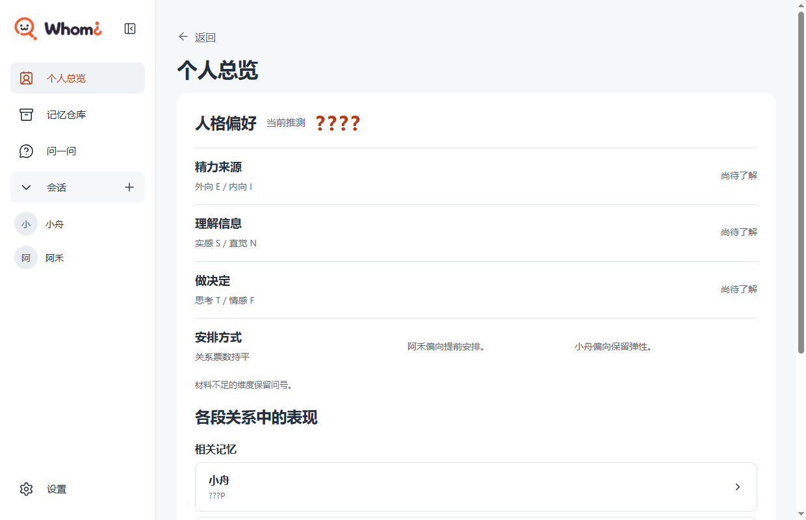
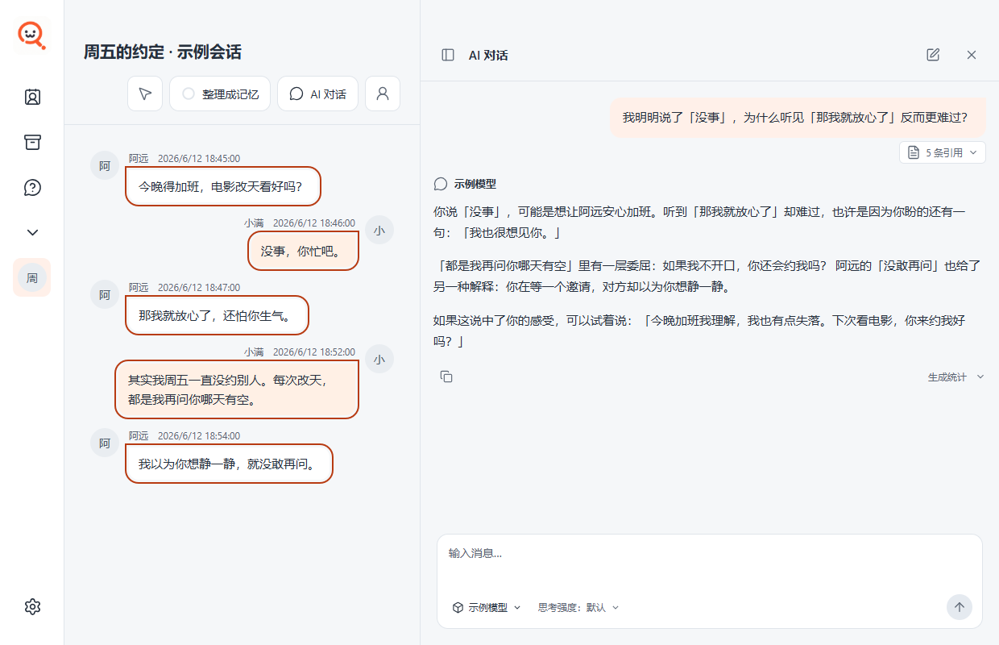
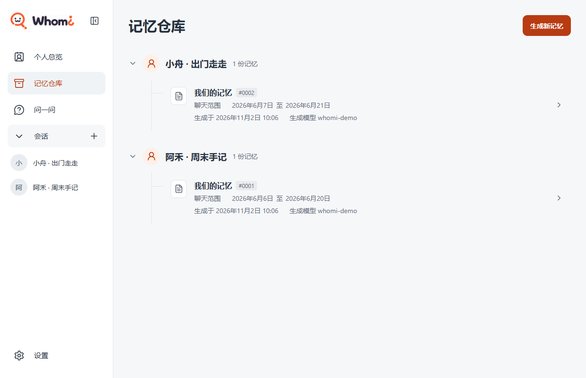
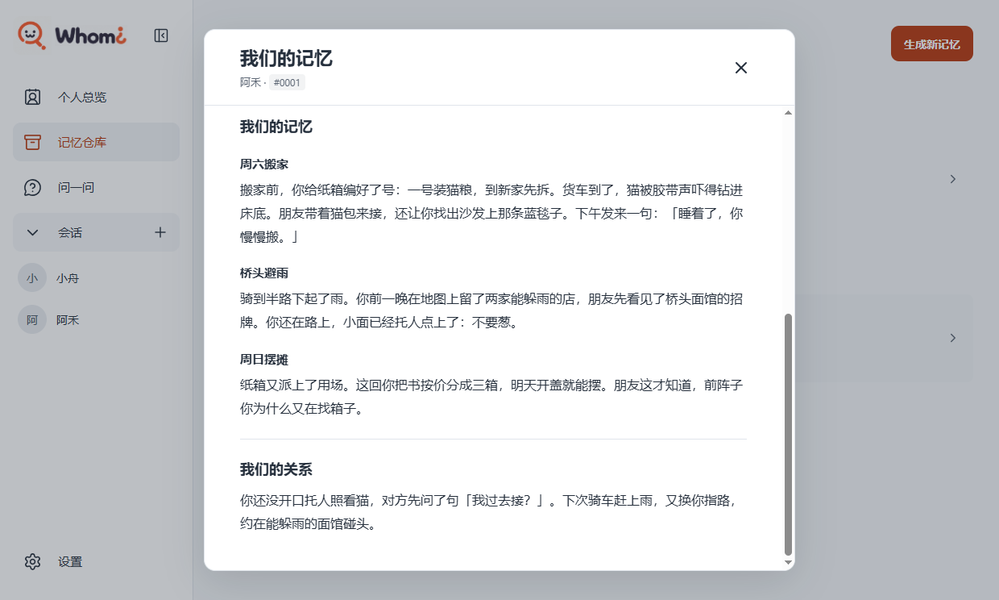

  

<h1 align="center">Whomi</h1>

<strong>从会话中发现自己</strong>

  
  
  

  我们在交谈中表达想法，也会流露出自己尚未察觉的感受，选几句聊天原文，与AI一起进行讨论。 
  Whomi 陪你重读这些对话，看看自己在意什么，又习惯怎样回应别人。

## 支持的会话平台

  
  
  
  
  
  
  
  

<a href="docs/getting-started.md#按平台准备聊天文件">查看各平台的导出与导入步骤 →</a>

## 界面截图

截图来自 [Whomi 0.1.10 桌面版](docs/releases/0.1.10-windows-validation.md)。聊天记录和模型回复均为虚构示例。

### 个人总览

### 选择原文提问

### 记忆仓库

### 我们的记忆

## 使用指南

按[使用指南](docs/getting-started.md)启动 Whomi 后，点侧栏「会话」旁的 **＋**，选择[周六搬家示例](docs/readme/weekend.telegram.json)。点「打开会话」，选择「小满」为本人，就能读到这段虚构聊天的 8 条原文。

聊天记录保存在本机，阅读原文无需连接模型。提问或整理记忆时，相关材料会发送给你选择的模型服务。详见[模型设置与引用提问](docs/getting-started.md#试一次引用提问)。

## 致谢

- [ChatLab](https://github.com/ChatLab/ChatLab) 提供了 Whomi 导入聊天记录时使用的文件解析代码。
- [Cherry Studio](https://github.com/CherryHQ/cherry-studio) 提供了模型服务设置和对话回复排版所用的代码。
- [shadcn/ui](https://github.com/shadcn-ui/ui) 提供了侧栏和工具提示的参考实现。
- [Simple Icons](https://github.com/simple-icons/simple-icons) 提供了 README 和操作指引中的聊天平台图标。

各组件与素材的来源和许可见[第三方声明](THIRD_PARTY_NOTICES.md)。

## 开源许可

[AGPL-3.0](LICENSE) · [StarryJia/whomi](https://github.com/StarryJia/whomi)
