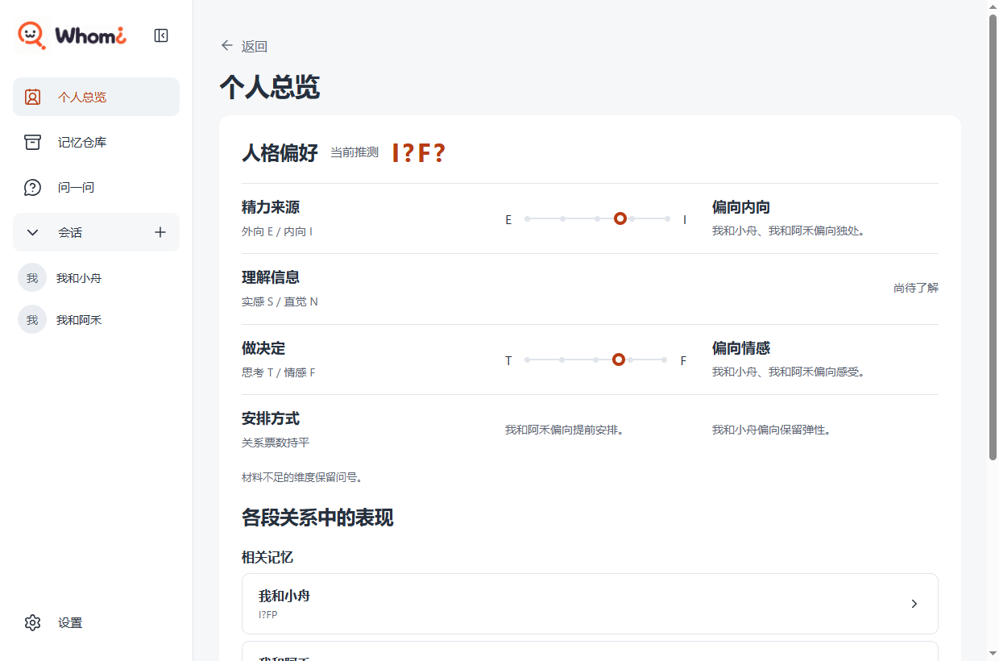
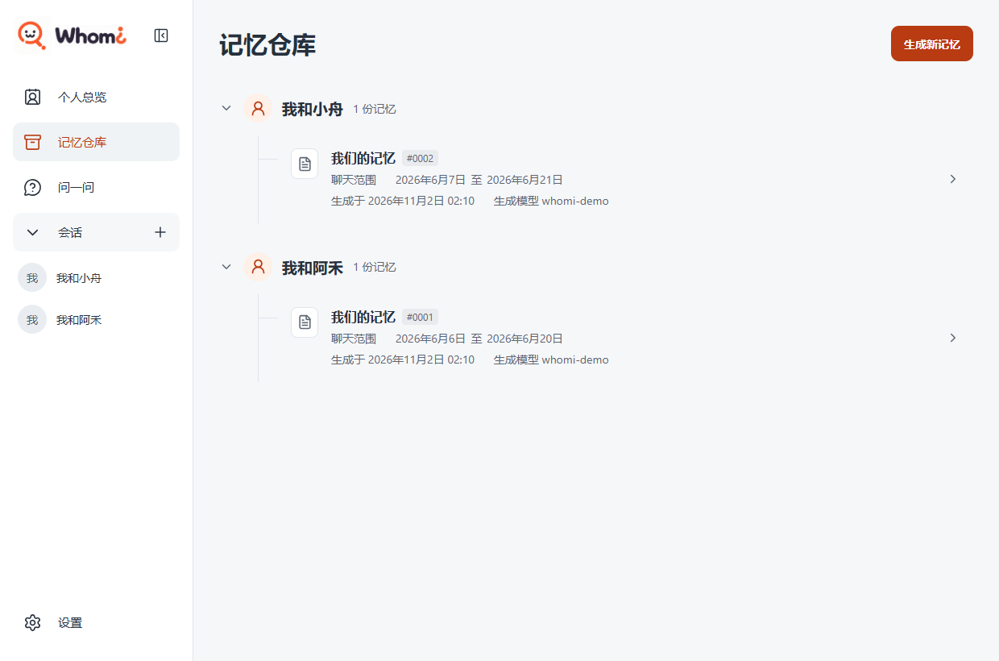
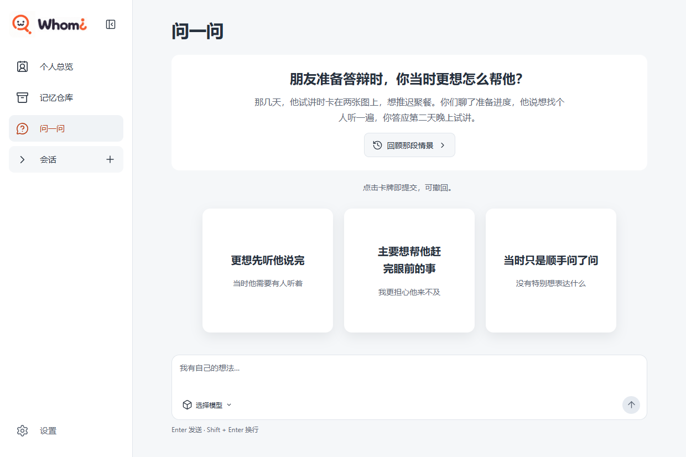
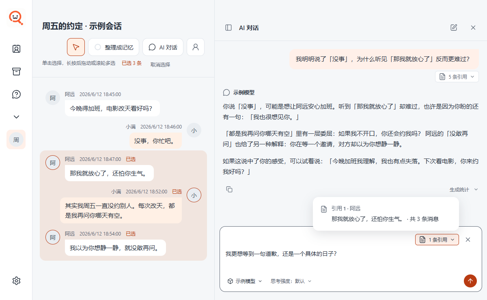

  

<h1 align="center">Whomi</h1>

<strong>从会话中发现自己</strong>

  我们在交谈中表达想法，也会流露出自己尚未察觉的感受。 
  Whomi 陪你重读这些对话，看看自己在意什么，又习惯怎样回应别人。

## 个人总览

和阿禾出门，你习惯提前安排。和小舟散步，你却愿意走到哪儿算哪儿。个人总览把两段关系里的表现放在一起，让你看见自己的不同侧面。

## 记忆仓库

每段关系的记忆文稿都收在一起。比如这份搬家记忆，写下了阿禾特意把书房留给猫的经过。[读一份《我们的记忆》](docs/readme/memory.png)

## 问一问 · 界面预览

朋友准备答辩，你答应听他试讲。那时你是想帮他赶进度，还是想先听他说完？示例题可以选卡，也可以用自己的话回答。正式版暂不自动出题或保存回答。

## AI 对话

明明说了「没事，你忙吧」，为什么听到「那我就放心了」反而更难过？右侧是人工智能（AI）对话的模拟回答：小满也许是在等阿远主动约下一次，阿远却以为小满想静一静。左侧高亮的三条原话，是小满为追问选的。

---

以上画面均使用虚构测试数据。聊天记录保存在本机，提问或整理记忆时，相关材料会发送给你选择的模型服务。

[使用指南](docs/getting-started.md) · [开源许可证](LICENSE)
