# 对话洞察 · 页面设计记录

2026-11-24，维护者试用安装包后调整了 A 版阅读页。标题和会话范围之后，居中显示本次 MBTI（迈尔斯–布里格斯性格类型指标）预测，四个字符之间等距留白。例如示例报告显示 `EN??`，摘要把 E、N 分别与外向、直觉配在一起。「关于你」下的「MBTI 人格倾向」逐项展开，如「N · 偏向直觉」「T / F · 暂难判断」。读完四维分析后从「个人观察」接着阅读。历史报告没有四维观察时直接显示已有正文。

正文保留「关于你」「你们的相处」两个章节，每项判断的依据、其他解释和适用范围就近阅读。以虚构的读书会为例，读者看到「聊完我反而有精神了」，接着读到另一天的「今天想自己静一会儿」。长引文可以从当前行排到下一行，左引号与后一个字同排，右引号和句末标点紧跟前文。点击任一句可核对各自的消息和上下文，关闭后回到刚才的引文。「你们的相处」正文结束即为报告结尾。

2026-11-24，洞察详情统一使用 `token`。输入、输出与缓存明细直接显示截至当前回执的累计数。桌面合成测试中，前两次请求各返回 20 个输入 token，第三次在途时详情显示「40」，后续回执到达后更新。没有任何回执提供某项数值时显示「—」，明确报告零时显示「0」。[实测详情](../../research/assets/pi-insights-issue-35/usage-details.png)

更新：2026-11-15。首期七类主要界面均已有设计图；启动浮窗四状态据用户本次纠正补记已确认。当前没有待新增设计的主页面。完整图片、批准范围、同布局补充状态和后续独立计划见[设计清点表](design-inventory.md)。未单独画图、行为未定及功能未实现分别记录，不再混为待设计；此目录中的图不代表功能已经实现。

2026-11-15 出图范围调整：已确认的页面继续作为实现依据。普通窗口缩放、长文本换行和同布局的简单加载提示直接复用既有设计，在实现时验证；只有尚未确定、影响用户操作的差异才继续讨论设计图。例如缩窄报告窗口只检查换行与滚动，不再让用户重新确认报告页。

## 试用反馈后的报告阅读页

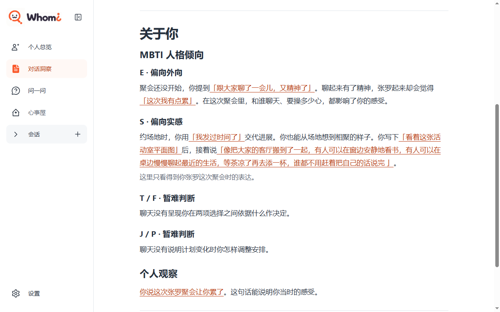

同一段合成引文在 1280 × 800 的窗口跨两行，在 960 × 640 的窗口跨三行。两种宽度下都从上一句剩余的位置起排，末尾的右引号和句号跟随引文最后两个字。打开引文可查看并高亮当时的整段原话。[窄窗口实测](assets/report-reader-inline-quotes-narrow.png)

## 已确认：报告阅读页

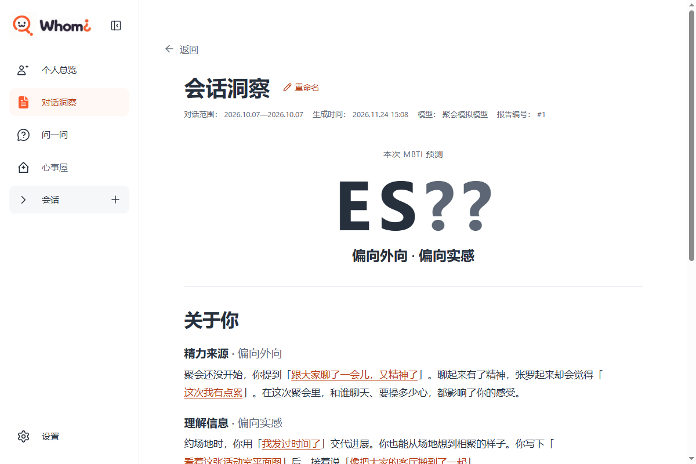

这张试用反馈前的 A 版截图显示合成报告 `ES??`。点击「像把大家的客厅搬到了一起」会打开提及活动室平面图的消息，并高亮这个比喻。同一消息里的另一条引文可以独立点开。[原版窄窗口](assets/report-reader-a-narrow.png) · [原话定位](assets/report-reader-a-quote.png)

报告名称、范围和返回入口沿用已确认的布局。[早期阅读页设计图](assets/report-reader-a-v2.png) · [报告界面工单草稿](../../planning/issues/2026-11-13-conversation-insights/05-report-interface.md)

| 项目 | 已确认约束 | 可观察结果 |
|---|---|---|
| 阅读布局 | 沿用 A 方案的单列长文布局、现有侧栏、关于你及你们的相处两节 | 阅读报告时正文在主区域，经历短语保留链接外观 |
| 返回 | 左上角箭头后文案为返回 | 点击后返回进入报告前的页面 |
| 创建入口 | 报告阅读页右上角不放新建报告按钮 | 生成沿用每个会话原整理成记忆的位置，文案改为会话洞察 |
| 默认报告标题 | 应用程序统一赋值会话洞察，不由大模型按内容生成，也不拼接范围 | 全量和日期范围生成的新报告初始标题均为会话洞察 |
| 手动改名 | 保留标题旁的重命名入口 | 用户仍可改成那次合作等名称；列表行内编辑与保存失败采用后续选定的 G 方案 |
| 范围信息 | 分析范围和生成时间独立展示 | 改名不会改变或隐藏实际分析范围 |
| 功能名称 | 侧栏报告入口叫对话洞察；会话工具栏启动按钮叫会话洞察 | 默认报告标题仍为会话洞察，三处文案按各自用途呈现 |

虚构验收场景：用户生成十月聊天的报告，阅读页标题先显示会话洞察，元信息单独显示十月范围，左上角显示返回，右上角没有新建报告。用户手动改名为那次合作后，日期范围保持不变；点击经历短语仍指向同一组来源。

## 已确认：报告阅读页重命名

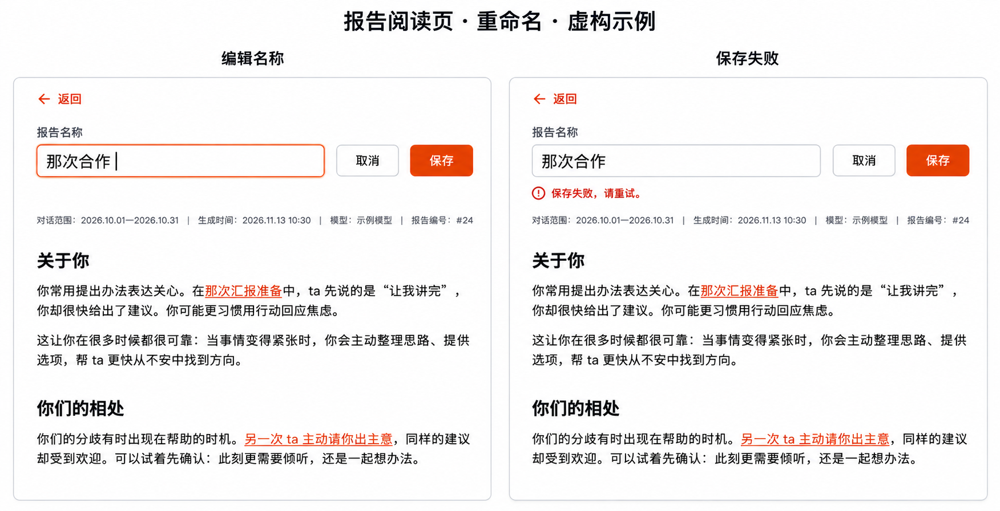

2026-11-14 用户确认本图所示的编辑、保存失败两状态及明确交互。它延续已选 A 阅读页，在标题原位置编辑名称，不改全局导航或 G 管理页。正常阅读时仍显示已保存标题及重命名入口，新报告默认名仍为会话洞察。

虚构场景：用户在十月报告 #24 点击重命名，将会话洞察改为那次合作。左图显示尚未保存的输入与取消、保存按钮；右图保存失败，请重试，输入仍保留。两图范围均为 2026.10.01—2026.10.31，生成时间 2026.11.13 10:30、示例模型、#24 及正文相同，均为虚构数据。

- 编辑框预填当前已保存标题并聚焦，正文继续可见。名称由用户手动输入，不让模型生成候选名称。
- 取消放弃草稿，恢复已保存名称及重命名入口焦点。空白输入尚未单独画图；纯空白不提交并提示请输入报告名称属于待明确的校验规则，复用既有编辑区，不设置独立选图门槛。
- 保存失败保留输入和编辑态，错误就近显示；列表仍显示原已保存名称。有效名称保存失败不使用非法输入样式，可再次点击保存。
- 保存成功才同步阅读页和报告列表，退出编辑并恢复重命名入口焦点；原范围、生成时间、模型、编号、正文及引用不变，不调用模型。同名报告不会互相覆盖。
- 保存请求进行中防止重复提交。名称长度上限、首尾空白裁剪、快捷键、保存中取消和离页处理尚未确定，不从示例推导这些规则。

已静态核对输入保留、错误位置、两处按钮、元信息与正文一致；实际保存、焦点、键盘、对比度仍待实现后审查。空白校验、保存中、长名称和窄窗复用已选布局，规则与适配按 [I05](../../planning/issues/2026-11-13-conversation-insights/05-report-interface.md)核对和验收，不另列为缺失页面。

## 历史适配参考：报告阅读页窄窗口

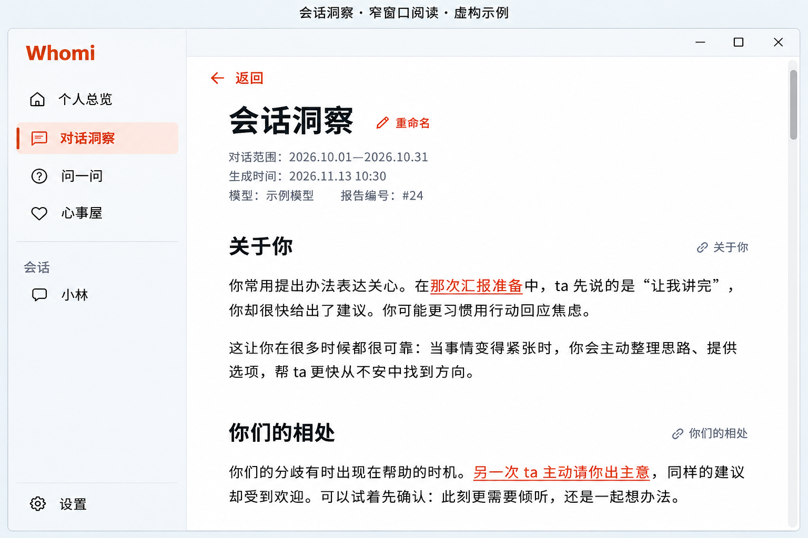

本图是 2026-11-15 生成的普通窗口适配参考。用户指出报告阅读页已经设计完成后，取消此图的单独选图门槛：保留图片供回溯，不标为已批准，也不替代已确认 A。虚构示例：用户将窗口缩至 960 × 640，保留展开侧栏，打开十月的 #24 报告；对话范围、生成时间、模型与编号自然分行，正文保持可读字号，通过主阅读区纵向滚动继续阅读。

保留返回、会话洞察标题、重命名、关于你与相处分析，以及两处橙色原文引用；不增加新建报告、目录、选模或本人选择。图中最后一段位于当前视口下方，当前画面不出现阅读完毕。侧栏和底部设置沿用全局导航，不随文章滚走。图中元信息为三行，实际行数随可用宽度变化，不写死为三行。

现有应用在显示器工作区足够大时采用 960 × 640 最小窗口；更小工作区按实际尺寸收缩。展开侧栏默认 240 像素、可按既有规则调宽或收起，960 像素宽时不会自动收起。本图是构图与换行示意，生成图片的比例不能替代实际布局数值，也不改变导航的既有响应规则。

实施验收时，在上述窗口和实际侧栏宽度下确认元信息完整、正文无横向溢出、可滚动至末尾；例如点击那次汇报准备后关闭原文弹窗，应回到原先阅读位置和引用焦点。需另行验证长标题、文字缩放、侧栏调宽及键盘操作；不从本图推定返回或标题固定在顶部。

已完成静态文案和构图核对，尚未实现或运行页面。这张图不覆盖重命名编辑态、管理页、启动与进度浮窗、原文弹窗的窄窗表现，也不新增手机页面范围。详细约束见 [I05](../../planning/issues/2026-11-13-conversation-insights/05-report-interface.md)。

## 已确认：会话内启动浮窗的日期范围正常态

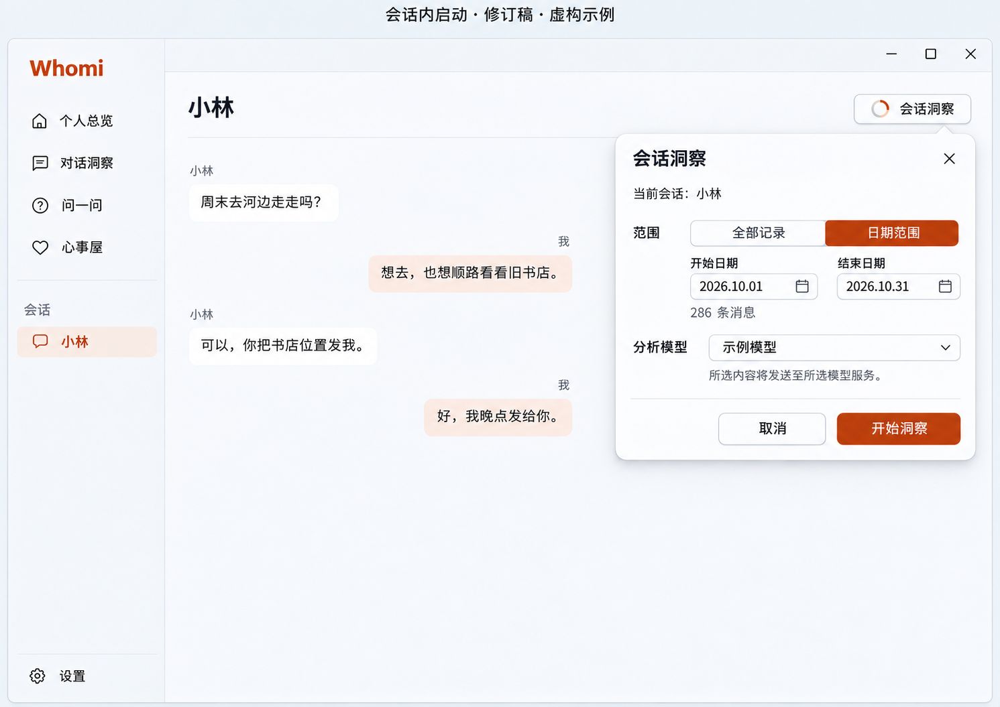

用户确认启动入口继续放在每个会话原整理成记忆的位置，按钮改为会话洞察。生成操作承接当前会话；浮窗可只读展示会话名，不提供联系人或会话切换下拉。侧栏对话洞察继续作为报告入口，管理列表不另增全局创建入口。

修订图沿用现有按钮下方打开浮窗的方式，展示日期范围正常态：全部记录/日期范围、起止日期、消息数、既有模型选择、取消及开始洞察。模型搜索、分组和按能力显示的思考强度沿用已有组件，不用示例模型的简化外观替代其能力。本人尚未确认时在点击会话洞察入口即提醒并拦截，不能打开范围与模型浮窗；已确认时不重复选择，详见已确认的本人缺失提醒图。

虚构场景：用户正在阅读小林的聊天，点击工具栏中的会话洞察，在浮窗选择十月与分析模型，确认后只分析小林的所选记录。点击取消则回到原聊天和阅读位置，不启动分析。

2026-11-13 用户确认本张修订图，批准范围为当前会话工具栏入口及其下方启动浮窗的日期范围正常态，不代表原聊天阅读器的全部控件。既有原文阅读、本人选择、人工智能会话入口等能力继续保留。原四状态候选图留作历史，不能继续据其中的管理页背景和会话切换下拉实施。全部记录、日期错误、空范围和模型缺失的当前四状态图已获确认，2026-11-15 据用户纠正补记；本人缺失入口提醒已另行确认；常规窄窗按既有布局验收。

对应 [I05 工单草稿](../../planning/issues/2026-11-13-conversation-insights/05-report-interface.md) 已附本图，并标记日期范围正常态已确认。图片展示的聊天及日期数量均为虚构示例。

## 已确认：进度浮窗收起与展开

用户已接受默认消息处理进度、已运行时间、平均分析速度（消息数/s，s 表示秒）及只读模型配置；输入输出用量、平均输出词元/秒、分析范围和服务提供的提示词缓存读写放在展开详情。省略累计模型请求耗时，不显示阅读、核查、成稿阶段或核查事项计数。消息 N / N 不等于报告已完成，完整口径见[I05 工单](../../planning/issues/2026-11-13-conversation-insights/05-report-interface.md#已确认的进度浮窗收起与展开)。

2026-11-14 用户批准以下两张同一进度浮窗的收起、展开状态图；它们约束这两个状态的实现。这两张图覆盖生成中浮窗；列表的暂停与失败摘要另见 G 方案，暂停、失败、完成另有已确认三状态图。未展示的同布局状态需补字段及行为规则，窄窗需适配验收，不逐项再出图。

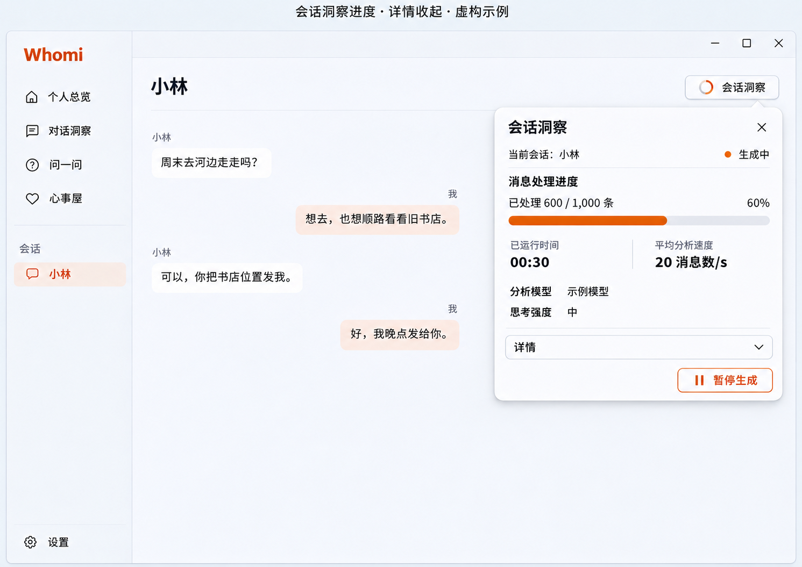

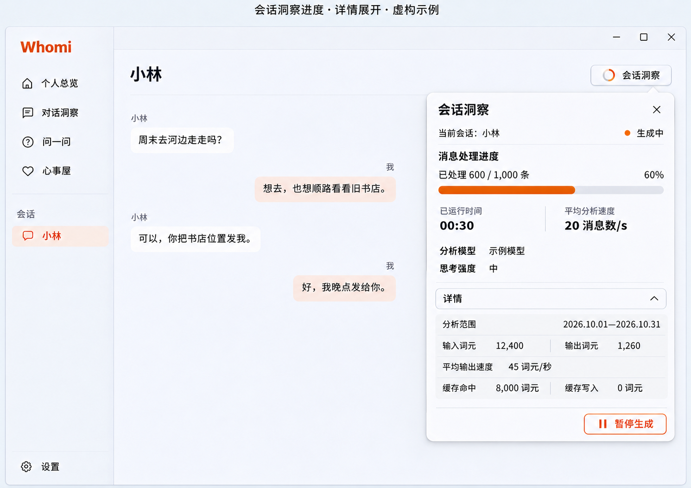

虚构示例统一为 600 / 1,000 条、60%、运行 30 秒、平均分析速度 20 消息数/s。展开显示输入 12,400、输出 1,260 词元，平均输出 45 词元/秒、缓存读取 8,000 和写入 0 词元、范围 2026.10.01—2026.10.31。缓存写入 0 来自示例服务明确返回，不代表缺失统计。两张图仅改变详情展开状态，不切换任务或算法阶段；当次设计不包括暂停、失败或完成状态图。

## 已确认：引用原文聊天弹窗桌面初次定位正常态

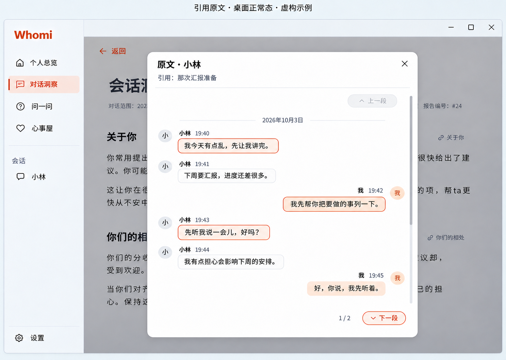

对应 [I06 工单草稿](../../planning/issues/2026-11-13-conversation-insights/06-source-dialog.md)。2026-11-14 用户确认 V2，批准范围仅为点击经历文字后首次定位原文的桌面正常态；滚动自动加载、保持阅读位置及上下分置的片段按钮为已确认要求，功能尚未实现。[V1 历史候选图](assets/source-dialog-v1.png)保留供回溯，不作为当前实现依据。

虚构场景：用户点击报告中的那次汇报准备，弹窗定位到小林在 2026 年 10 月 3 日的聊天。19:40、19:42、19:43 三条被引用的消息以橙色描边标出，穿插的 19:41 及后续 19:44、19:45 消息作为普通上下文显示。关闭弹窗后回到报告原阅读位置。

连续阅读采用滚动自动加载，不显示查看更早消息或查看更晚消息按钮。用户向上或向下滚动接近已加载区域边缘时，自动读取该方向的相邻聊天，保持当前消息的阅读位置；确认该方向没有更多记录后停止请求。

上一段小气泡固定在聊天区右上角，下一段固定在右下角；两者位于弹窗内并留出空间，不遮盖消息。界面删除相关片段文字，在底部下一段旁保留简洁的 1 / 2 计数。首段禁用上一段，末段禁用下一段，不循环跳转。

片段跳转与滚动加载独立：例如点击下一段直接定位 10 月 10 日的另一段依据，向下滚动则继续加载当前 10 月 3 日附近的聊天，不切换引用绑定的片段。静态图仅呈现初次定位状态，自动加载及保持阅读位置需在实现后验证。

回到引用只在用户离开引用位置后出现，本张初次定位图不显示。自由浏览和下一段临时失败已另行确认；历史四状态图中的原文修改、会话删除后返回报告两格按 2026-11-15 核查结果移出首期流程。简单加载和窄窗复用已选布局验收，不继续补不存在的原文编辑/删除流程。图中人物、消息及日期均为虚构示例。

## 已选：G 管理布局与任务状态

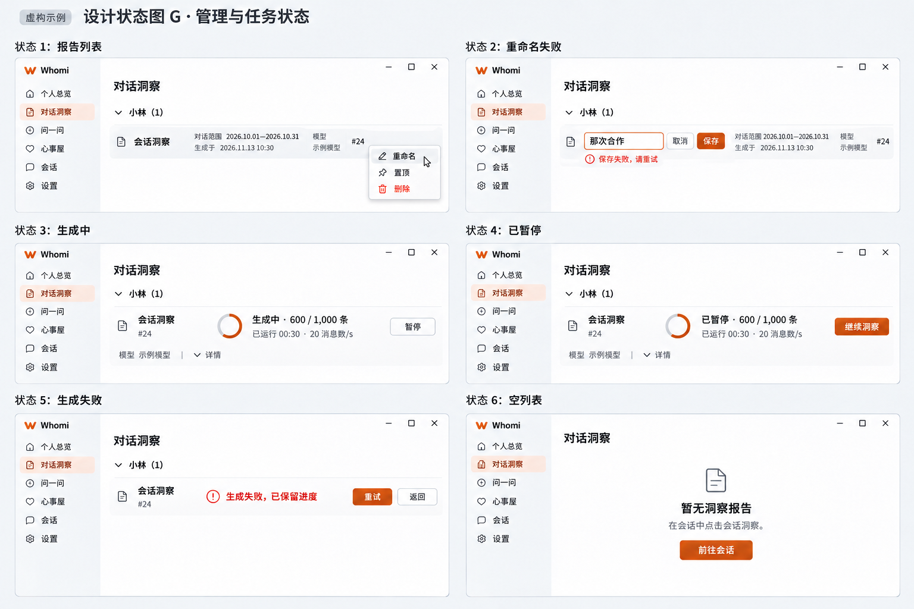

对应 [I05 工单草稿](../../planning/issues/2026-11-13-conversation-insights/05-report-interface.md)。用户选择 G 的紧凑列表布局和右键改名方式，并明确移除列表中的本人、模型准备条件。本图按这些意见及此前入口、标题和进度约定修订；2026-11-14 用户确认采用 G 修订方案，批准范围限于所示状态与已明确要求；功能尚未实现。

六个状态分别展示报告列表与右键管理、行内改名保存失败、生成中、已暂停、生成失败和空列表。列表按会话收展，行内保留标题、实际对话范围、生成时间、模型及编号；默认报告名仍由程序设置为会话洞察。全部记录也保存并展示实际日期范围，同名报告不覆盖。

虚构场景：用户右键小林的会话洞察 #24，选择重命名，在当前行输入那次合作。保存失败后输入保留，可再次保存或取消；十月范围、编号和生成时间不变。点击已完成报告进入主区阅读页，返回时恢复原分组和列表位置。

列表及空列表不要求选择本人或模型，没有可用模型也能读取已保存报告。本人只在具体会话选择，模型在开始该会话的洞察前确认。空列表的前往会话只导航到会话区，不创建任务、不弹配置；用户仍从具体会话工具栏的会话洞察开始。列表没有全局新建入口，不增加搜索、筛选或排序下拉框。

任务行展示普通状态和消息进度，不展示阅读、核查、成稿等阶段。虚构示例统一为 600 / 1,000 条、00:30、20 消息数/s 和只读示例模型，输入输出等用量放在折叠详情。暂停和继续沿用同一任务，暂停期间不累计运行时间；失败时只有实际保存了进度才能显示已保留进度。完整口径及验收见 I05。

本图约束管理内容及六个状态；侧栏图标与设置固定底部等全局外壳继续遵守既有规范，不随拼图背景差异改变。第一格已展示保存完成的报告行；生成中任务详情展开、首次读取中与无数据读取失败已另行确认。其他任务详情、有数据刷新失败及生成转完成复用已选布局补行为约定，长名称和窄窗按适配验收；失败行返回按钮的目标仍需实施前明确。

[原始 G 图](assets/management-g-original.png)及[列表 V1 历史候选](assets/report-list-v1.png)保留供回溯，不作为当前实现依据。人物、范围、编号和统计均为虚构示例；静态图不表示交互已实现。

## 已确认：本人缺失的入口提醒

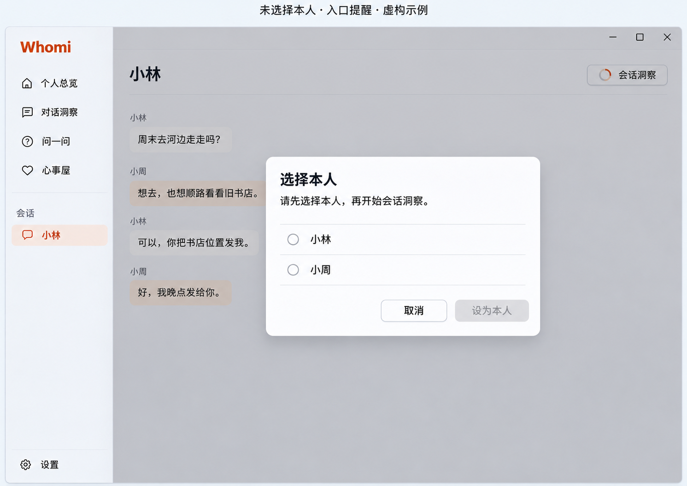

2026-11-14 用户明确：当前会话未选择本人时，点击会话洞察立即提醒，不允许进入洞察启动浮窗。这是入口检查，不是在已经打开的范围和模型浮窗里禁用开始按钮。

2026-11-14 用户确认采用下图及保存后返回聊天的流程：直接复用当前会话的选择本人弹窗，提示「请先选择本人，再开始会话洞察。」并列出成员；不另叠提醒框。图中小林、小周及聊天均为虚构，两个成员尚未选中，因此设为本人禁用，取消可用。批准范围为桌面成员读取成功、尚未选择的状态及保存后返回流程；读取和保存错误复用既有反馈，窄窗按既有布局验收，不再单独补图；功能尚未实现。

虚构操作场景：用户在小林会话点击会话洞察，先看到上述本人选择。选中小周并成功设为本人后回到原聊天，再点击会话洞察才打开范围和模型设置；不会自动开始分析。若取消或按 Escape 关闭，仍停在原聊天，再次点击洞察仍需确认本人。

- 检查当前会话已保存的本人确认状态。来源推测、仅勾选未保存、保存失败均不能放行；不能沿用另一会话的本人选择。
- 读取中、读取失败或没有成员时不放行。复用既有读取、重试与保存错误反馈；失败保留已选成员，保存成功前不创建任务或发送分析请求。这些状态和窄窗不再逐项补图，未明确的恢复操作仍须核对。
- 本人已确认时直接进入启动浮窗，不重复选择；实际创建任务仍保留已有后端本人校验。侧栏报告列表及已保存报告阅读不受此入口检查阻塞。
- 打开时键盘焦点进入选择弹窗，关闭后回到会话洞察触发按钮，保留聊天阅读位置；现有从选择本人按钮进入的流程归还原按钮。焦点限制、恢复与实际保存结果须实现后验证。

既有成员选择与保存流程位于 src/components/conversations.tsx；洞察浮窗入口位于 src/components/conversation-ai/workspace.tsx。本方案复用已有成员选择能力，只为洞察入口增加检查和场景提示，不改变进入会话时已有的本人确认行为。

## 已确认：启动浮窗的范围与异常状态

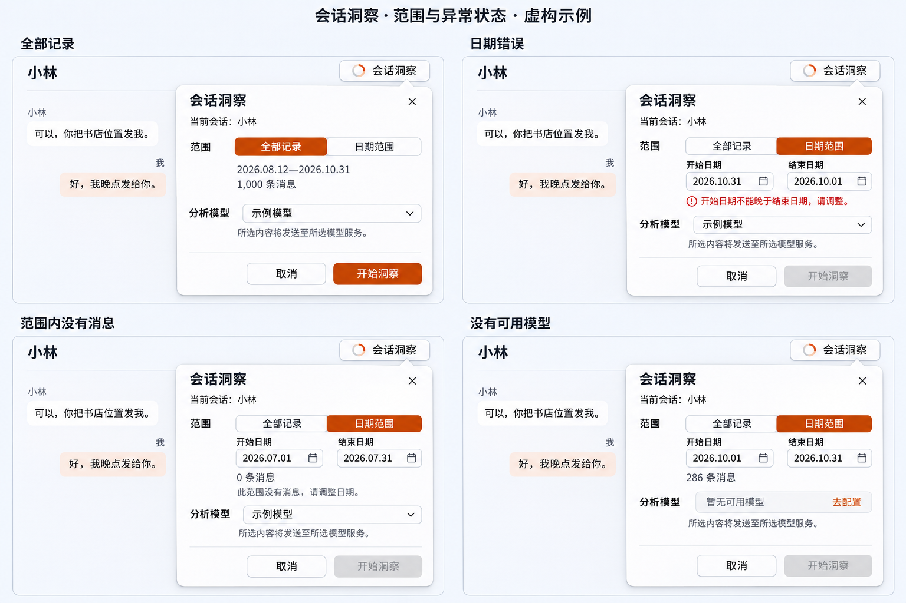

2026-11-15 据用户纠正补记已确认：该四状态图此前已经设计并确认，本次因状态漏记重复展示。用户所附图与本目录图片的 SHA256 文件指纹完全一致；补记日期不代表首次批准日期。本图沿用已确认启动浮窗，展示同一小林会话的四个局部状态；画面裁切不改变应用侧栏或原文阅读器。本轮只核对记录，不生成或再次展示图片。

| 状态 | 虚构输入与可见反馈 | 预期操作 |
|---|---|---|
| 全部记录 | 全部记录选中，只读显示 2026.08.12—2026.10.31 和 1,000 条消息，模型为示例模型 | 可以开始洞察；不展示可编辑日期输入框 |
| 日期错误 | 开始为 2026.10.31，结束为 2026.10.01，日期下方提示开始日期不能晚于结束日期 | 保留输入供修改，禁用开始洞察，不显示 0 条或之前的有效消息数 |
| 范围内没有消息 | 合法范围 2026.07.01—2026.07.31 返回 0 条，提示调整日期，输入框保持正常样式 | 调整范围后重新计算条数；此时不能启动 |
| 没有可用模型 | 十月有效范围仍为 286 条，模型字段显示暂无可用模型和去配置 | 前往已有模型设置；返回保留会话和范围，选择模型后手动开始，不自动创建任务 |

四种状态均保留取消和关闭。本人已在当前会话确认，本图不加入本人选择或其他会话选择；本人缺失属于入口拦截，已确认提醒图见上节。模型组件只画收起态，其搜索、分组及按能力显示思考强度沿用已指定组件。图中的人名、日期和数量均为虚构；外发提示只显示一次。

静态图已核对表单信息、状态区分及控件可见性；实际点击、键盘焦点、配置返回、对比度数值及窄窗仍须实现后按必用技能流程验证。

## 已确认：进度浮窗的暂停、失败与完成

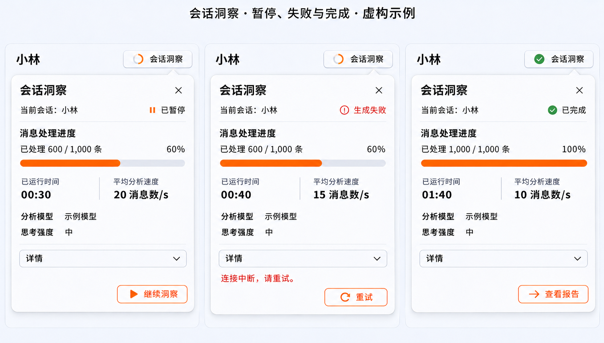

2026-11-14 用户确认本图，批准同一进度浮窗的已暂停、生成失败与已完成三个详情收起状态。每格只裁切当前会话工具栏与浮窗，不更改应用侧栏。消息数、时间、速度、模型及思考强度均为虚构示例；输入输出和其他用量仍在折叠详情内，前台不显示算法阶段。

| 状态 | 虚构数据与操作场景 | 主操作及结果 |
|---|---|---|
| 已暂停 | 小林会话已保存 600 / 1,000 条，60%，有效运行 00:30，平均 20 消息数/s | 继续洞察恢复同一任务；暂停期间时间与平均速度保持不变 |
| 生成失败 | 已保存 600 / 1,000 条，60%；连接中断前累计运行 00:40，平均 15 消息数/s；提示连接中断，请重试 | 重试沿用已有任务和已保存进度，不重复生成另一份报告；失败后等待重试期间不继续计时 |
| 已完成 | 1,000 / 1,000 条，100%，有效运行 01:40，平均 10 消息数/s；报告已保存成功 | 查看报告打开该任务保存的会话洞察；工具栏同步显示完成勾选 |

三个均速分别按 600 / 30、600 / 40、1,000 / 100 计算。失败示例多出的 10 秒是任务仍运行时等待请求的时间；不是失败后等待用户操作的时间，也不代表不同状态固定耗时。具体值必须来自真实任务。

- 右上角关闭只收起浮窗，不暂停运行、不恢复已暂停任务、不丢弃报告；重新打开显示该任务的真实状态。
- 暂停确认或重试进行中禁用重复操作，实际暂停后才显示已暂停。继续累计有效运行时间和去重处理数；恢复失败显示对应可操作提示，不假定一定成功。
- 失败图假设已有任务且保存了 600 条。没有保存首批时不能照抄这个数量或宣称已保留分析进度；已创建任务可从首批继续，任务创建前失败不能假装有旧任务可恢复。未知统计显示 —，服务明确返回的 0 才显示 0。
- 消息数到 1,000 / 1,000 但报告尚未保存时仍为生成中；若保存失败则为生成失败，不显示已完成或可用的查看报告入口。
- 现有累计请求耗时与任务有效运行时间不是同一字段；实施时按已确认口径另行记录任务运行区间，不能直接把现有请求耗时当作图中的已运行时间。

已静态核对三格数值、普通任务状态、只读模型、折叠详情和按钮；真实暂停、恢复、保存、关闭、键盘与对比度仍待实现后验证。未保存首批、暂停或重试过渡、其他详情展开尚未单独画图；复用已有进度和详情布局补字段及行为约定，窄窗按适配验收，不增设逐图确认门槛。

## 已确认：原文浏览与临时读取失败

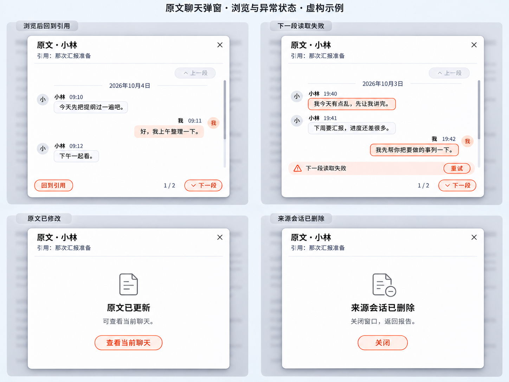

本图于 2026-11-14 曾整体获选。2026-11-15 核查实际数据规则并经用户认可后，当前实现依据限定为上方两格；下方原文修改及来源会话删除后返回报告两格仅保留历史，不作为首期流程。

| 当前适用状态 | 虚构操作与结果 |
|---|---|
| 浏览后回到引用 | 用户从第一处引用滚动读到十月四日普通聊天，仍显示 1 / 2；回到引用定位回当前片段，普通消息没有证据高亮 |
| 下一段临时读取失败 | 第一段聊天和 1 / 2 保留，提供重试；重试同一第二段，读取和定位成功后才切换内容与计数 |

只读、滚动自动加载、上下分置片段按钮和关闭恢复要求继续有效。临时失败不覆盖已有聊天；防止重复请求，迟到结果不能跳错目标或重开已关闭弹窗。来源编号校验和异常数据兜底仍需实现，不能恢复已删除原文。

当前没有单条原文编辑或删除入口，重新导入采用追加和去重。删除整个会话会同时清除其报告，不能再返回已经删除的报告。若界面仍持有旧阅读状态，应退出该报告及原文弹窗，回到仍存在的报告列表或既有空状态，并撤回个人总览中对应贡献；不能聚焦已删除入口。

实际滚动、请求去重、键盘、读取失败和导航失效处理须实现后验证。简单加载和窄窗不再单独选图。完整范围见 [I06](../../planning/issues/2026-11-13-conversation-insights/06-source-dialog.md)。

## 已确认：管理页生成中任务的详情展开

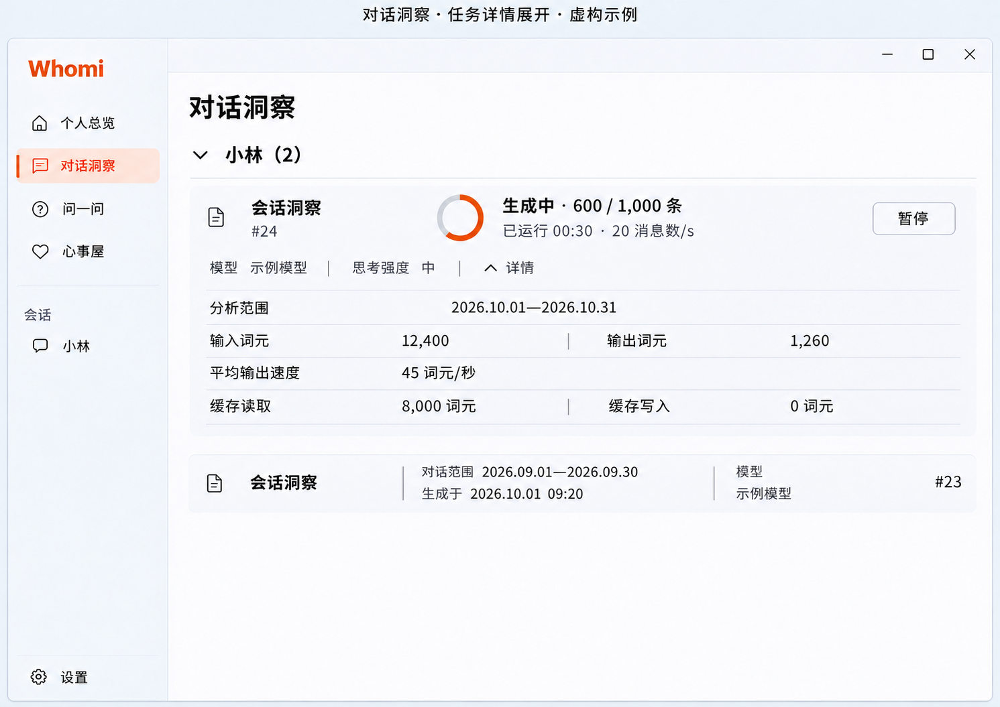

本图延续已选 G 的会话分组和紧凑报告行，并使用已确认的应用侧栏与窗口外壳。2026-11-14 用户确认生成中任务的详情展开画面及明确交互，功能尚未实现。小林分组中的两条记录及全部数值均为虚构示例。

虚构场景：用户在对话洞察管理页查看生成中的 #24，展开详情核对本次分析范围与模型用量；下方 #23 是已有九月报告，可直接打开正文。两者默认标题均为会话洞察，通过编号、实际范围和保存时间区分，不因同名互相覆盖。#23 仅用于列表上下文，不借此标记管理页任务完成状态已设计。

| 区域 | 示例显示 | 操作或含义 |
|---|---|---|
| #24 摘要 | 生成中，600 / 1,000 条；已运行 00:30；20 消息数/s；暂停 | 进度为已保存的去重覆盖，暂停仅操作该任务；尚未保存最终报告时不提供正文 |
| 只读配置与详情入口 | 示例模型、思考强度中、展开的详情 | 配置不在管理页修改，详情只展开或收起，不重置任务 |
| 详情范围与用量 | 2026.10.01—2026.10.31；输入 12,400、输出 1,260 词元；平均输出 45 词元/秒；缓存读取 8,000、写入 0 词元 | 输入包含缓存，不能重复相加；0 是示例服务明确返回，未知值仍显示 — |
| 已保存 #23 | 九月范围，生成于 2026.10.01 09:20，示例模型，编号只显示一次 | 生成于为成稿完成时间；点击报告行进入已保存正文 |

摘要沿用 600 / 30 = 20 消息数/s；平均输出速度使用累计请求耗时而非任务运行时间，本例 1,260 / 28 = 45 词元/秒。详情不重复显示摘要的模型、思考强度、运行时间和消息速度。生成中的 #24 不显示报告完成时间，已保存的 #23 才展示生成于。

详情和暂停作为独立控件处理点击及键盘操作，不能冒泡为报告打开或任务重新启动。展开与收起保留当前任务、进度和已有统计，不调用模型；已保存报告行正常打开正文。分组收展、右键管理及导航沿用已选方案；本图没有新增全局新建、本人选择、模型选择或搜索筛选。

已静态核对数值、字段归属、只读配置、时间语义、编号及既有外壳。实际展开、暂停、键盘、焦点、对比度及数据更新仍待实现后验证；首次列表读取中与无数据读取失败已另行确认。其他任务详情、有数据刷新失败和生成转完成需补行为约定，长名称和窄窗按既有布局验收，不另列待设计页面。完整验收见 [I05](../../planning/issues/2026-11-13-conversation-insights/05-report-interface.md)。

## 已确认：管理页首次读取列表与读取失败

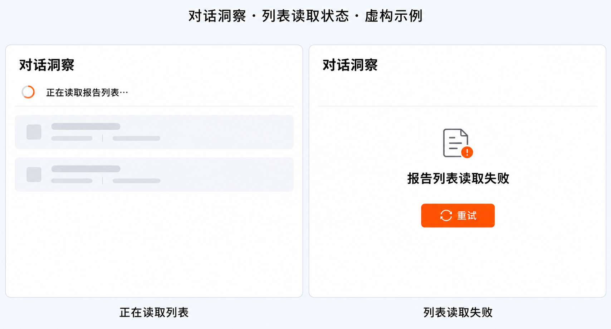

本图沿用已确认管理页，仅裁切主内容区，应用侧栏及其他导航保持可用。用户于 2026-11-15 确认尚无可展示报告数据时的首次读取中、读取失败两状态及所述重试行为；不替换已确认 G 空列表，也不代表功能已实现。

| 状态 | 虚构操作与可见反馈 | 下一步 |
|---|---|---|
| 首次读取中 | 用户进入对话洞察，列表尚未返回；显示正在读取报告列表…及两条灰色行占位 | 占位不代表实际报告数量，无真实姓名、编号、时间或百分比；等待结果时仍可使用导航 |
| 首次读取失败 | 同一次列表读取失败且尚无可展示数据，显示报告列表读取失败及重试 | 重试重新读取列表，过程中防止重复请求；不启动生成、不调用模型、不修改或清除报告 |

只有成功返回空结果才进入已选的暂无洞察报告状态；读取失败不能显示为没有报告、报告已删除或生成失败。未查明原因时不归因于网络。示例只讨论列表读取，不是会话列表读取或某一报告正文读取。

已有列表的刷新错误继续保留现有报告并单独反馈；初次读取期间已收到有效任务数据时，也不能用整页失败替换数据。上述有数据状态没有单独图片，复用列表内反馈并补行为约定，不套用本图的空白内容区，也不新增独立选图门槛。

占位行不可点击、不可聚焦，也不被辅助技术当成报告朗读。读取提示和错误分别提供状态与错误播报；用户用键盘触发重试后应能继续导航，状态切换不得丢失可用焦点。导航离开后，旧请求结果不能强行重新打开管理页。

当前代码已区分报告列表读取与会话列表读取：MemoryLibrary 的 loading、error、retry 对应报告读取；listLoading、listError、retryList 对应会话列表，实施时不能误接。报告重读沿用 listAnalyses，当前失败也不清空已有任务。新文案、骨架和视觉表现仍需按选定图实现。

已静态核对提示、占位和重试入口，未执行真实读取、键盘、播报或错误恢复验证。已有数据刷新失败尚无单独图片，复用列表内反馈；离页、迟到响应及窄窗属于行为和适配验收，不单独出图。完整范围见 [I05](../../planning/issues/2026-11-13-conversation-insights/05-report-interface.md)。

## 已确认：删除已完成报告

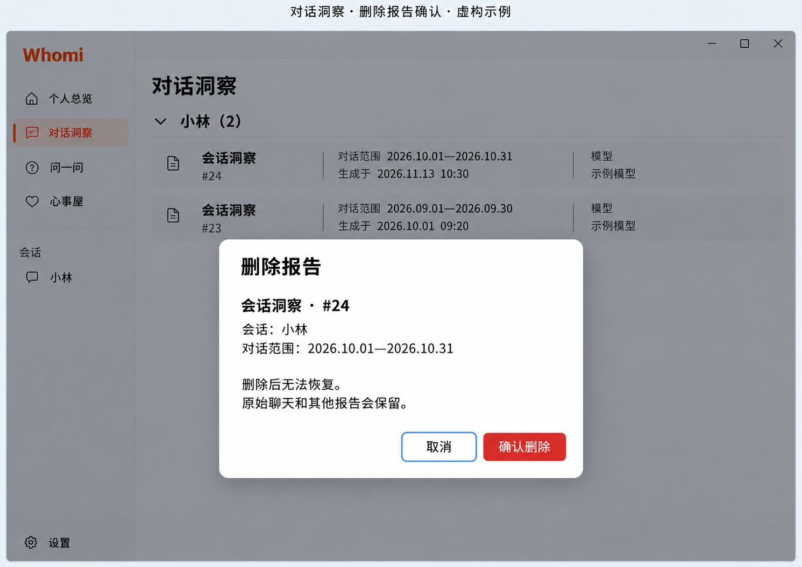

2026-11-15 用户确认此图及删除已完成报告流程，并补充报告增删须联动个人总览的要求；功能尚未实现。虚构示例：小林分组有同名的 #24 十月报告和 #23 九月报告，用户对 #24 点击删除，弹窗展示会话洞察 · #24、会话小林及十月范围。确认前两份报告都保留在背景列表，避免把打开弹窗当成已执行删除。

弹窗说明删除后无法恢复，原始聊天和其他报告会保留；提供取消与红色确认删除。默认焦点落在取消，不增加输入名称、勾选框或撤销入口。取消、按 Escape 或点遮罩返回原列表与入口焦点；提交中沿用现有忙碌处理，防止重复请求和关闭中途误解结果。

复用现有 DeleteListItem 与 ReaderDialog 的确认、失败反馈及重试结构。提交成功后移除目标报告及所属生成记录，撤回其对个人总览的贡献并按剩余有效来源更新总览；列表其余报告与原始聊天保留，焦点交给下一可见条目或列表标题。明确失败时保留弹窗和目标信息，原位提示并可再次提交。上述行为需在实现后验证，不为忙碌和简单失败反馈另造独立页面。

本图只讨论已完成报告。删除进行中任务涉及先停止执行，不能照搬已完成报告的失败后状态；不由此图批准任务取消、批量删除或删除整个会话。

图稿约束目标辨认、后果说明和按钮层级。实现继续使用共享弹窗居中、现有主题焦点色与 G 列表排版；图中弹窗略偏下、蓝色焦点轮廓和背景编号位置不是新规范。静态文案已核对，未执行删除或实际页面审查。具体交互与验收见 [I05](../../planning/issues/2026-11-13-conversation-insights/05-report-interface.md)。

## 已确认要求：报告与个人总览联动

2026-11-15 用户明确：个人总览的数据来自洞察报告，新增和删除报告都要调整对应数据。只有成功保存的已完成报告才能加入总览来源；删除成功后撤回该报告的贡献，基于剩余有效来源重新计算。取消、明确失败和重复完成通知不能增加或误删贡献，改名只同步显示名称。

虚构示例：当前只有 #23 和 #24 两份有效报告，删除 #24 后不能继续展示仅由 #24 支持的判断；两份报告共同支持的内容依据 #23 重新评估。再删除最后的 #23 后，总览回到没有有效报告依据的状态，原始聊天仍保留。重新进入或重启应用也不能恢复已删除报告的派生数据。

删除整个会话同样必须联动：例如小林的 #23、#24 都属于被删除会话，两份报告和其原始聊天一并移除，总览撤回两份贡献；其他会话仍有效的报告继续参与。单独删除 #24 则保留小林原文和 #23。两条路径都不能被迟到响应或旧缓存恢复。

开发和验收使用全新资料库。个人总览从当前格式的有效洞察报告汇总判断。例如同一会话的两份报告引用同一条原文时，只计入一次；删除其中一份后，仍能从另一份报告回查这条依据。[当前验收范围](../../planning/issues/2026-11-13-conversation-insights/07-validation.md)

## 历史异常参考：部分片段不可用

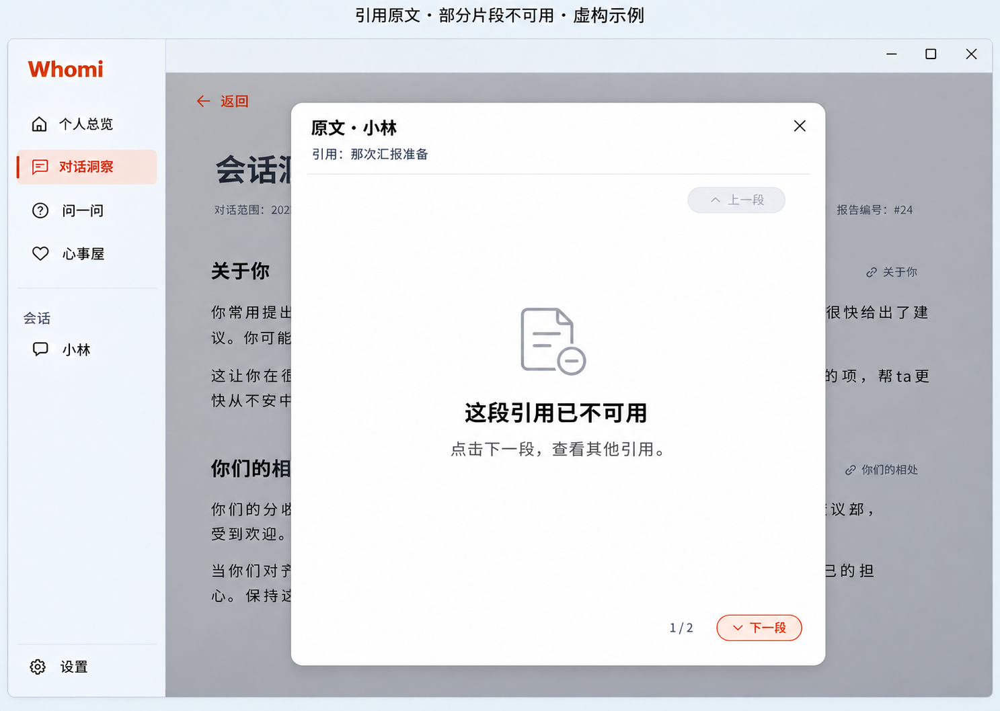

2026-11-15 核查后，本图移出首期必做和待选图清单，不标记为已批准。当前没有单条消息编辑、删除或替换原文的正常入口；重新导入不会删除旧正文，删除整个会话又会连带删除其报告。因此图中的部分原文消失而报告继续保留，不是当前可达的正常业务流程。

图片与生成记录只保留供回溯。首期保留引用编号验证、临时读取失败重试及异常数据防护；不恢复缓存原文，不凭粗粒度不可用结果宣称消息或会话已删除。未来如明确增加原文编辑、单条删除等能力，再根据真实数据规则讨论相应界面，不因本图预先引入功能。

## 逐页进度

| 页面或状态 | 状态 | 工单 |
|---|---|---|
| 桌面报告阅读正常态 | A 方案已选，三处修订已附图 | I05 |
| 报告阅读页：重命名编辑、保存失败 | 2026-11-14 两状态及明确交互已确认 | I01 / I05 |
| 会话工具栏启动入口 | 位置及文案已确认 | I05 |
| 启动浮窗：日期范围正常态 | 修订图已选定 | I05 |
| 启动浮窗：全部记录、日期错误、空范围、无可用模型 | 2026-11-15 据用户纠正补记已确认，取消重复审图 | I01 / I05 |
| 会话入口：本人缺失提醒与成员选择 | 2026-11-14 确认提醒图及保存后返回聊天、再次点击洞察的流程 | I01 / I05 |
| 本人选择读取与保存失败 | 未决定的恢复操作继续讨论；普通加载及窄窗按既有布局验收 | I01 / I05 |
| G 管理与任务状态：列表右键管理、改名失败、生成中、暂停、失败及空列表 | 方案已选，修订图已附 I05 | I01 / I05 |
| 管理列表：生成中任务详情展开 | 2026-11-14 图及明确交互已确认，已附 I05 | I01 / I05 |
| 管理列表：首次读取中、无可展示数据读取失败 | 2026-11-15 两状态及重试行为已确认，已附 I05 | I01 / I05 |
| 管理列表：删除已完成报告的确认弹窗 | 2026-11-15 已确认，新增个人总览联动要求；未实现 | I01 / I05 |
| 列表其他任务详情、有数据刷新失败、生成转完成 | 复用已选布局补行为约定；完成报告行已有图，失败行返回目标待明确 | I01 / I05 |
| 生成进度：详情收起与展开 | 2026-11-14 两张同页状态图已确认 | I01 / I05 |
| 进度浮窗：暂停、失败、完成 | 2026-11-14 确认三种详情收起状态，图已附 I05 | I01 / I05 |
| 进度浮窗：过渡、无首批保存及其他未展示状态 | 未定字段与操作继续核对；简单状态和窄窗复用现有布局并验收 | I01 / I05 |
| 原文聊天弹窗：桌面初次定位正常态 | 2026-11-14 V2 已确认并附 I06，滚动加载与片段按钮要求已确认 | I01 / I06 |
| 原文聊天弹窗：回到引用、下一段临时失败 | 已确认；历史四状态图仅上方两格作为当前实现依据 | I01 / I06 |
| 原文部分片段不可用、原文修改后的独立流程 | 移出首期必做，仅保留历史异常参考，不再选图 | I01 / I06 |
| 会话关联删除后的导航及总览清理 | 按真实删除链路实现验收，不返回已删除报告 | I02 / I05 / I06 / I07 |
| 报告阅读页：窄窗口适配 | 历史参考，不再单独选图；按已确认 A 实现并验收 | I01 / I05 |
| 常规窄窗口与文字重排 | 复用各页已选布局，实施后验证；操作有实质差异时再讨论 | I01 / I05 / I06 |

当前图稿覆盖首期七类主要界面。未单独画出的同布局补充状态不自动成为新页面或独立选图门槛；具体未定行为、适配和实现验证仍需完成。当前依据和历史图的区分以[设计清点表](design-inventory.md)为准，不能把历史参考重新列入确认队列。

## 产物来源与核对

- 方法：design-shotgun，使用内置图像生成工具编辑已选 A 图，未修改产品代码。
- 项目内实现依据：assets/report-reader-a-v2.png，1487 × 1058 像素。
- 文件 SHA-256：06e98bc1249d0d852fce957a4b5f27b0edbea3861f8acc1913eef5f853431c1f。
- 原始设计及批准记录：C:/Users/86188/.gstack/projects/StarryJia-whomi/designs/conversation-insights-20261113/，修订图 report-reader-A-r2.png，批准记录 approved.json，编辑提示词 report-reader-A-r2-prompt.txt。项目附件与修订图内容一致，原候选图保留。
- 发布工单前应将本项目设计图附为可访问附件或仓库图片链接，不能把本机路径当作远端审阅者可访问的地址。
- 已人工核对报告阅读页三项修订、保留的改名入口和功能名称。产品交互测试和实现截图对照尚未执行。
- 启动修订图：assets/startup-current-conversation-v2.png，1491 × 1055 像素；由内置图像生成工具编辑，SHA-256 为 e1d852888a1501b7f786d62539213e369acfe5b1fa0b6e84eeab02cd27bd78c9。已核对工具栏位置、按钮名称、只读当前会话及范围和模型控件。
- 启动图原始产物与编辑提示词：C:/Users/86188/.gstack/projects/StarryJia-whomi/designs/insights-startup-20261113/；startup-current-conversation-v2.png、startup-current-conversation-v2-prompt.txt 与 session.json。该次记录覆盖日期范围正常态；其他四状态及本人缺失提醒已另行确认，当前状态见设计清点表。

- 已确认的进度浮窗：assets/progress-collapsed-v1.png 与 assets/progress-expanded-v1.png，均为 1491 × 1055 像素，由内置图像生成工具编辑，属于同一方案的收起/展开状态，2026-11-14 获用户批准。
- 本轮原始产物、提示词与图片指纹：C:/Users/86188/.gstack/projects/StarryJia-whomi/designs/insights-progress-20261114/，见 prompts.json 与 session.json；项目内图片与原图指纹一致。
- 已人工核对两状态的示例数值、隐藏字段、只读模型信息及关闭/暂停按钮位置；展开后内容在当前桌面窗口内完整可见。真实交互、窄窗和其他任务状态仍需按已选布局补充行为及实现验证。
- 已确认的原文弹窗：assets/source-dialog-v2.png，2026-11-14 获批，仅覆盖桌面初次定位正常态；滚动自动加载、上下分置的片段跳转及简洁计数为已确认要求。assets/source-dialog-v1.png 保留为历史候选；原始产物、提示词及本轮反馈保存于 C:/Users/86188/.gstack/projects/StarryJia-whomi/designs/insights-source-dialog-20261114/，本轮记录见 session-v2.json。
- 已核对修订图中更早/更晚按钮及相关片段文字均已移除，上一段位于右上且禁用，下一段位于右下，1 / 2 计数位于下一段左侧；三条证据精确描边，普通上下文未被一并高亮。滚动自动加载、保持阅读位置和关闭还原仍需实现后验证，其他行为边界及实现验收见 I06。

- 已选 G 管理布局与任务状态：assets/management-g-v2.png；原始 G 图 assets/management-g-original.png 与上轮列表候选 assets/report-list-v1.png 保留历史，不作为当前方案。
- 已核对 G 修订图：移除全局新建及空列表本人/模型条件，默认标题为会话洞察，右键改名后行内编辑，生成与暂停无算法阶段，统计与示例口径一致。图中的全局外壳偏差不作为新增规范，未展示状态及失败行返回目标见 I05。
- 历史列表 V1 的提示词与记录仍保存于 C:/Users/86188/.gstack/projects/StarryJia-whomi/designs/insights-report-list-20261114/session.json。

- G 方案原图、修订图、完整提示词与图片指纹保存于 C:/Users/86188/.gstack/projects/StarryJia-whomi/designs/insights-management-g-20261114/session.json；approved.json 记录用户确认采用 management-g-v2.png，未展示状态和未明确行为仍待细化。

## 必用设计技能

涉及界面的工单必须使用 impeccable、ui-ux-pro-max、design-review，具体阶段和证据见[界面技能流程](ui-skill-workflow.md)。本轮已读取项目上下文并检索表单反馈建议；静态图核对不代替实现后的真实页面 design-review。

- 已确认的启动四状态：assets/startup-scope-states-v1.png，提示词、参考图、静态核对和图片指纹保存于 C:/Users/86188/.gstack/projects/StarryJia-whomi/designs/insights-startup-states-20261114/session.json。2026-11-15 据用户纠正补记已确认，approved.json 保存本次更正，不追认未知的首次批准日期。

- 已确认的本人缺失入口图：assets/startup-self-required-v1.png。由内置图像工具编辑已选会话启动参考图；完整提示词、参考图、静态核对和图片指纹保存于 C:/Users/86188/.gstack/projects/StarryJia-whomi/designs/insights-self-required-20261114/session.json。2026-11-14 用户确认弹窗图与保存后返回流程；实际交互审查未执行。

- 已确认的进度三状态图：assets/progress-task-states-v1.png，提示词、参考图、一次完成图标修订及图片指纹保存于 C:/Users/86188/.gstack/projects/StarryJia-whomi/designs/insights-progress-task-states-20261114/session.json。2026-11-14 已获用户确认，未运行产品页面审查。

- 原文弹窗四状态历史图：assets/source-dialog-states-v1.png，完整提示词、参考图、静态核对和图片指纹保存于 C:/Users/86188/.gstack/projects/StarryJia-whomi/designs/insights-source-states-20261114/session.json。2026-11-14 历史确认保留；2026-11-15 按实际数据规则将当前依据限定为上方浏览及临时读取失败两格，原文修改和删除后返回报告不再作为首期流程。修正记录见同目录 scope-correction-20261115.json，未运行页面 design-review。

- 已确认的阅读页重命名图：assets/report-reader-rename-v1.png，提示词、参考图、静态核对和图片指纹保存于 C:/Users/86188/.gstack/projects/StarryJia-whomi/designs/insights-reader-rename-20261114/session.json。2026-11-14 编辑和保存失败两状态及明确交互已确认；功能与真实页面审查未完成。

- 已确认的管理页任务详情：assets/management-task-details-v1.png。完整提示词、三张参考图、一次去除重复编号的修订及图片指纹保存于 C:/Users/86188/.gstack/projects/StarryJia-whomi/designs/insights-management-details-20261114/session.json。2026-11-14 已确认生成中任务详情展开；其他任务详情不一并获批，真实页面审查未执行。

- 已确认管理页列表首次读取图：assets/management-list-read-states-v1.png。完整提示词、参考图、静态核对和图片指纹保存于 C:/Users/86188/.gstack/projects/StarryJia-whomi/designs/insights-list-read-states-20261114/session.json。首次读取中和无可展示数据失败两状态于 2026-11-15 确认；approved.json 保存反馈。未运行真实页面 design-review。

- 报告阅读页窄窗口历史适配参考：assets/report-reader-narrow-v1.png。完整提示词、参考图、静态审阅和图片指纹保存于 C:/Users/86188/.gstack/projects/StarryJia-whomi/designs/insights-reader-narrow-20261115/session.json。图片仅为构图参考，已取消单独选图门槛，不替代已确认 A；真实布局需按当前窗口与侧栏规则核验，未进行实际页面 design-review。

- 已确认的删除已完成报告图：assets/report-delete-confirm-v1.png。使用 design-shotgun 与内置图像生成工具；完整提示词、参考图、静态审阅及文件指纹保存于 C:/Users/86188/.gstack/projects/StarryJia-whomi/designs/insights-report-delete-20261115/session.json。2026-11-15 用户已确认，approved.json 保存反馈；另明确增删报告必须联动个人总览。未执行实际删除或页面 design-review。

- 原文部分片段不可用历史异常参考：assets/source-dialog-partial-unavailable-v1.png。使用 design-shotgun 与内置图像生成工具；完整提示词、参考图、静态审阅及文件指纹保存于 C:/Users/86188/.gstack/projects/StarryJia-whomi/designs/insights-source-partial-20261115/session.json。2026-11-15 移出首期必做和待选图清单，生成记录保留；未批准此图或运行 design-review。

- 2026-11-15 清点纠错：用户指出启动四状态图早已确认。原 review-20261115.json 的待确认判断有误，已补更正说明；session.json 与 approved.json 同步当前确认状态。核对19个图片文件，14个作为当前依据，其中原文四状态图仅上方两格有效，5个整图为历史参考。首期七类主要界面没有缺图；本轮未生成图片。
