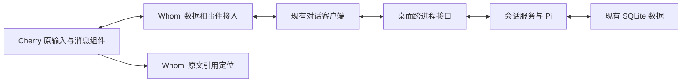

# Cherry 对话模块正式迁入方案 · 第 1 版

2026-11-08。关联 [003 · AI 对话模块对齐 Cherry](../planning/ideas/003-cherry-chat-alignment.md)。

**状态：用户已确认第 1 版并授权开始开发，实施中。** 用户在本方案交付后明确回复「可以，开始开发吧」。下文范围和验收条件是本轮开发依据，不是已经实现或通过的检查；运行通知例外、发布与推送仍未获授权。执行见[开发计划](../superpowers/plans/2026-11-08-cherry-chat-migration.md)。

## 1. 目标与选型

采用 Cherry 原输入组件、消息显示组件及其相关状态逻辑，连接 Whomi 已有的模型调用、本地存储与原文引用。目标是让基础文本对话沿用 Cherry 的操作流程，同时保持 Whomi 中已保存的聊天和引用可用。

必须满足：直接复用可用原模块；保留 Whomi 后端和材料权限；不退化既有草稿、会话切换、引用定位与恢复行为；发送、停止、失败恢复和窄窗口都能完整操作。颜色、字体等主题统一安排在行为接通之后。界面与用户所装 Cherry 的逐像素一致不是本版承诺：本版固定源码提交，尚未证明其与用户安装版本相同。

**贯穿场景，全部使用示例数据：** 用户选择原聊天中的两条消息，发送「把这段聊天整理成表格」。回答逐步显示时，用户向上阅读并输入「我想补充当时的背景」。停止、失败重试或切换对话后，回答、下一条草稿和引用各归其位；点击已发送引用能回到对应原文。

沿用已完成的[三条路径比较](../planning/ideas/003-cherry-chat-alignment.md#上游基线与现成路径)，不重新扩大调研：

| 路径 | 从现在开始的主要工作 | 本版决定 |
|---|---|---|
| 整体改造 Cherry | 把 Whomi 原文阅读、引用、记忆及现有数据迁到另一产品底座；例如原引用不能直接指向新数据库 | 不采用，影响超出本次对话框目标 |
| 迁入 Cherry 对话模块 | 复用输入和消息流程，适配 Whomi 数据；例如原停止按钮连接已有终止请求 | 推荐，隔离验证已证明核心链路能接通 |
| 旧 Pi 网页组件或继续自写近似界面 | 旧组件另需接口和框架迁移；自写则继续承担输入、滚动等状态维护 | 不采用，缺少比固定 Cherry 模块更省事的依据 |

Pi 是模型调用与会话运行库，不提供这套对话界面。共用 Pi 有利于保留 Whomi 的生成链路，输入、消息动作和阅读行为仍需迁入 Cherry 的界面层。

## 2. 已有证据与尚未证明的部分

基线为 Cherry 提交 [`263667f7a99dfed736c939708a55deb435164820`](https://github.com/CherryHQ/cherry-studio/tree/263667f7a99dfed736c939708a55deb435164820)。65 个原文件有来源校验，原输入核心和列表滚动接入 Whomi 正式客户端、服务、SQLite 数据库和 Pi 本机生成链路后，9 项操作断言通过。

严格运行诊断未通过：最终复跑捕获 61 条尺寸观察器通知。另一次独立诊断在完成、停止和窄窗后分别静置 2.5 秒，未出现新增通知或位置漂移。这不是运行检查全绿，也不能据此判断所有长会话均无影响。

完整 ChatComposer、消息外壳和动作、多对话切换、正式桌面跨进程通信、真实 Windows 输入法及 Cherry 同版本操作对照尚未验证。详见[隔离验证报告及截图](../research/cherry-chat-isolated-validation.md)。

## 3. 本版迁入范围

### 3.1 原组件和状态逻辑的边界

下表是正式目标，不把原型中的自写消息外壳提升为产品实现。固定文件路径均相对 Cherry 仓库；源码导航见[输入器](https://github.com/CherryHQ/cherry-studio/tree/263667f7a99dfed736c939708a55deb435164820/src/renderer/components/composer)和[消息模块](https://github.com/CherryHQ/cherry-studio/tree/263667f7a99dfed736c939708a55deb435164820/src/renderer/components/chat/messages)。

| 部分 | 优先直接迁入 | Whomi 的必要接入与例子 |
|---|---|---|
| 文本输入流程 | `ChatComposer` 的基础文本路径、`ComposerCore`、`ComposerSurface`、完整 `ComposerSurfaceRuntime`；草稿缓存、输入历史算法、焦点、组合输入、提交锁及发送结果交接 | 替换会话、模型、偏好和发送服务入口；用户发送甲后继续写乙，旧请求不能再次清空乙。输入历史限定为当前独立对话的内存记录，不沿用 Cherry 全局持久键；生成中自动排队和历史编辑分支不在本版启用 |
| 消息显示 | `MessageList`、`MessageListProvider`、`MessageGroup`、`MessageFrame`、`MessageContent`、`MessagePartsRenderer` 的文本路径、动作注册与流式分层 | 把 Whomi 轮次映射为问题与回答；失败只在对应回答显示一次，可复制真实正文；不保留原型自写行组件作为最终消息呈现 |
| 阅读与滚动 | `MessageVirtualList` 及跟随、阅读归属、位置记忆、几何和动画逻辑 | 使用稳定的 Whomi 对话与轮次编号；用户上滚后回答继续增长，视口保持阅读位置，回到底部后恢复跟随 |
| 菜单、模型入口及统计 | 原模块需要的共用控件、模型入口和用量呈现；保留原布局、展开和键盘规则 | 数据来自 Whomi 已有模型目录和本轮用量；模型改名后，旧回答仍显示生成时的身份。账号和服务商设置页不在本轮重做 |
| Markdown 正文 | 继续使用 Whomi 已迁入的 Cherry `MarkdownCore` 及现有输出处理 | 接入原消息正文容器；表格、代码和链接沿用已有边界，不另起一套渲染器。旧正文模块版本单独记录，不冒充全部已升到本次基线 |

保留可直接运行的上游状态算法；只有访问 Cherry 宿主服务的边界需要改接。若某段状态逻辑和排除功能不可分离，先列明依赖及必要差异，再实现最小接入补丁；不得默默退回本地 `textarea` 或自行重写滚动。`ChatComposer` 中未启用的排队、历史编辑、工具等路径不算已经复用的能力。

### 3.2 本版可见操作

- 单个文本模型的选择、思考强度、问题输入、快捷键发送与换行、停止、继续编辑下一条草稿。按 Cherry 原流程，点击发送至后端确认保存该请求期间短暂锁定输入和本次引用增删；确认后即可写下一条草稿，不必等待首段回答，不会自动排队或插入当前生成。这里的短暂锁定是本版明确建议，区别于 Whomi 当前点击后立即腾出输入的做法。
- 正常、停止、失败、中断和空回答状态；非空回答原始纯文本复制；真实生成统计。最新一轮失败或中断可在原轮重试。**拟补齐最新停止轮的重试入口**，这是现有后端已支持、正式界面尚未提供的可见操作；重试沿用原问题与请求配置，清除该轮旧部分回答后重新生成，不表示接着旧半句续写。
- 保留 Whomi 现有的对话技能选择、适用条件与 `skillId` 请求快照。这里的技能是已有的本轮提示词选择，不是本版排除的 Cherry 工具执行。**拟允许生成期间为下一条草稿选择模型和思考强度**，当前正在运行或重试的请求仍使用原快照；相比现有生成时禁用选模，这是本版明确的可见变化。
- 保留 Whomi 的新建、切换和恢复独立对话、关闭与打开对话区、草稿和引用隔离。已有空对话重复点击新建仍聚焦原草稿；关闭区域不会停止后台请求。
- 待发送引用的预览、分组移除和清空；已发送引用回到原文；选择模式与查看引用互斥。比如选择两条消息后查看上一轮引用，选择标识收起，但待发送两条引用和问题草稿保留。

消息动作按本版范围提供：复制、符合条件的原轮重试、模型与用量查看、原文引用定位。原菜单中的历史编辑、重新生成、导出、翻译、删除、朗读等不会因复制整个模块而自动启用；逐项用真实能力约束按钮、菜单与快捷键。

### 3.3 明确不纳入本版

| 后续范围 | 为什么单列，以及本版行为 |
|---|---|
| 修改已发送问题、编辑已保存回答、重新生成已完成回答、分支切换 | Cherry 使用父消息、同级分组和活动分支；Whomi 当前是线性轮次。修改第二轮会影响后续上下文，不能用失败重试代替。本版保留输入中草稿编辑，不显示这些尚无后端合同的历史动作 |
| 生成期间自动排队或跟进消息 | 当前只证明生成中保留新草稿；例如写好乙后，必须等甲终止再显式发送乙，不让原排队逻辑自动发出 |
| 附件、语音、朗读、联网、工具执行、多个模型并发 | 只迁入基础文本路径；例如粘贴图片不得开始上传或留下不能发送的附件。文本粘贴正常，非文本内容按真实能力处理 |
| Cherry 账号、数据库、云服务及整个工作区 | Whomi 继续管理原文、会话、数据与密钥；不因点开消息菜单而访问 Cherry 服务 |
| 未发送草稿跨应用重启恢复、整体正文引擎升级 | 维持现有内存草稿边界，重启恢复已保存问答；不把旧 Markdown 的升级混入当前迁入 |

历史编辑仍是对齐目标的一部分，暂不在本版承诺。后续若纳入，应按固定 Cherry 的编辑、重新生成与分支规则提出下一版方案，明确旧回答与后续提问如何保留、当前上下文如何选取，再扩展 Whomi 的数据与运行接口；不要求用户重新设计 Cherry 已有的全部交互。

## 4. 数据与状态接入

### 4.1 唯一事实来源

已保存轮次以 Whomi `AiTurn` 快照为准；编辑器草稿、菜单、焦点和阅读位置属于界面状态。不能同时维护两份各自可修改的 Cherry 与 Whomi 历史记录。

| 接入合同 | 拟议处理与可观察结果 |
|---|---|
| 稳定消息身份 | 一轮映射为稳定的问题和回答标识，例如示例轮次 `42` 对应 `42:user`、`42:assistant`；收到新快照更新同一消息，不追加重复气泡 |
| 请求受理与生成结束 | 收到本次 `requestId` 对应的已保存 `AiTurn` 即表示受理，快照可以是任意状态，不要求仍在排队或生成，也不等首字。受理前保留并锁定甲及其引用增删，仍可阅读原文；受理后清空本次输入与待发送引用并解锁，再写乙。确定未保存的失败才原样解锁；若保存后回执丢失，用同一请求编号查询或重试核对结果，保持待确认快照，不换编号制造重复轮次 |
| 生成状态 | `queued/running/summarizing` 映射为进行中，`completed/stopped/failed/interrupted` 分别显示真实终态；例如停止的半段回答不能伪装为完整成功 |
| 事件顺序 | 保留客户端先订阅后读取、按 `eventSequence` 丢弃旧快照的规则；先收到长回答再收到延迟短快照，文字不得倒退 |
| 重试资格 | 只有最后一轮且为停止、失败或中断时调用原 `retryTurn`；后端仍验证模型、本人及引用。使用原动作注册机制增加 Whomi 的原轮重试能力，按每条消息的轮次和状态判断显隐；不把全局 `regenerateMessage` 直接连到 `retryTurn`，以免已完成或旧轮出现不可用的重新生成按钮 |
| 空回答 | 后端若保存 `completed` 且正文为空，显示未收到内容、可重新提问的提示，保持已保存终态；不在前端伪装为失败，不提供后端拒绝的原轮重试，重启后表现一致。若以后要允许重试此类轮次，须单列后端终态规则变更 |
| 显式停止与离开 | 点击停止终止该轮；切换对话或离页仅解除观察，保留现有 `detach` 语义。甲生成中切到乙，再回甲读取最新真实状态，不重复发起模型调用 |
| 草稿与输入历史 | 原输入逻辑使用以原始会话和独立对话标识区分的内存草稿接入；现有草稿 Map 与 Cherry 缓存只能保留一个写入入口。输入历史也只读取当前独立对话的本次运行记录；在乙中按上方向键不带出甲的问题。切甲乙后恢复各自问题、引用和阅读位置；不引入跨重启草稿或全局输入历史 |
| 模型、技能与时间 | 使用生成时模型版本、技能和请求快照，缺失历史身份沿用未知状态，缺少服务商快照时不拿当前目录冒充。`AiTurn` 无独立消息创建时间，隐藏无法还原的发送时间；实际生成起止时间仍可在统计中按其真实含义显示，不用当前时间或请求开始时间伪装发送时间 |
| 统计口径 | `AiTurn.usage` 是该轮各次尝试的实际汇总，不是最后一次重试的独立用量；沿用 Whomi 已有汇总和缺失值规则。不得用最早开始到最晚结束之差替代实际累计耗时，也不伪造 Cherry 单次调用明细。只有已有接口能返回真实明细时才接对应展示；否则保留原统计容器并隐藏无依据的分解项 |

上述接入可能需要为现有客户端补充明确的受理通知或类型映射，但保持后端行为和数据库格式。改动只限必要合同，不把保留后端理解为适配层完全不能改。

依据：[数据合同](../../src/shared/ai-contract.ts)、[客户端](../../src/data/conversation-ai-client.ts)、[会话服务](../../electron/main/ai-service.ts)、[轮次与引用存储](../../electron/data/ai/repository.ts)。例如 `retryTurn` 会校验末轮资格并增加尝试次数，不能作为已完成回答重新生成的替代接口。

### 4.2 原文引用与正文边界

原文定位、选择模式和待发送引用继续由 Whomi 管理。编辑器需要的是引用摘要及移除、预览操作，不把原文伪装成 Cherry 附件或把整份会话塞进编辑器。发送时只交引用编号，由后端核验当前原始会话并重新取材；处理只作用于发送副本，原文不变。

引用入口仍在同一输入区域就近出现，发送后归属对应问题，当前新草稿不再保留已发送引用的副本。跨页定位等待、失败重试、取消及迟到结果仍走现有定位流程。例如查看第 12000 条原消息时中途切回选择，迟到的定位结果不得重新出现描边或错误提示。

保留现有 Markdown 输出清理、链接和资源访问规则。正确的 `**示例文字**` 应加粗；空格或标点导致的不规范语法使用明确标注的合成样例对照。用户截图中的异常 `**` 尚缺原始 Markdown 字符串，需取得可脱敏重放的原串后才能验证该实际案例，截图转录或合成样例不能算该案例已经通过。若同一原串两边均显示字面标记，记录为输入语法表现，不用全局删除星号或修改已保存回答掩盖。

原复制按钮接 Whomi 的原始纯文本复制，保留前导空格和 Markdown 行尾两个空格；只允许 Windows 剪贴板换行等价。这是明确的必要差异：Cherry 原复制命令会整理部分空白并可复制富文本，本版不沿用这一转换。非空的停止或失败回答也按保存原文复制，空回答没有无效复制入口。

### 4.3 目录与上游差异管理

拟新增 `src/vendor/cherry-chat/` 保存原组件、状态逻辑、必要共用控件和来源清单；`src/components/conversation-ai/cherry/` 集中放 Whomi 的数据、动作和宿主服务接入。现有 `workspace.tsx` 保留页面组织、原文操作与历史入口，移除被原模块接替的输入和滚动实现，避免两套监听同时运行。现有 `src/vendor/cherry-markdown/` 保持独立来源。

每个原文件记录固定提交、原始内容散列和本地差异；导入路径、宿主服务与能力条件补丁单独可查。依赖以隔离验证锁定版本为起点，核对正式应用已有 React、Radix 和样式依赖后再合并，不能直接覆盖根锁文件或携带原型服务替身。原型继续作为研究证据，正式程序不得导入 `prototypes/`。

例如升级上游滚动修复时，能定位具体原文件与本地补丁，再复跑相同阅读场景；不需要比较一份重新手写的滚动器。旧 Markdown 与新消息模块并存的版本差异要在来源清单中明确，兼容检查失败时先处理该边界，不顺带升级整套界面库。

## 5. 剩余问题与处理门槛

| 问题与当前证据 | 本版处理及通过条件 |
|---|---|
| 完整输入和消息模块尚未接入 | 首先列出真实宿主依赖，完成一个从原输入到原消息外壳的最小文本流程。草稿、停止和失败恢复通过后再扩展；若必须迁入 Cherry 数据库或改变历史模型，停止该部分并提出范围修订，不改成自写外壳交差 |
| 菜单存在直接服务调用 | 原朗读动作不因省略动作接口自动消失；用能力条件明确移除不支持入口及快捷键。逐项检查菜单、粘贴、拖放、工具栏，无无效按钮、上传或 Cherry 服务请求 |
| 统计有 Cherry 专用读取接口 | `MessageTokens` 的统计读取改接 Whomi 真实用量；弹窗与摘要使用一致的整轮汇总、缺失值和历史身份，不冒充最后一次尝试或伪造调用明细。已有真实完成时间继续显示，无创建时间不补值 |
| 尺寸观察器通知未解决 | 在正式开发版与桌面构建中分别采集原生窗口错误、未处理拒绝、控制台和滚动几何，包含长内容及改变窗口尺寸。先验证是否有持续循环、闪动或错误边界；不先过滤通知。目标为严格诊断通过；若仅剩已知瞬时通知，必须提交复现与影响证据，由用户明确接受这一项例外，不能自行降低验收标准 |
| 正式跨进程通信与恢复未覆盖 | 通过正式预加载接口调用真实服务，使用隔离数据库和本机合成模型；进程重启后恢复真实保存状态，不能靠刷新原型内存证明通过 |
| 真实中文输入与桌面焦点未覆盖 | Windows 实际输入法选词回车不发送，后续发送一次；关闭菜单恢复输入焦点。合成组合事件只作自动回归，不能代替此项验收 |
| 样式、布局和加载成本 | 原型入口约 1.09 MB、输入器延迟块约 450 KB 只是原型构建值。正式接入保留按需加载，记录相同合成数据下改前改后的加载、打字与滚动表现；不预先承诺包体或性能收益 |
| 第三方来源和分发限制 | 应用层代码按实际 AGPL-3.0 来源记录，共用包按其 MIT 声明单列，不以共用包许可覆盖聊天业务代码；沿用现有第三方说明和未获公开分发授权的边界。此方案不改变项目整体许可或授权发布 |

## 6. 验收矩阵

以下全部是拟执行的产品验收；隔离原型结果不自动勾选。优先沿用既有测试与合成样例，新增测试只覆盖新的接入行为、缺口及回归风险。

| 编号 | 示例输入与操作 | 通过条件与证据 |
|---|---|---|
| A01 原模块与基础输入 | 用原输入器粘贴两段文字、换行、发送；展开模型与消息菜单 | 原组件来源可核对，使用原输入/菜单状态逻辑；无原型宿主和无效扩展入口；源码差异与桌面截图 |
| A02 发送受理与草稿 | 发送甲，分别延迟受理、首段正文和完成回执；受理后、首字前写乙；模拟保存后丢回执和同请求编号返回终态 | 受理前甲及引用保留且不可编辑、增删，仍可阅读原文；确认未保存才原样解锁。同编号核对不会增加第二轮，任意已保存快照均能确认受理；随后才清空并允许写乙，乙不被完成或失败覆盖 |
| A03 生成期间操作 | 甲生成中编辑乙、按普通发送快捷键、打开模型菜单为乙改选模型；甲失败后重试 | 不发送或排队乙；甲及其重试仍用原模型、技能与提示词，乙显式发送时使用新选择；同一独立对话无第二个活动请求，菜单焦点正确 |
| A04 中文输入 | Windows 输入法输入示例中文，按回车选词，再用发送键 | 第一次仅选词，第二次只发送一次；人工操作记录及自动组合输入回归 |
| A05 流式阅读 | 长回答生成时真实滚轮上滚，再点回底；连续追加段落和表格 | 上滚后不抢回底；回底后继续跟随。固定窗口和内容样例中稳定锚点偏移不超过 2 像素；停止后静置 3 秒不漂移；记录锚点、尺寸、文字增长和截图 |
| A06 停止和重试 | 已输出一段时停止，再重试该最新停止轮；另注入失败、中断和已完成空回答 | 停止保留已保存正文且不追加；重试沿用原轮、原问题与配置，尝试次数增加，替换旧正文，新草稿保留；已完成和非末轮无重试入口。已完成空回答提示重新提问，重启后仍一致 |
| A07 会话切换与迟到事件 | 甲生成中切乙，给两边不同草稿和引用，再回甲；在乙用方向键取输入历史；重放旧快照 | 草稿、引用、滚动、输入历史和回答不串线；乙不会取到甲的历史问题；甲后台任务不因切换停止，不重复请求，旧快照不覆盖新内容 |
| A08 新建、关闭及取消 | 连点新建空对话、关闭再打开面板、取消引用预览或菜单 | 只有一条空对话；已有草稿保留；关闭只是隐藏，取消回到可继续操作的状态，焦点可恢复 |
| A09 引用完整流程 | 选择两组原文、发送、写新草稿、预览已发送引用、移除待发送一组及清空；定位跨页 19 条引用并注入失败后重试 | 已发送与待发送引用各出现一次；移除只影响待发送引用；按当前来源定位。查看引用与选择双向互斥，迟到结果不恢复已取消状态；复用现有桌面引用场景 |
| A10 材料隔离 | 在甲会话中提交乙会话引用编号；触发发送副本清理；显示含链接和远程资源的合成回答 | 后端拒绝跨会话编号，原文保持原样；既有正文与链接边界不退化，无意外远程资源加载 |
| A11 复制和格式 | 标题、表格、代码、长链接、正常及合成不规范加粗；复制含前导空格和行尾两个空格的部分回答 | 复制值与保存原文相同，仅换行可等价；合法 Markdown 正常，同版本对照合成非法语法，不篡改内容。截图实际案例取得原串后单独复测，未取得则明确未验证该案例 |
| A12 模型、技能与统计 | 子场景一：两个同名模型，选现有对话技能，完成后改名或停用，核对旧身份。子场景二：另用配置未变的模型，连续失败或停止后在同轮重试两次，检查汇总及缺失字段 | 技能与请求快照保持；旧身份不随目录改名，已更改或停用的模型仍按现有后端规则拒绝重试。摘要与详情按真实整轮汇总，不伪造单次明细；缺失用量、时间和服务商快照不补零或当前身份；模型菜单搜索、分组和键盘选择可用 |
| A13 保存和重启 | 完成、停止、失败、生成中退出后分别重启正式桌面程序 | 已保存文本、引用、状态和身份保持；遗留活动轮标为中断，不自动再次付费请求；不要求恢复未发送草稿 |
| A14 宽窄窗与对照 | 正式窗口 1280×800、960×720，另沿用测试内最小尺寸覆盖检查 360×800；打开原文、历史、模型菜单和统计，并对照固定 Cherry | 无页面级横向溢出，长代码/表格局部滚动；发送、停止、关闭及窗口控制均可点击，焦点可达；保留关键状态截图。360 是既有响应式压力用例，本版不更改产品 960×640 的最小窗口限制 |
| A15 运行与长会话 | 示例 200 轮历史、长回答持续增长、切换窗口宽度后停止，静置 3 秒 | 默认要求原生窗口错误、未处理拒绝及错误级控制台记录为 0，无持续观察器循环或静置位移；记录开发与构建版诊断及改前改后表现。已知通知仍出现时本项仍未通过，按第 5 节提交例外申请；有解释不等于自动通过 |

固定 Cherry 版本无法运行时，可以先做 Whomi 接入验证，但视觉和交互一致性仍标未验，不用不同版本截图或原型截图代替。原文引用是 Whomi 的专属流程，按现有需求验收，不强求在 Cherry 中存在同一功能。

## 7. 实施顺序与测试先行

以下顺序已随第 1 版获得开工授权；可执行步骤已记入[开发计划](../superpowers/plans/2026-11-08-cherry-chat-migration.md)，不创建外部工单。

1. **建立隔离基线并接通最小完整模块。** 优先使用 Codex 原生 worktree 工具，以确认后的最新远端 main 建立隔离目录，建议开发分支为 `codex/cherry-chat-migration`，本研究分支保留。只定向带入第 003 条方案和必要来源记录，不携带其他未提交文档；原型不直接转产品代码。记录基线测试后，核对依赖与来源，将基础文本流接到原输入、原消息外壳和现有客户端。此步解决模块是否可完整接入的剩余不确定性。
2. **接入真实状态与 Whomi 特有操作。** 完成受理与终态、快照顺序、草稿与会话隔离、停止重试、引用及统计；先在对应测试中观察预期失败，再写必要适配。通过后移除被替代的旧输入和滚动代码，保留页面与原文生命周期。
3. **完成桌面验收并处理遗留。** 核对真实输入法、正式跨进程通信、恢复、尺寸观察器通知及同版 Cherry 对照，再统一主题。任何能力或材料范围变化回到第 003 条确认，不临时扩大数据库或调用范围。

按用户指定的测试驱动开发技能执行：新行为先有会因缺失行为而失败的测试，观察失败后再迁入或连接生产代码，转绿后整理。直接复用的外部源码作为依赖保留，不为满足测试先行而重新手写；原文件散列检查只证明来源，不能代替行为测试。既有行为回归原本通过时保留，不故意改坏实现制造失败。测试替身仅放测试工具，生产适配层不能保留示例模型、固定用量或空服务实现。

复用现成测试入口：[草稿与重试](../../src/components/conversation-ai/cherry-workspace.test.tsx)、[切换与面板](../../src/components/conversation-ai/workspace-refinements.test.tsx)、[客户端快照与取消](../../src/data/conversation-ai-client.test.ts)、[生命周期边界](../../src/components/conversation-ai/lifecycle-boundaries.test.tsx)、[后端仓库](../../tests/backend/ai-repository.test.ts)、[后端服务](../../tests/backend/ai-service.test.ts)、[桌面阅读](../../tests/desktop/reading-polish.spec.mjs)。涉及引用时继续运行既有互斥、跨页与迟到结果回归。

正式完成前执行仓库完整前端命令 `npm test`、完整后端 `npm run test:backend`、`npm run typecheck`、`npm run build`、`npm run desktop:build` 和完整桌面回归 `npm run test:desktop`。原生 SQLite 依赖须按 Node 与 Electron 的运行环境分别准备，避免并行切换二进制导致假失败。已知原型诊断是未通过基线，不能在产品验收中继承为默认例外；任何既有或新增失败按名称记录，不能只报告定向用例通过。

## 8. 交付、回退与确认内容

交付以同一第 003 条记录验收矩阵的实际结果、关键截图、运行日志、原文件清单、本地补丁及第三方说明。验收通过前不把 `PRODUCT.md` 中的已有能力更新为完成。保留现有数据库格式，因此回退界面版本应继续读取同一份数据；使用隔离副本验证这一点，不靠保留两套活动输入器实现回退。本版不包含安装包发布、远端推送或外部工单。

**已确认的范围：** 采用原输入和消息显示模块的基础文本流程；复用 Whomi 后端、正文、原文定位及对话技能；自行实现宿主接口、消息状态映射、能力条件与引用接入。沿用原提交锁，后端受理后即可编辑下一条草稿并为其选模；加入最新停止轮重试；输入历史只在当前独立对话内存中保留，复制保持原始纯文本。历史编辑、已完成回答重新生成、分支和自动排队暂缓。尺寸观察器问题保留明确验收门槛，确认本版不等于接受运行通知例外；用户回复「可以，开始开发吧」为正式开工依据。

方案编写时的历史基线：`codex/cherry-chat-alignment`，无远端跟踪分支。当时已执行 `git fetch --all` 和 `git pull --ff-only origin main`，`HEAD` 与 `origin/main` 均为 `b637889`，相差 0 个提交；该阶段只编写方案，未创建新 worktree、安装依赖或运行产品测试。随后用户明确授权开发，当前实施情况见第 003 条主记录。

方案在提交确认前经独立只读审查，已补清受理锁、请求去重、输入历史隔离、现有技能、原始文本复制、逐轮重试资格、空回答终态、汇总统计及窄窗测试边界。审查意见本身不代表功能完成；开工依据为用户随后明确回复的「可以，开始开发吧」。
