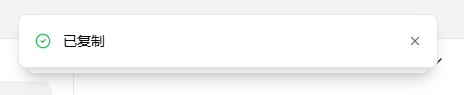

# 导入流程与全局异常提示审核清单

2026-11-17，承接工单 #22 和用户对[导入文案审核页](../../release/import-design-audit-20261117/copy-review.html)的 20 项反馈。本文件作为本轮统一清单，编号与用户反馈一一对应；文中的「审核项」指原审核页的场景编号。

统一跟踪工单为 [#25 导入流程完善](https://github.com/StarryJia/whomi/issues/25)，已包含后续确认的保存结果异常、统计更新失败处理以及 ChatLab 拖放参考。

前 20 项保留 2026-11-17 的原审核要求和历史截图。2026-11-19 确认的实施方案、结果和本轮运行证据见文末。历史截图对应修改前的版本。

本轮失败操作统一按第 15、17 项执行。第 7 项采纳的保存失败标题与提示调整纳入清单，原建议中的重试保存入口按第 15 项调整。第 10、11 项将取消的目标确定为整批恢复到导入前状态。

## 统一清单

1. [ ] **查找阶段使用易懂标题**，对应审核项 19，要求已确认。

   将「正在查找文件入口」改为「正在查找聊天记录」。例如用户选中聊天导出目录后，等待期间看到新标题和取消入口。 [当前截图与文案](../../release/import-design-audit-20261117/copy-review.html#s19)

2. [ ] **会话选择标题与按钮**，对应审核项 20，要求已确认。

   标题改为「选择要导入的会话」，移除「已发现 X 个文件入口」提示，主按钮改为「导入所选会话」。没有勾选会话时，主按钮禁用。例如列表有两个会话，用户勾选其中一个后，按钮才可点击。 [当前截图与文案](../../release/import-design-audit-20261117/copy-review.html#s20)

3. [ ] **隐藏无法识别的文件**，对应审核项 21，要求已确认。

   可选列表仅展示可识别的会话，移除未识别文件的计数、展开入口和文件列表。例如目录内有两个聊天文件和一个普通资料文件，界面只展示两个可选会话。全部文件都无法识别时，按第 4、15 项展示异常和处理操作。 [当前截图与文案](../../release/import-design-audit-20261117/copy-review.html#s21)

4. [ ] **Whomi 全局统一异常提示**，对应审核项 8、9、22、24、28、30，要求已确认。

   整个应用的异常消息采用统一展示方式。参考用户提供的 Cherry 消息提醒，提示位于应用窗口上方正中间，使用有圆角、边框和阴影的卡片，支持折叠与展开。折叠、展开是用户明确提出的交互要求；参考图展示了紧凑卡片的外观。

   本轮覆盖选择窗口失败、来源失效、没有可导入会话、多会话解析失败、解析中发现异常记录和单文件解析失败。例如用户导入时发现异常记录，顶部正中出现异常消息卡片，展开后可查看对应提示。因异常无法继续导入时，操作按第 15 项执行。全局视觉要求已同步到 [DESIGN.md](../../DESIGN.md#全局异常消息提醒)。

   自动消失时长、折叠后的内容、多条消息如何排列等细节留待设计核对。参考图原件如下。

   

   [审核项 8](../../release/import-design-audit-20261117/copy-review.html#s8) · [9](../../release/import-design-audit-20261117/copy-review.html#s9) · [22](../../release/import-design-audit-20261117/copy-review.html#s22) · [24](../../release/import-design-audit-20261117/copy-review.html#s24) · [28](../../release/import-design-audit-20261117/copy-review.html#s28) · [30](../../release/import-design-audit-20261117/copy-review.html#s30)

5. [ ] **多会话导入期间折叠完成项**，对应审核项 36，要求已确认。

   多会话仍在导入时，将已经完成的会话收起。例如会话甲已完成、会话乙正在保存，界面突出当前进度，甲的详细结果折叠，用户可展开核对。完成项在本批取消后的处理遵循第 10 项。 [当前截图与文案](../../release/import-design-audit-20261117/copy-review.html#s36)

6. [ ] **参考 ChatLab 实现打开选择窗口后仍可改用拖放**，对应用户提出的新场景，参考方向已确认，适配效果待验证。

   期望用户点击「选择文件」后，仍能将文件或文件夹拖到 Whomi 导入区，完成来源选择。例如文件选择窗口已经打开，用户发现资源管理器里已有目标聊天文件，希望直接拖入 Whomi。

   代码核查显示，当前选择窗口附属于 Whomi 主窗口，打开期间主窗口受模态限制；来源选择过程中，导入区也被标记为忙碌并拒绝拖放。因此实现需要同时调整选择窗口的交互和来源选择状态。可评估让选择窗口与导入区并行可操作，并在用户拖入后处理原选择窗口的迟到结果，防止创建两次导入。该路径具有改造可行性，Windows 上的具体行为尚待验证。 [窗口调用](../../electron/main/index.ts) · [选择状态](../../src/data/use-import.ts) · [拖放入口](../../src/components/file-import.tsx) · [Electron 原生窗口文档](https://www.electronjs.org/docs/latest/api/dialog#dialogshowopendialogwindow-options)

   用户补充 ChatLab 已有类似功能，要求参考其实现。源码核对版本为 `bb292e35a00d68132de203e8b2d52e2d7e74dcd3`。该版桌面选择窗口通过 `dialog.showOpenDialog(options)` 打开，导入页等待选择结果期间保持原有导入状态，拖放区域由实际导入状态控制禁用。点击选择与文件拖放都进入文件路径处理流程，文件夹拖放有单独入口。后续按这条现有实现路径适配，并核对窗口打开期间拖入文件、拖入文件夹、取消选择窗口和迟到选择结果这四种实际操作。此处证据为源码核查。 [ChatLab 窗口调用](https://github.com/ChatLab/ChatLab/blob/bb292e35a00d68132de203e8b2d52e2d7e74dcd3/apps/desktop/main/ipc/window.ts#L356) · [导入页](https://github.com/ChatLab/ChatLab/blob/bb292e35a00d68132de203e8b2d52e2d7e74dcd3/src/components/import/ImportArea.vue#L234) · [拖放组件](https://github.com/ChatLab/ChatLab/blob/bb292e35a00d68132de203e8b2d52e2d7e74dcd3/src/components/UI/FileDropZone.vue)

7. [ ] **保存失败标题及统一提醒**，对应审核项 37，要求已确认。

   保存已失败时标题使用「保存失败」，错误原因通过第 4 项的消息卡片提醒。例如磁盘空间不足导致保存停止，页面应明确失败，顶部提示原因。操作统一为第 15 项的两个按钮。 [当前截图与文案](../../release/import-design-audit-20261117/copy-review.html#s37)

8. [ ] **已有会话追加结果的文案**，对应审核项 40，要求已确认。

   会话标题使用「发现已有会话：XXX」，删除末尾的「已更新」。新增和重复条数采用统一表达。例如已有会话名为「示例联系人」，本次新增一条、重复一条，显示「发现已有会话：示例联系人」和「新增 1 条消息，跳过 1 条重复消息」。 [当前截图与文案](../../release/import-design-audit-20261117/copy-review.html#s40)

9. [ ] **全量重复结果的文案**，对应审核项 41，要求已确认。

   采纳全量重复场景的建议。例如同一份两条消息的导出再次导入，显示「发现已有会话：示例联系人」和「没有新增消息，跳过 2 条重复消息」。 [当前截图与文案](../../release/import-design-audit-20261117/copy-review.html#s41)

10. [ ] **取消整批导入并恢复原状**，对应审核项 42，要求已确认。

    用户取消多会话导入时，取消该批全部导入任务，撤销本批已写入的数据，恢复到本批导入之前的状态。例如甲是本次新建且已保存的会话，乙仍在处理中；取消后甲随本批结果撤回，乙停止处理，回到可重新选择来源的起点。

    对已有会话的追加，同样以恢复导入前状态为准。例如原有会话有 100 条消息，本批追加 20 条后取消，应恢复为原有 100 条；本批新增会话与原有会话的追加数据需要分别撤回。当前实现会保留先前已保存的会话，此项涉及整批数据处理规则的调整。 [当前截图与文案](../../release/import-design-audit-20261117/copy-review.html#s42)

11. [ ] **统一所有多会话取消状态**，对应审核项 43，要求已确认。

    与第 10 项采用同一规则。即使当前状态已经包含某个会话的已保存结果，取消也撤销整批导入。例如审核项 43 当前显示「已取消剩余导入」并保留甲，后续应以整批恢复完成后的状态呈现。 [当前截图与文案](../../release/import-design-audit-20261117/copy-review.html#s43)

12. [ ] **消息解析错误的提醒与本地日志**，对应审核项 44，要求已确认，日志细则待讨论。

    解析消息发生错误时，通过统一消息卡片提醒，并将失败情况写入本地日志，供用户提交工单。例如某个导出文件第 1 条记录解析失败，用户收到异常提醒，并可通过「查看错误日志」打开此次失败记录。日志路径、内容范围、隐私处理、保存时长和提交方式留待后续专项讨论。 [当前截图与文案](../../release/import-design-audit-20261117/copy-review.html#s44)

13. [ ] **同批多会话失败的提醒与日志**，对应审核项 45，要求已确认。

    多会话导入出现失败时，也统一消息提醒和本地错误日志。例如会话甲已写入、会话乙解析失败，异常卡片提示失败，提供第 15 项的操作；用户取消后按第 10 项恢复本批导入前的数据。失败时是否立即自动撤销整批、还是在用户点击取消后撤销，留待明确。 [当前截图与文案](../../release/import-design-audit-20261117/copy-review.html#s45)

14. [ ] **整批失败消息提醒**，对应审核项 46，要求已确认。

    整批导入失败且没有会话结果时，同样产生统一异常提示。例如保存前发生存储错误，顶部消息卡片提示失败，导入区提供第 15 项的两个操作。 [当前截图与文案](../../release/import-design-audit-20261117/copy-review.html#s46)

15. [ ] **阻断导入异常的操作限定**，适用于所有因异常无法继续导入的情况，要求已确认。

    失败处理只提供「查看错误日志」和「取消导入」两个业务操作。「查看错误日志」自动打开相应的本地日志文件；「取消导入」按第 10、11 项撤销本批任务并恢复原状。例如单文件解析失败后，用户可以打开日志核查，也可以取消回到导入起点。原有重试解析、重试保存、重选失败来源和失败页继续导入的入口都按本要求调整。

    两按钮规则适用于导入异常处理；全应用其他功能按第 4 项统一消息展示。消息卡片的折叠、展开属于提示控件。日志文件无法生成或无法打开时如何反馈，纳入后续日志设计。

16. [ ] **缺少保存确认时统一异常处理**，对应审核项 47，处理要求已确认。

    当前前端只有同时获得已保存或重复的状态、会话编号和提交时间，才认定结果已持久保存。审核项 47 的测试专门构造了「任务显示完成，但提交时间为空」的矛盾数据，因此出现「请重新查询保存结果」，同时缺少打开会话按钮。

    正常保存会在同一次数据库提交中写入消息与提交时间。此次状态属于受控防御检查，尚未在真实导入中复现。用户已确认将其纳入统一导入异常处理，弹出顶部消息提醒，记录并可打开错误日志，按第 10、15 项取消整批导入并恢复导入前状态。验收时构造缺少提交时间的结果，应进入异常处理流程，成功结论须以完整的保存确认信息为依据。 [当前截图与文案](../../release/import-design-audit-20261117/copy-review.html#s47) · [保存确认条件](../../src/data/use-import.ts) · [保存写入](../../electron/data/import/merge.ts)

17. [ ] **失败后结束本次尝试**，对应审核项 48，要求已确认。

    一次导入按一遍完成组织，发生阻断失败后只允许查看日志或取消本批，取消后的新一轮导入从起点开始。移除在失败批次内重选文件再完成剩余项目的流程。例如原审核项 48 的「重选失败文件后成功」路径，后续由查看日志、取消整批、重新发起导入的流程替代。 [当前截图与文案](../../release/import-design-audit-20261117/copy-review.html#s48)

18. [ ] **解释重试保存完成与普通完成的区别**，对应审核项 49，代码与截图含义已核实。

    两者最终页面和保存结果相同。审核项 49 额外覆盖「第一次保存请求失败，用户点击重试保存，第二次成功」这一过程，因此单独列图；普通完成直接到达成功结果。根据第 15、17 项的新要求，后续导入流程将取消同批重试保存路径。 [当前截图与文案](../../release/import-design-audit-20261117/copy-review.html#s49)

19. [ ] **本地会话统计更新失败时统一异常处理**，对应审核项 51–54，处理要求已确认。

    这里的摘要保存本地会话统计，包括消息数、成员数、最早消息时间和最晚消息时间。例如导入后统计出 320 条消息、两个成员和一段时间范围，程序将这些字段写入会话统计表。该过程执行本地数据库统计。

    正常导入时后台自动完成统计，完成页通常只展示保存条数。审核项 51–54 专门模拟统计更新失败，再展示待更新、更新中、再次失败和重试成功，因此用户正常导入时通常看不到它们。「摘要」一词容易让用户联想到生成聊天内容总结，后续需明确用户文案。

    用户已确认将统计更新失败纳入统一导入异常处理，弹出顶部消息提醒，记录并可打开错误日志，取消整批导入并恢复导入前状态。即使聊天已经写入，仍须撤销本批改动。原有「重试摘要」及其更新中、再次失败、重试成功分支统一按第 15、17 项处理。例如本批写入 320 条消息后统计更新失败，应走异常提示、日志和整批取消流程。 [审核项 51](../../release/import-design-audit-20261117/copy-review.html#s51) · [52](../../release/import-design-audit-20261117/copy-review.html#s52) · [53](../../release/import-design-audit-20261117/copy-review.html#s53) · [54](../../release/import-design-audit-20261117/copy-review.html#s54) · [本地统计实现](../../electron/data/import/summary.ts) · [完成页显示条件](../../src/components/import/import-progress.tsx)

20. [ ] **解释指引返回和焦点恢复**，对应审核项 57，代码含义已核实。

    用户点击「操作指引」阅读平台步骤，再点击「返回导入」，页面回到文件选择区，键盘当前操作位置回到「操作指引」按钮。例如使用键盘的用户返回后按 Enter，可以再次打开指引；这项截图用于检查返回导航与键盘操作能否连续进行。它是验收场景名称，页面仍显示选择文件、选择文件夹和操作指引。 [当前截图与文案](../../release/import-design-audit-20261117/copy-review.html#s57) · [焦点恢复实现](../../src/components/file-import.tsx)

## 本次记录结果与下一步

已逐项核对 20 条用户反馈及其审核页编号，并将全局异常展示要求写入根设计文档。当前实现证据仍以原图册和代码为准。

用户追加确认了第 47 项和第 51–54 项统一采用异常提示、日志和整批取消，并指定参考 ChatLab 的选择与拖放实现。后续完善包括 ChatLab 路径在 Whomi 的适配、本地日志规则、统一异常流程中的撤销时点与故障恢复，以及消息卡片的收展细节。

2026-11-17，按用户要求汇总并发布工单 #25，涵盖已确认改动、待完善细节及验收场景。本地现有代码、测试与设计资料的未提交状态另行检查，实施进度以后续记录为准。

### 方案第 1 版（2026-11-19 确认，待验收）

用户确认在 `codex/issue-25-import-recovery` 开发，基线为 `0f95425`。沿用现有导入解析器、来源授权、界面控件和 SQLite。Windows 原生选择参考 ChatLab 的无父窗口调用。授权和结果先后顺序继续由 Whomi 管理。

- [x] 核对两条关键边界。合成批次先向已有 100 条的会话追加 20 条，再创建新会话，分别注入保存凭据缺失与本地统计失败。两种情况下，旧会话仍为 100 条，新会话未进入资料库。Windows 实际选择窗口保持打开时，应用接收了合成文件与文件夹的受控拖放，关闭窗口时收到取消结果。迟到选择结果在真实应用内用受控窗口返回值验证。
- [x] 用一个数据库事务保存整批，核对各会话的保存编号、提交时间、条数与统计后发布。进行中可展开已处理项目。阻断错误立即回滚，失败页保留查看日志和取消。已覆盖重复取消、其他写入排队、进程在第一个会话处理后退出及暂存清理失败。升级前已部分保存的历史任务保留原资料，用户退出旧结果后可发起新导入。
- [x] 在同一区域完成来源选择、解析、会话勾选、保存与结果。只列出识别的会话，名称相同时显示可识别的来源，单文件含多个会话时也可逐项勾选。已核对已有会话追加、完全重复、无可导入会话与操作指引焦点恢复。
- [x] 在应用窗口上方显示统一异常卡片，覆盖导入、会话、报告、问一问、对话和设置。导入日志放在应用本机数据目录下的 `import-errors`，记录版本、时间、阶段、错误代码和可用计数。取消后可从「设置 → 关于」打开最近一份。测试区分写入失败、找不到文件和系统无法打开。日志保留周期与统一软件日志政策由后续专项确定。
- [x] 两路代码复核检查工单、仓库规范、故障交错和历史数据。修复了短暂查询失败遮蔽后来成功结果、页面切换后看不到后台失败、同名候选难以区分，以及删除最后一个导入会话后旧结果阻挡新导入。

#### 运行证据

- 类型检查、桌面构建、前端 621 项与后端 717 项全量测试通过。后端使用真实子进程中断测试，验证第一个会话处理后进程退出，重新打开时仍没有本批的部分数据。升级前已提交的导入仍可查看，资料库中的历史统计错误不会把它变成待撤回批次。
- Windows 扩展导入测试首次 9 项通过、3 项失败。失败原因分别是删除最后一个已导入会话后误报缺少凭据、旧版删除对话框文案断言，以及默认文本应用持有合成日志目录。修复并复跑后 12 项通过，Windows 默认文本应用实际打开了本次合成日志。首次日志保留在 `release/issue-25-verification/desktop-verified-20261119-102925608/`，复测日志和正常、异常、取消及窄窗截图保存在 `release/issue-25-verification/desktop-final-20261119-103633590/`。
- Windows 文件和文件夹原生选择窗口两项通过。测试确认原生窗口实际存在，向应用发送受控拖放，随后在原生窗口发送 Escape 并收到取消结果。首次识别按应用进程查找窗口时遗漏了 Windows 承载的选择窗口，后续按本轮窗口标题和句柄确认。完整记录位于 `release/issue-25-verification/native-escape-20261119-103519460/`。
- 洞察桌面检查首次 3 项通过、1 项在删除报告后没有恢复列表标题焦点。单独复测及后续分组复测通过，首轮焦点异常原因尚未确认。另经截图检查修正了原文弹窗标题和异常卡片的重叠。最终 4 项洞察检查通过，保留原文滚动位置。首次和最终记录分别位于 `release/issue-25-verification/insight-notices-20261119-103724860/` 和 `release/issue-25-verification/dialog-layout-final-20261119-104614713/`。
- 最终构建再次通过 3 项导入定向检查，覆盖无可导入会话的日志、保存凭据缺失和会话统计错误。记录位于 `release/issue-25-verification/import-release-check-20261119-104926926/`。
- 资源管理器鼠标拖放仍待现场复核。Windows 计算机操作工具启动被拒，补充系统输入测试在源和目标坐标都命中其他窗口，未发出鼠标事件。首轮记录保存在 `release/issue-25-verification/native-system-drag-20261119-103326986/`，补充窗口定位记录保存在 `release/issue-25-verification/native-system-drag-final-20261119-104100175/`。
- 来源准备尚未取得任务编号时的反馈和取消方式，随原清单待确认事项保留。
