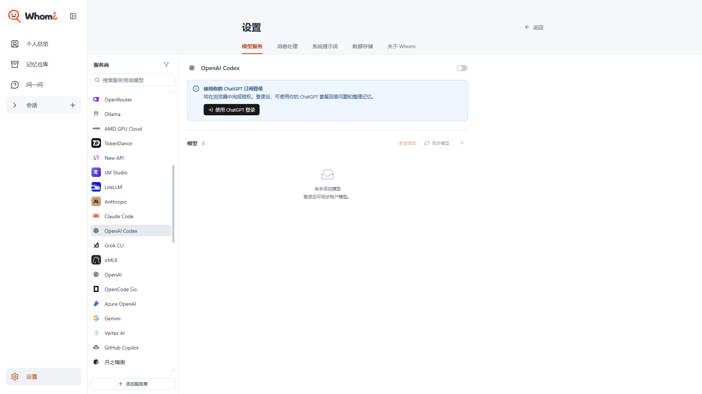
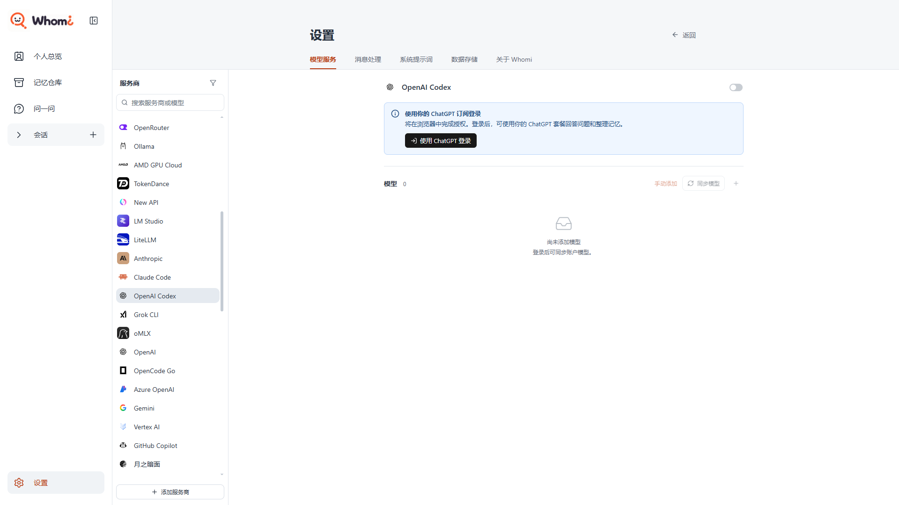
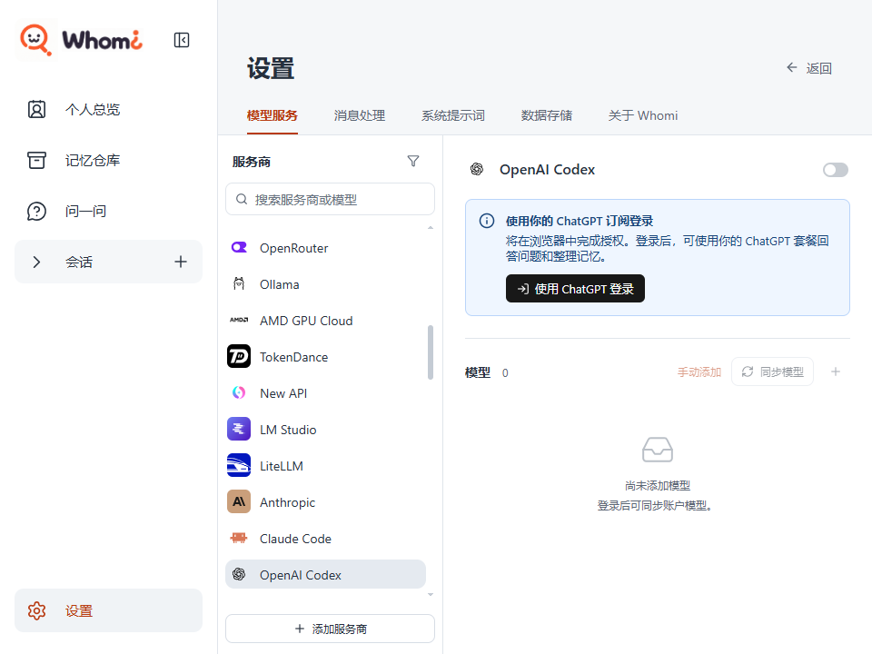

# 模型配置页内容列居中修复

2026-11-12。状态：已实现并完成本机桌面验证，待用户视觉验收。

用户要求参照所给 Cherry 截图，只调整模型配置页：大窗口将服务商配置放在右侧可用区域中央，窄窗口随可用宽度收缩，左侧应用导航和服务商列表保留。

## 实现与范围

基线为最新 `origin/main` 的 `ce765f4`，已执行 `git fetch --all` 和 `git pull --ff-only origin main`。用户确认从该基线创建独立分支 `codex/model-settings-layout`；原工作区的 `Research Paper/` 保持原样。

页面属于操作型设置界面。已有 `.ms-detail-body` 将服务商标题、连接区和模型区组织在同一条最大 768 像素的内容列内，但宽窗下整列贴左。此次只增加 `margin-inline: auto`，复用现有宽度、字号、换行、窄窗切换和组件；没有引入依赖或改变配置、授权及模型保存逻辑。

例如用户选择 OpenAI Codex 时，标题、登录提示和模型列表整体居中，文字仍按原方式左对齐；窗口收窄时，同一内容列缩小，说明自然换行。切换到已配置服务商或未配置预置项也使用同一规则。

## 桌面验证

使用 Electron 桌面程序、隔离临时数据库和虚构服务商；账号页面只检查未登录状态，没有发起真实登录或付费模型请求。测试覆盖 OpenAI Codex、已配置的示例服务商和未配置的深度求索预置项。

| 实际窗口 | 内容列宽度 | 修改前左右留白 | 修改后左右留白 | 结果 |
|---|---:|---:|---:|---|
| 1920 × 1080 | 768 px | 24 / 640 px | 332 / 332 px | 三类详情均居中 |
| 1280 × 800 | 744 px | 24 / 24 px | 24 / 24 px | 自适应宽度保持正常 |
| 960 × 720 | 424 px | 24 / 24 px | 24 / 24 px | 说明换行，长模型名省略，按钮可见 |

九组检查均无详情区域横向溢出、无页面运行错误；服务商列表左边界始终为 240 px。真实桌面截图见下方；完整前后截图与测量文件保存在本分支工作目录的 `artifacts/model-settings-layout/`。

- `npm run desktop:build`：通过。
- `node node_modules/@playwright/test/cli.js test tests/desktop/cherry-settings.spec.mjs --workers=1`：1 项通过，覆盖自动保存、同步失败重试、取消后不保存、确认添加、模型编辑、960 与 360 窗口。
- `git diff --check`：通过。

本次仅修改样式，复用现有交互用例；未新增业务测试。没有验证真实账号授权、外部模型连通性或重新制作安装包。

## 视觉证据

## 设计复核

本轮限定一个布局问题，已修复并验证。优先修复项即共用内容列居中，没有扩展为全站视觉改造。布局专项评价从 B 提升至 A，属人工评价，不代表全应用评分。

按 ui-ux-pro-max 与 design-review 检查。前者的界面指导检索命中长文本换行规则，React 专项两次检索无匹配，实际实现依据仓库已确认的布局约定和原生样式能力。design-review 启动脚本报告 Bash 兼容值与更新检查异常，未安装或升级工具；视觉证据直接来自项目桌面运行，未运行额外外部模型审查或机械扫描。

后续复用提示：预置详情和已配置详情共同使用 `.ms-detail-body`，调整最大宽度或水平对齐应改此处；分别改登录卡和模型列表会造成边线不一致。下一步由用户对照参考图验收宽窗与窄窗效果。
