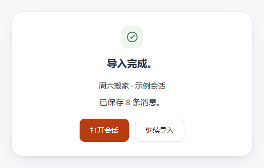
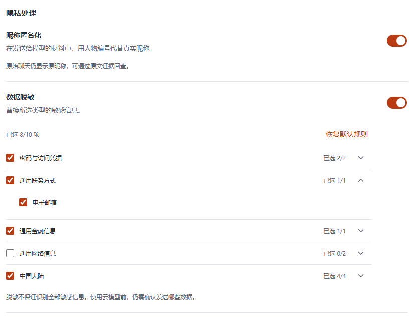

# Whomi 使用指南

## 从源码启动

以下步骤已在 64 位 Windows 的 PowerShell 中验证。GitHub 目前尚未提供可下载的安装包。

1. 安装 Node.js。项目使用 Node.js 24.12.0 和包管理工具 npm 11.6.2 验证。
2. 在仓库首页选择 **Code → Download ZIP**，解压后在包含 `package.json` 的目录打开 PowerShell。
3. 依次执行以下命令。最后一条会打开 Whomi 的桌面窗口。

```powershell
npm.cmd ci
npm.cmd run native:electron
npm.cmd run desktop:dev
```

如果安装时提示找不到 Python 或 C++ 编译器，安装 Python 和 Visual Studio Build Tools 的「使用 C++ 的桌面开发」组件，再重试失败的命令。

## 先试一段虚构聊天

点侧栏「会话」旁的 **＋**，选择仓库里的[周六搬家示例](readme/weekend.chatlab.json)。看到「已保存 8 条消息」后点「打开会话」，选「小满」为本人，就能读到小满和阿禾的原话。再次导入同一份示例，新增 0 条。自己的聊天导出也从这里导入。[支持的导出格式](research/chatlab-parser-reuse.md#实际验证范围)



## 试一次引用提问

阅读原文无需连接模型。想提问或整理记忆，先在「设置 → 模型服务」添加可用的服务和文本模型。

要试首页里的情感提问，导入[周五的约定（虚构会话）](readme/friday.chatlab.json)，打开会话并选「小满」为本人。点「选择消息」，选中五条原话，在「AI 对话」里问：我明明说了「没事」，为什么听见「那我就放心了」反而更难过？

收到回答后，点问题下的「5 条引用」可以回看原文。要接着问，就选中想再聊的几句：连续选中的原话会连成一片底色，作为一组引用放进追问框。首页展示的是模拟回答，你选择的模型可能给出不同的解读。

提问时，模型服务会收到问题、所选引用和相关对话历史。如果当前会话已有有效的记忆成稿，也会带上其中的内容。整理记忆时，发送的是确认范围内的聊天材料。使用云端模型前，可以在「设置 → 消息处理」启用昵称匿名化和数据脱敏，选择要替换的邮箱、手机号等信息。规则可能漏掉正文中能识别身份的细节。


