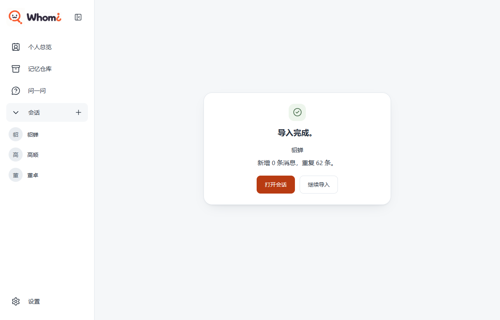
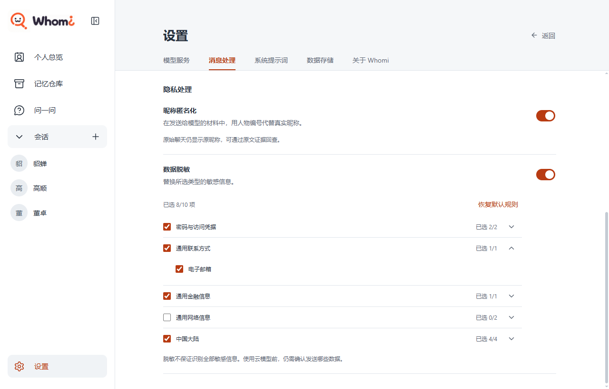

# Whomi 使用指南

## 从安装包启动

在 64 位 Windows 上打开 Whomi 的安装程序，选择安装目录，完成后启动 Whomi。点侧栏「会话」旁的 **＋**。还没有聊天文件时，点「选择文件夹」下面的「操作指引」，选择自己的平台。准备好文件后点「返回导入」。

## 从源码启动

以下步骤已在 64 位 Windows 的 PowerShell 中验证。

1. 安装 Node.js。项目使用 Node.js 24.12.0 和包管理工具 npm 11.6.2 验证。
2. 在仓库首页选择 **Code → Download ZIP**，解压后在包含 `package.json` 的目录打开 PowerShell。
3. 依次执行以下命令。最后一条会打开 Whomi 的桌面窗口。

```powershell
npm.cmd ci
npm.cmd run native:electron
npm.cmd run desktop:dev
```

如果安装时提示找不到 Python 或 C++ 编译器，安装 Python 和 Visual Studio Build Tools 的「使用 C++ 的桌面开发」组件，再重试失败的命令。

## 先试一段虚构聊天

点侧栏「会话」旁的 **＋**，选择[貂蝉的虚构聊天文件](fixtures/lvbu/conversations/diaochan.chatlab.json)。看到「已保存 62 条消息」后点「打开会话」，选「吕布」为本人。最后八句是吕布到西门接貂蝉的那一晚。

再次导入同一份文件时，已有的消息会被识别为重复。下面是 0.1.11 正式版保留这 62 条消息后的导入结果。



要看吕布在不同关系里的表现，再导入[董卓](fixtures/lvbu/conversations/dongzhuo.chatlab.json)和[高顺](fixtures/lvbu/conversations/gaoshun.chatlab.json)的会话，同样选「吕布」为本人。在三段会话中分别点「整理成记忆」，完成后到「记忆仓库」查看。要复现首页截图的最终材料，再分别导入[第二轮的两个补充文件](fixtures/lvbu/round-2/README.md)，重新整理董卓、高顺两段会话，打开「个人总览」。

## 试一次引用提问

阅读原文无需连接模型。想提问或整理记忆，先在「设置 → 模型服务」添加可用的服务和文本模型。

打开貂蝉会话并选「吕布」为本人。点「选择消息」，从吕布的「我到西门了。董卓说你自己愿意留下？」选到貂蝉的「外头冷，去茶铺坐。我出来找你。」，共八条，再打开「AI 对话」。

选中的八条原文会成为一组引用。再点一次指针图标退出选择，引用会保留。发送前可从输入框上方的「1 组引用」核对原文，然后问：

> 从这段聊天看，我们相处的时候，有什么是我没留意到的？

回答留意到貂蝉的两句话：「让我自己同他说」是在争取自己开口，「外头冷，去茶铺坐」则是在照顾等她的人。点问题下的「8 条引用」，可以回到左侧原话，看看你是否也这样读。[查看实际问答截图](readme/screenshots/conversation-question.png)。

提问时，模型服务会收到问题、所选引用和相关对话历史。如果当前会话已有有效的记忆成稿，也会带上其中的内容。整理记忆时，发送的是确认范围内的聊天材料。使用云端模型前，可以在「设置 → 消息处理」启用昵称匿名化和数据脱敏，选择要替换的邮箱、手机号等信息。规则可能漏掉正文中能识别身份的细节。



## 按平台准备聊天文件

先从原平台导出聊天记录，再点 Whomi 侧栏「会话」旁的 **＋** 导入。下载的是压缩包时，先解压。下文的 JSON 是一种结构化数据格式，在导出菜单里选它，会得到以 `.json` 结尾的文件。

### 微信

在微信导出工具 [SIWX（Stories in WeChat）](https://github.com/ImUpXuu/SIWX) 中选择目标会话，勾选消息内容并导出为 JSON。在 Whomi 里选择该会话的文件；同目录的 `manifest.json` 是导出清单。

### QQ

用 [QQ Chat Exporter](https://shuakami.github.io/qq-chat-exporter/docs/guide.html) 将好友或群聊导出为 JSON，选择解压后的会话文件。如果手上已有旧版 QQ 消息管理器导出的聊天文本，也可以直接选择那份 `.txt` 文件。

### Telegram

在 Telegram 桌面版打开目标会话，点右上角「⋮」→「Export chat history」（导出聊天记录），格式选 JSON。在 Whomi 中选择导出的会话文件。

### WhatsApp

在手机上打开目标聊天，选择「导出聊天」→「不附加媒体」。把导出的聊天文本传到电脑，在 Whomi 中选择 `.txt` 文件。

### Discord

用 [DiscordChatExporter](https://github.com/Tyrrrz/DiscordChatExporter) 选择目标频道，格式选 JSON。在 Whomi 中选择导出的频道文件。

### Google Chat

在 [Google Takeout](https://takeout.google.com/) 中只勾选 Google Chat，下载并解压。保留 `Groups` 和 `Users` 两个子目录，在 Whomi 点「选择文件夹」，选择包含它们的 `Google Chat` 文件夹。

### Instagram

在账户中心将「消息」导出到设备，格式选 JSON。解压后打开目标私信的目录，在 Whomi 中选择 `message_1.json`；同一段聊天分成多个消息文件时可以多选。

### LINE

在手机的聊天菜单中选择「设置」→「导出聊天记录」。把保存的 `.txt` 文件传到电脑，再拖入 Whomi。

更多格式及验证范围见[导入格式清单](research/chatlab-parser-reuse.md#实际验证范围)。
