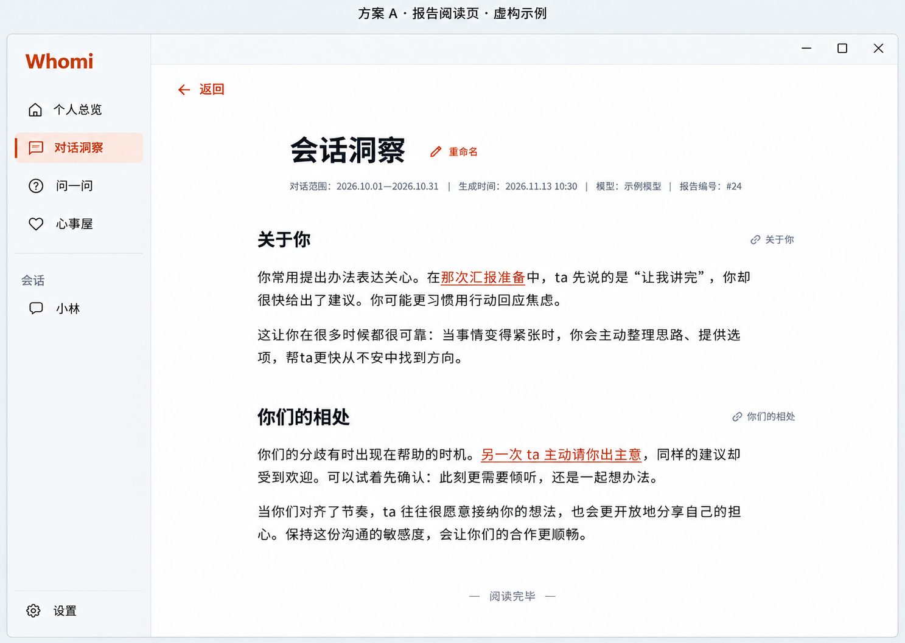
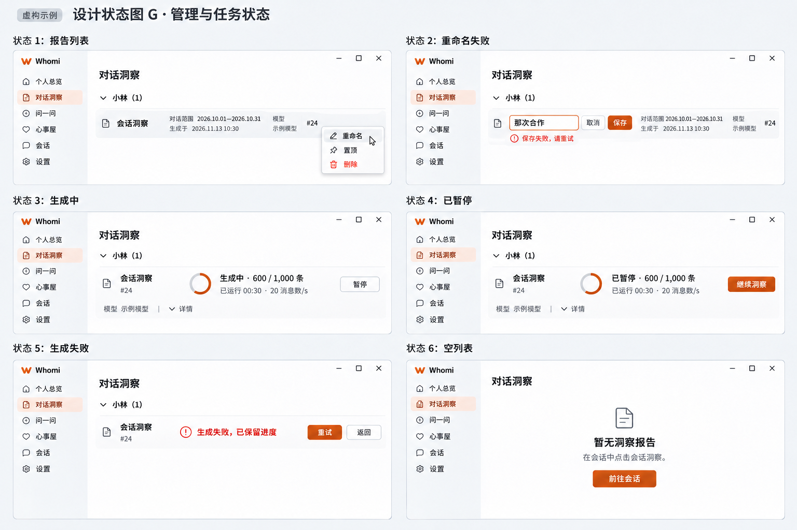

# 对话洞察：落实已确认设计与界面验收基线

GitHub 工单：[#11](https://github.com/StarryJia/whomi/issues/11)；2026-11-15 已发布。

**2026-11-15 实施回填：** 已按14份有效设计图实现并检查实际 Electron 窗口，覆盖正常、暂停、失败重试及960 × 640窄窗。头像与气泡、进度环问题已修复复查。逐图映射、37张实际截图与三项技能执行边界见[实施验证](../../../research/conversation-insights-validation.md)；下方为发布时设计要求。

规划编号：I01。首期七类主要界面已有设计图；本工单维护设计依据和交付约束，不重新组织一轮选图。静态设计已确认，功能实现与真实页面验收仍待完成。

## 使用场景与目标

以下为虚构场景：用户在小林会话点击会话洞察，选择十月范围并开始分析；生成后在报告中点击那次汇报准备，查看原文再回到原阅读位置。实现者需要从同一套图和规则完成这条路径，避免从历史候选恢复全局新建入口、重复选择本人或更早/更晚按钮。

## 已确认设计及所属工单

所有图片中的人物、日期、报告编号、正文及统计均为虚构示例。图外方案名称、状态标题和说明不进入应用；全局外壳继续遵守现有产品规范。

| 界面 | 当前设计依据 | 实施工单 |
|---|---|---|
| 会话内启动与范围检查 | [日期范围正常态](../../../designs/conversation-insights/assets/startup-current-conversation-v2.png)、[全部记录／日期错误／空范围／无模型](../../../designs/conversation-insights/assets/startup-scope-states-v1.png) | [I05](05-report-interface.md) |
| 未选择本人入口提醒 | [本人选择](../../../designs/conversation-insights/assets/startup-self-required-v1.png) | [I05](05-report-interface.md) |
| 生成进度 | [收起](../../../designs/conversation-insights/assets/progress-collapsed-v1.png)、[展开](../../../designs/conversation-insights/assets/progress-expanded-v1.png)、[暂停／失败／完成](../../../designs/conversation-insights/assets/progress-task-states-v1.png) | [I05](05-report-interface.md) |
| 报告管理 | [G管理方案](../../../designs/conversation-insights/assets/management-g-v2.png)、[生成中详情](../../../designs/conversation-insights/assets/management-task-details-v1.png)、[首次读取与失败](../../../designs/conversation-insights/assets/management-list-read-states-v1.png) | [I05](05-report-interface.md) |
| 报告阅读与改名 | [阅读页A](../../../designs/conversation-insights/assets/report-reader-a-v2.png)、[原位改名与失败](../../../designs/conversation-insights/assets/report-reader-rename-v1.png) | [I05](05-report-interface.md) |
| 引用原文 | [弹窗V2](../../../designs/conversation-insights/assets/source-dialog-v2.png)、[自由浏览／读取失败](../../../designs/conversation-insights/assets/source-dialog-states-v1.png)，后者仅上方两格有效 | [I06](06-source-dialog.md) |
| 删除已完成报告 | [删除确认](../../../designs/conversation-insights/assets/report-delete-confirm-v1.png) | [I05](05-report-interface.md) |

报告阅读基线：



管理布局基线：



## 实现约束

- 导航入口仍叫对话洞察；每个会话原整理成记忆位置改为会话洞察。报告默认名称固定为会话洞察，支持手动改名，不让模型生成名称。
- 本人未确认时在点击会话入口即拦截；成功保存本人后回原聊天，再点击才进入范围和模型设置。报告列表与历史报告阅读不受本人或模型配置限制。
- 报告采用关于你、你们的相处两节，具体经历文字本身作为原文入口。生成分析中的对方用 ta，原始聊天与发送者保持原样。
- 进度显示消息覆盖、有效运行时间、消息数/s及只读模型配置；不显示算法阶段。输入输出和缓存用量在详情中，消息处理完不等于报告已保存。
- 原文只读，滚动自动加载相邻消息；上一段在右上、下一段在右下，没有相关片段文字。正常关闭恢复报告位置和入口焦点。
- 删除一份报告保留聊天和其他报告；新增或删除报告同步个人总览。删除整个会话则关联删除报告，失效阅读页和弹窗退出到有效列表或既有空态。

## 同布局状态与历史图边界

首批无进度、暂停或重试过渡、其他任务详情、重命名保存中、本人读取或保存失败、已有列表刷新失败及普通窄窗，复用已选布局和组件，补齐行为并做运行验收，不设逐张补图门槛。例：列表已有两份报告时刷新失败，应保留两行并提供重试，不套用无数据的整页失败画面。

名称长度与空白处理、保存中取消或离页、失败行返回目标等尚未定的行为，由 I05 在实施前明确。只有现有布局无法承载且改变实际操作的差异才重新讨论。

历史整图及原文四状态下方两格不作为实现依据，具体清单见[设计清点表](../../../designs/conversation-insights/design-inventory.md)。当前正常业务没有单条消息编辑、删除或替换后仍保留报告的流程，不为该假设增加页面。个人总览本期只要求数据联动；问一问和心事屋保持独立计划。

## 待办与验收

- [x] 各实施工单已附固定版本的当前设计图及适用状态，发布后链接检查通过。
- [x] I05、I06 的主要流程已在正常 Windows 用户环境复测，覆盖正常、取消、失败恢复及 960 × 640 窄窗。
- [x] 核对侧栏「对话洞察」、工具栏「会话洞察」、本人检查时机、默认报告名、进度字段和原文跳转。
- [x] 总览已打开时新增报告会增加来源，单份删除保留其他报告和聊天，整会话删除退出失效报告或原文并撤回来源。
- [x] 对照仅使用当前有效图，历史候选和原文状态图下方两格留档。

2026-11-18 验收记录包含图稿映射、18 张实机截图、修复复查和待验证的补充状态。首轮桥接用例超时，保留原始日志，后续完整复测 6 项通过。 [桌面验收记录](../../../research/conversation-insights-design-baseline-20261118.md)

## #28 定向复核与验收要求

以下是修改前在 Windows 桌面用提交 `8118b16` 和合成会话确认的验收要求。删除确认和原文重试使用 960 × 640 窗口，侧栏分页使用 1280 × 900 窗口。[修改后的验收](../../../research/conversation-insights-design-baseline-20261118.md#28-修改后的验收)

- **删除前告知范围。** 在现有「删除会话」确认框的删除清单中明确列出「此会话的全部洞察报告」。例如小林有两份报告，用户在选择「取消」或「确认删除」之前就能读到两份都会被删除。实测确认框列出了记忆成稿，遗漏了洞察报告。
- **删除后恢复侧栏。** 删除成功即移除对应会话。只有小林时，侧栏恢复为空会话列表并保留导入入口。有其他会话时，保留它们当前的顺序与置顶状态。用户无需为此次删除再点「重试会话列表」。例如先后导入甲、乙、丙，删除乙后仍可打开甲和丙。分页时若删除已显示的第 100 条，原第 101 条仍可找到，迟到的列表结果不能重新显示已删项。删除请求本身失败时，保留会话、报告和原确认框供重试。
- **原文重试后继续阅读。** 用户用键盘重试第 2 段，成功后将焦点移到原文弹窗的「引用聊天记录」，保留刚定位的消息。验收时，在第二段下方还有消息的情况下，直接按一次 ↓ 就能往下读。关闭弹窗仍回到报告原来的引用入口。[定向桌面复测](../../../research/conversation-insights-design-baseline-20261118.md#28-两条路径的定向复测)

两条路径的信息顺序如下。出现错误时沿用当前操作区。

```text
侧栏会话 → 删除会话 → 核对会话名和删除范围 → 取消 / 确认删除
报告引用 → 当前聊天与计数 → 下一段 → 读取失败 → 重试 → 阅读目标片段
```

| 用户所处步骤 | 等待、取消或失败时看到什么 | 成功后怎样继续 |
| --- | --- | --- |
| 在侧栏删除会话 | 确认框默认聚焦「取消」。取消后回到原行。正在删除时防止重复提交，删除失败保留确认框、会话和报告，可原地重试 | 移除该会话及报告，撤回其总览来源。失效报告退出到有效列表或原有空态，分页继续可用 |
| 从报告打开原文 | 首次等待显示正在读取，失败可重试或关闭。若上一个引用的响应迟到，继续显示当前引用 | 初次成功定位精确证据，关闭时恢复报告阅读位置与引用焦点 |
| 从原文第 1 段切到第 2 段 | 失败时第 1 段、阅读位置和 `1 / 2` 保留，聊天下方显示提示和「重试」 | 成功才更新为 `2 / 2` 并定位第 2 段。键盘重试后直接按 ↓ 可继续阅读 |

| 操作顺序 | 用户此刻关心什么（示例） | 判断依据 |
| --- | --- | --- |
| 看到删除确认框 | 「我在报告列表里保存的两份报告也会消失吗？」 | 确认前即可读到「此会话的全部洞察报告」 |
| 删除后继续看侧栏 | 「甲和丙还在原来的位置吗？」 | 其余会话的相对顺序和置顶保留，原先在下一页的会话仍可打开 |
| 原文翻页暂时失败 | 「我刚读到哪里？重试会打开哪一段？」 | 第一段保留，重试成功显示第二段，方向键可继续读聊天 |

## 必用界面技能与证据

- **impeccable**：依据选定图和已有组件系统实现，记录每页采用的图与状态。
- **ui-ux-pro-max**：核查桌面应用中的表单、交互、键盘焦点、对比度及窄窗，记录实际步骤与结果。
- **design-review**：对应页面实现后审查真实运行截图，修复后复查，保留前后截图及未验证项。由 I05、I06 交付，不为本设计工单提前开发页面。

新增或修改图稿仍使用 design-shotgun，并沿用逐页讨论流程；共同要求见[界面技能约定](../../../designs/conversation-insights/ui-skill-workflow.md)。

## 依赖与实施定位

依赖 [I00](00-tracking.md) 的功能范围；设计交付给 [I05](05-report-interface.md)、[I06](06-source-dialog.md)，完整验证由 [I07](07-validation.md) 跟踪。先读取 PRODUCT.md、DESIGN.md，设计资产位于 docs/designs/conversation-insights/。本期为 Windows 桌面，不扩展移动端或另造全局导航。

## Implementation Tasks

以下三项已在第 28 号合并请求的本地工作区完成并通过 Windows 桌面回归。[场景、截图与运行记录](../../../research/conversation-insights-design-baseline-20261118.md#28-修改后的验收)

- [x] **T1 · 整会话删除确认。** 清单列出「此会话的全部洞察报告」。取消后两份合成报告均可打开，删除失败后可在原确认框重试。
- [x] **T2 · 删除后侧栏与分页。** 删除唯一会话后侧栏保留导入入口。删除首屏末项或列表中间项，其余行保留顺序与置顶，原第 101 条可正常翻页打开。迟到的列表结果会过滤已删项。
- [x] **T3 · 原文键盘重试。** 在 960 × 640 窗口重试成功后显示第二段与 `2 / 2`，直接按一次 ↓ 即向下滚动。按 Escape 回到报告引用入口。

## Design Review Completion Summary

评分只衡量上述两条路径的方案是否足以实施、验收。提交 `8118b16` 的实测行为见定向复测记录。

| 审查维度 | 评审前 → 明确要求后 | 依据 |
| --- | --- | --- |
| 初评 | 8/10 | 七类界面已有 14 份有效设计图，本次仅审删除与原文读取失败 |
| 1 信息层级 | 7 → 10 | 会话名称、全部报告的删除后果、确认操作按决策顺序呈现 |
| 2 操作状态 | 6 → 10 | 区分两类失败。补齐空侧栏、分页末项和重试后的阅读行为 |
| 3 用户路径 | 8 → 10 | 用户确认删除后可继续浏览其余会话，原文翻页失败后可从第一段继续读到第二段 |
| 4 视觉表达 | 10 → 10 | 桌面操作界面沿用会话行、确认框、只读聊天和单行反馈，七类通用模板问题均未命中 |
| 5 设计规范 | 10 → 10 | 复用既有字体、主题颜色、焦点和模态组件。原文状态图只参照上方两格 |
| 6 窄窗与无障碍 | 6 → 10 | 定义 960 × 640 键盘重试后的焦点、滚动及关闭返回。实测覆盖键盘，读屏软件表现尚未实测 |
| 7 待定设计 | 3 项已决定，0 项暂缓 | 删除告知、侧栏恢复、原文重试后的键盘操作 |
| 整体（维度 1–6 最低分） | **6 → 10** | 实现与复测见 T1–T3 |

**已有设计与组件。** 遵循 [Whomi 设计原则](../../../../DESIGN.md)、第 11 号工单既有图稿及原文弹窗。删除确认复用现有安全默认按钮，空态沿用「暂无洞察报告」，原文错误和重试留在聊天区下方。主题沿用 `--surface`、`--text`、`--line`、`--focus`。

**视觉核查。** 首屏可见 Whomi 标识。确认框或引用消息是当前视觉重点，标题足以区分删除和阅读，各区域职责独立。现有对话框和提示行足以承载两条路径。静态提示可避免推移聊天，标题、边界与遮罩在去掉装饰阴影后也能标明当前操作。

**范围与证据。** 本次复用已确认图稿，新生成与新批准图稿均为 0。手机端、其他五类界面和规划中的全局异常提醒沿用各自已有范围。独立外部复核按用户选择跳过。未新增独立待办提案。后续验证以三个实施任务为准。

## GSTACK REVIEW REPORT

| Review | Trigger | Why | Runs | Status | Findings |
| --- | --- | --- | --- | --- | --- |
| CEO Review | `/plan-ceo-review` | 产品范围 | 0 | 无记录 | — |
| Outside Review | Claude Code / 设计阶段 | 独立意见 | 0 | 用户选择跳过 | 仅当前 Codex 会话审阅 |
| Eng Review | `/plan-eng-review` | 工程方案与测试 | 0 | 无记录 | 尚未审查 T1–T3 的工程方案 |
| Design Review | `/plan-design-review` | 两条操作路径 | 1 | 方案已明确 | 6/10 → 10/10，3 项设计决定 |
| DX Review | `/plan-devex-review` | 开发者体验 | 0 | 无记录 | — |

**OUTSIDE COVERAGE**　按用户选择，设计阶段仅由当前 Codex 会话审阅。

**VERDICT**　两条路径的三项设计要求已通过本地实现与回归。表格记录的是 2026-11-18 的设计审查。

NO UNRESOLVED DECISIONS
