# 对话洞察：实现会话内启动、进度、报告管理与阅读

GitHub 工单：[#15](https://github.com/StarryJia/whomi/issues/15)；2026-11-15 已发布。

**2026-11-15 实施回填：** 已实现会话内入口、范围设置、本人和模型检查、进度、暂停重试、管理列表及阅读页。名称裁去首尾空白，最多80个Unicode字符；Enter保存、Escape取消，保存中锁定重复操作与离页，失败保留输入。失败行回原会话任务，另有再次洞察入口选择新范围，不自动启动。80字标题与长报告在960 × 640窗口已实测，见[实施验证](../../../research/conversation-insights-validation.md)；下方为发布时验收要求。

规划编号：I05。以下图稿和明确交互已确认；功能尚未实现。范围包括启动、进度、管理、阅读、改名、删除和个人总览同步，原文弹窗由 [I06](06-source-dialog.md) 实现。

## 使用场景与目标

以下均为虚构示例。用户在小林会话分析十月聊天，查看生成进度；报告保存后阅读关于你和你们的相处，手动改名为那次合作，并点击经历核对原文。若删除这份报告，聊天和其他报告保留，个人总览撤回该报告的贡献。

当前记忆入口缺少新报告的日期范围、手动名称及精确引用流程。本工单使用已有会话、模型选择、成员选择、列表和共享弹窗能力接入新洞察数据，不从头另造管理界面。

## 1. 会话内启动与本人检查

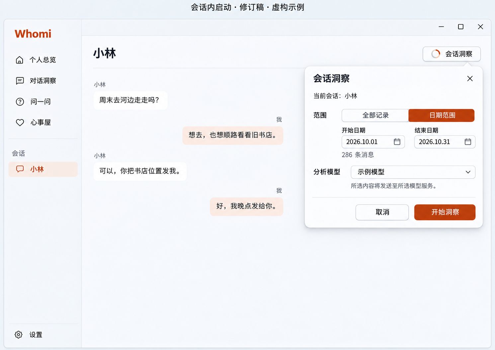

- 原整理成记忆位置改为会话洞察，只作用当前会话；不提供联系人切换，也不在管理列表或阅读页新增全局新建入口。
- 本人已确认时直接打开范围和模型浮窗；全量和日期范围可选，日期范围提供起止日期和实际消息数。
- 模型在开始前确认，复用已有模型搜索、分组及按能力显示的思考强度；范围和模型配置不强制增加上下文、输入、输出容量必填项。
- 所选内容发送至所选模型服务的提示只出现一次。洞察不使用检索增强生成，不承诺此操作构建未来问答索引。
- 取消或关闭回原聊天，保留阅读位置及入口焦点，不创建任务或请求模型。

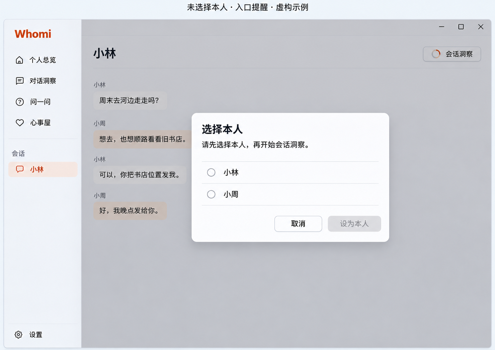

本人检查发生在打开范围浮窗之前。未确认时直接复用选择本人弹窗，提示请先选择本人，再开始会话洞察，不叠加第二个提醒框。

- 只接受当前会话已成功保存的本人确认；来源推测、仅选中未保存、保存失败或另一会话的选择均不放行。
- 读取中、读取失败或没有成员时不放行，复用现有读取、重试及保存错误反馈；失败保留已选成员。
- 成功保存本人后回原聊天，用户再次点击会话洞察才打开范围设置，不自动开始分析。取消或 Escape 关闭仍回原聊天。
- 不改变进入会话时已有的本人确认行为；实际创建任务仍做后端本人校验。列表与历史报告阅读不受该门槛限制。

示例：小林会话中小周仅有来源推测标记。点击会话洞察先选小周并保存，返回聊天后再次点击才进入范围设置；保存失败时不能提前创建任务。

## 2. 范围与模型异常

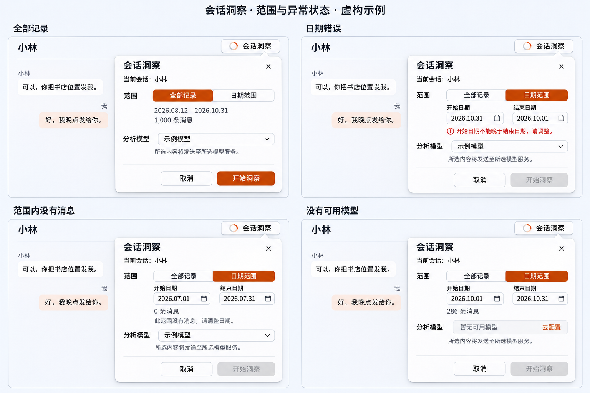

| 状态 | 示例输入与反馈 | 行为 |
|---|---|---|
| 全部记录 | 实际范围2026.08.12—2026.10.31、1,000条 | 隐藏可编辑日期栏，可开始；后续导入不扩大本次已保存范围 |
| 日期错误 | 开始2026.10.31，结束2026.10.01 | 保留输入并就近提示修改；禁用开始，不显示0或旧消息数 |
| 合法空范围 | 2026.07.01—2026.07.31、0条 | 提示调整日期，输入框不标格式错误，禁止开始 |
| 无可用模型 | 十月范围286条，暂无可用模型 | 提供去配置；返回保留会话与范围，选好模型后手动开始 |

所有状态保留取消和关闭。范围采用 [I02](02-scope-storage.md) 定义的日期边界与来源快照，计数和真正送入分析的材料一致。没有可用模型只阻止生成，不阻止查看已有报告。

## 3. 生成进度、统计与任务控制

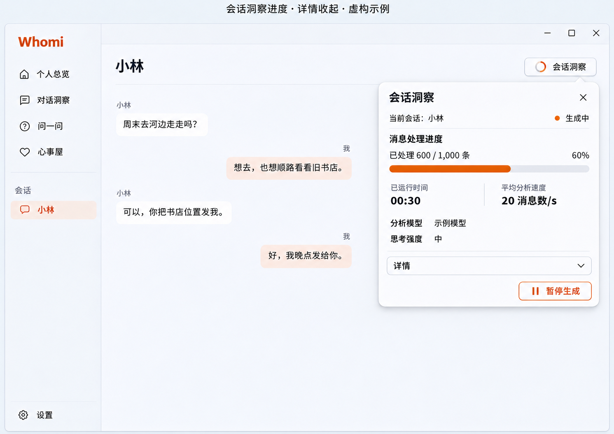

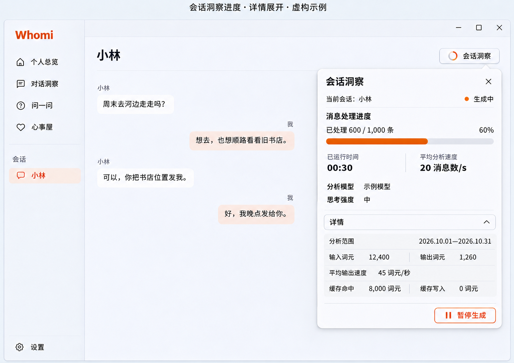

| 位置 | 显示内容与口径 |
|---|---|
| 默认摘要 | 首次处理且已保存的去重消息数／总消息数、累计有效运行时间、平均分析速度、只读模型与思考强度 |
| 分析速度 | 去重覆盖消息数÷有效运行秒数，单位消息数/s，s表示秒；回读不增加覆盖数，暂停及未运行间隔不计时 |
| 展开详情 | 分析范围、输入与输出词元、平均输出词元/秒、服务返回的提示词缓存读取与写入词元 |
| 统计边界 | 输入总量已包含缓存，不重复相加；缺失统计显示未知，不能填0；首批没有有效速度显示— |
| 隐藏内容 | 不展示阅读、核查、成稿等算法阶段、核查事项计数或累计模型请求耗时 |

平均输出速度沿用累计模型请求耗时作为分母，不能使用任务有效运行时间代替；请求耗时本身不展示。模型请求等待属于任务仍在运行的时间，暂停或失败后等待用户操作不计入。

示例：600条／30秒显示20消息数/s；输入12,400、输出1,260、缓存读取8,000、缓存写入0。输出速度45词元/秒来自1,260÷28秒请求耗时，缓存写入0须来自服务明确返回；这些示例值不能硬编码。

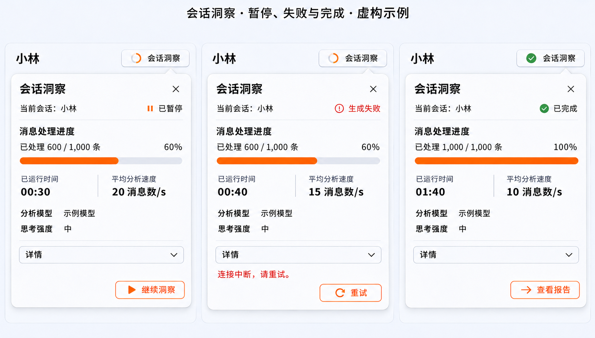

- 关闭仅收起浮窗，不暂停、恢复或删除任务；重新打开显示真实状态。
- 暂停确认后冻结有效运行时间和均速；继续洞察恢复同一任务及已保存进度。
- 重试已有任务沿用其保存状态，不创建重复报告。尚无首批保存不能宣称已保留分析进度；任务创建前失败不能假装有旧任务可恢复。
- 暂停或重试请求进行中防止重复操作，实际完成转换后才显示新状态。失败提示按实际原因给出操作，不能把所有失败写成连接中断。
- 消息达到N／N仅表示覆盖完成；报告保存成功后才显示已完成和查看报告。保存失败仍为生成失败。
- 暂停、失败、完成的展开详情及过渡反馈复用已选结构，按真实字段验收，不另设选图门槛。

示例：600条时暂停，30秒和20消息数/s保持不变；恢复后发生请求失败，有效时间累计至40秒，均速为15。报告最终保存后显示1,000条、100秒、10消息数/s。失败停留时间不继续增加。

## 4. 报告管理与列表读取

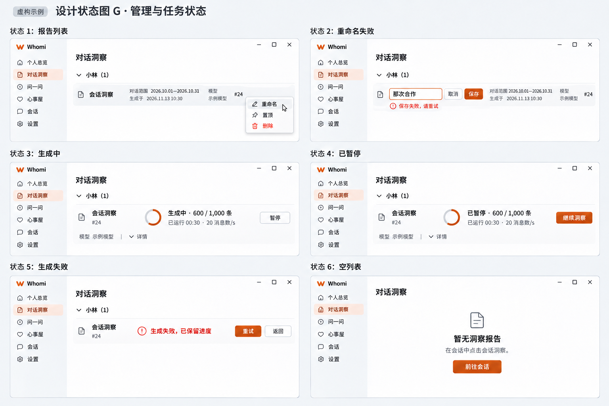

- 按来源会话分组并可收展；紧凑报告行显示名称、实际范围、生成完成时间、模型与编号。同名报告通过编号和范围区分，不相互覆盖。
- 保留右键重命名、置顶、删除及既有拖动排序；不新增搜索、筛选或排序下拉框，不增加全局新建入口。
- 右键重命名在当前行编辑；失败保留输入，取消和保存可用。成功后列表与阅读页同步，重启仍保留。
- 点击已保存报告整行进入主区阅读页，返回恢复分组收展、列表位置及入口焦点。
- 生成中、暂停、失败摘要使用同一统计口径；暂停、继续和重试只操作对应任务。尚未保存的任务不提供最终报告阅读。
- 空列表显示暂无洞察报告和前往会话，后者只导航，不创建任务或弹配置。列表不要求先选本人或模型。
- 完成报告行已在G图设计；生成任务转为完成行是需要验收的状态转换，不是缺少新页面。

示例：小林分组内十月#24和九月#23均叫会话洞察。对#24改名、置顶或重试均不能操作#23；无可用模型时仍可打开#23。

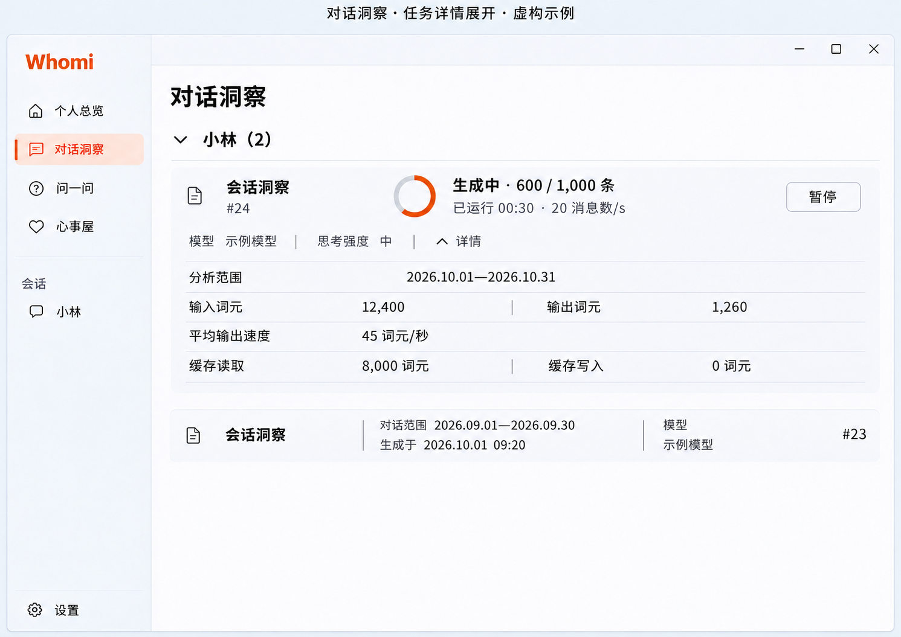

详情只展开当前任务的已记录信息，不重置任务、范围、进度或运行时间，不新增模型请求。详情和暂停按钮不得触发父行打开报告。模型、运行时间、分析速度不在详情重复显示。生成中的#24没有完成生成时间，已保存的#23展示自己的实际完成时间。

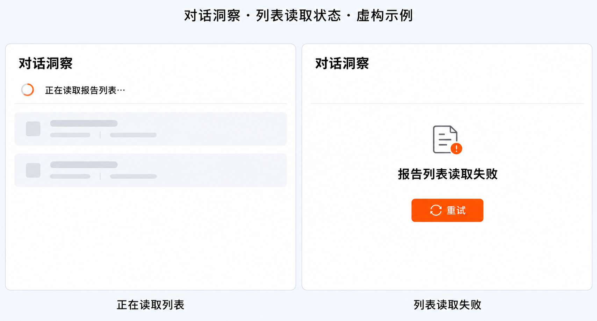

- 尚无可展示数据时初读显示状态与两条占位骨架；骨架不代表真实数量，不可交互、不作为报告朗读。
- 首次读取失败显示报告列表读取失败和重试，不显示暂无报告、生成失败或未经核实的网络归因。
- 只有成功读取且返回空结果才显示空列表。已有列表或初读期间收到有效任务数据时保留数据，刷新失败在原列表内反馈并允许重试。
- 重试只读取报告列表，防止重复请求，不调用模型、不创建或恢复任务、不修改删除报告。状态和错误可播报，焦点不落到占位元素。
- 报告读取使用现有loading/error/retry与listAnalyses；会话列表的listLoading/listError/retryList不能误接。技术字段不显示给用户。

## 5. 报告阅读与手动改名

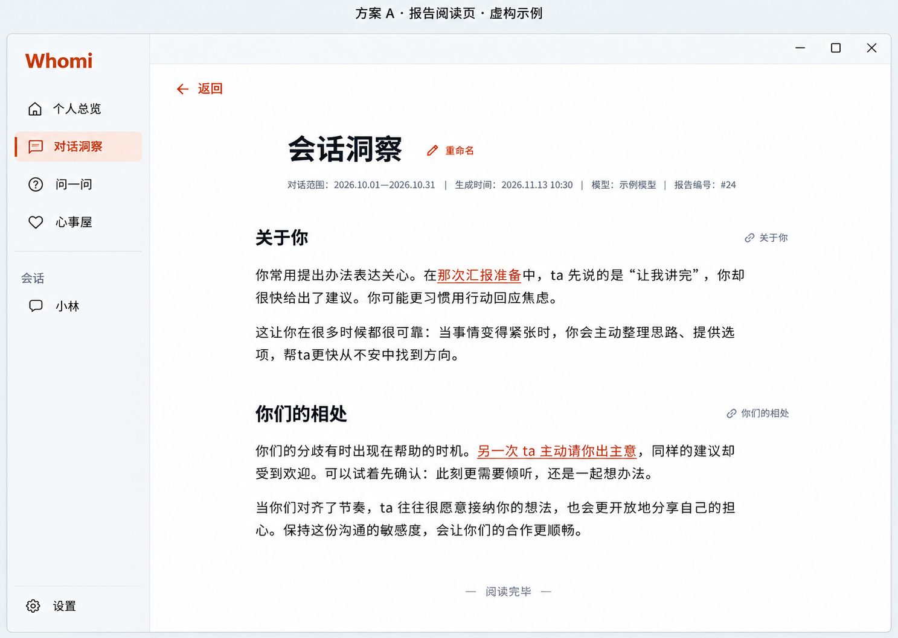

- 主区使用单列长文，只有关于你和你们的相处两节；共同经历融入分析，不新增独立回忆散文。
- 左上角为返回及箭头，右上角无新建报告。侧栏名称为对话洞察，报告默认标题由程序固定为会话洞察，全量与日期范围相同，不依赖模型命名。
- 标题旁保留重命名；分析范围、完成时间、模型和报告编号独立展示，使用已保存的真实元信息。
- 生成叙述对方统一用ta，不把原始聊天和发送者改写为ta。
- 具体经历文字采用链接形式，激活后以经过校验的引用编号打开I06原文弹窗；可键盘操作，不接受模型任意网页链接。
- 正文按可用宽度自然换行，主区纵向滚动；不缩小字号塞满一屏，不增加横向正文滚动，未到末尾不显示阅读完毕。

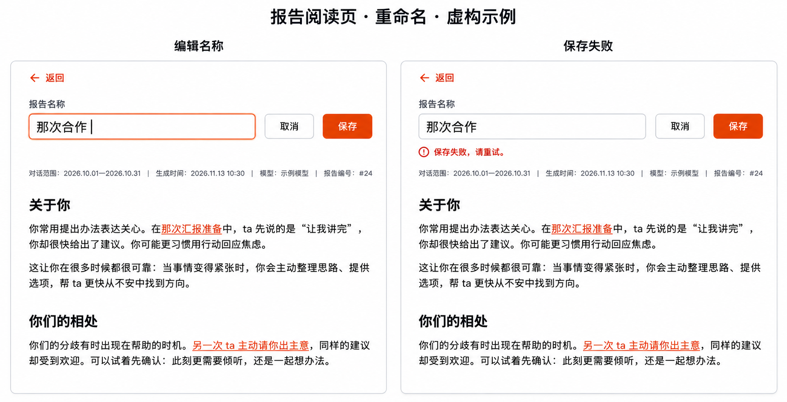

进入编辑时预填已保存标题并聚焦。取消放弃草稿、恢复原标题与重命名入口焦点；保存失败保留草稿和编辑态，列表仍显示旧名称，不将一般保存错误画成名称内容非法。成功后两处同步、退出编辑并恢复入口焦点。请求进行中防重复提交。

改名只改显示名称，不改变范围、编号、时间、模型、正文、来源或引用，不请求模型。同名不覆盖。示例：#24改为那次合作失败后，输入仍在，列表仍是会话洞察；成功后两处才更新。

## 6. 删除报告与个人总览同步

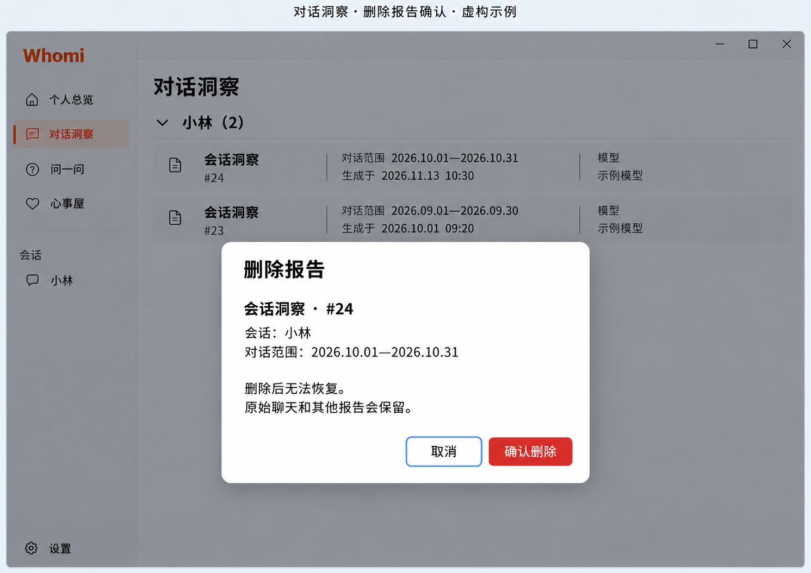

本图只定义删除一份已完成报告，不扩展批量删除、撤销或进行中任务删除流程。采用目标已保存的名称、编号、会话与实际范围，显示删除后无法恢复、原始聊天和其他报告会保留。

- 初始焦点在取消。未提交时取消、Escape或遮罩关闭均不删除，恢复原报告行焦点与列表位置。
- 确认后按稳定编号调用既有删除能力，不请求模型。提交中显示正在删除…，禁止重复提交及关闭，不提前移除报告。
- 删除失败在原弹窗保留目标与报告行，恢复取消和确认操作，可针对同一编号重试。
- 成功后删除目标及其分析任务、进度和用量记录，聊天和其他报告保留。更新数量，焦点转下一可见行；没有行时落到可见分组或页面标题，不能聚焦删除或隐藏条目。
- 复用DeleteListItem及共享弹窗的居中、主题焦点和危险按钮样式，图中插图偏移及蓝色焦点边框不覆盖共享规范。

示例：#24为十月、#23为九月，两者同名。打开#24删除弹窗时背景仍保留两份；取消不变，成功后仅#24移除。

**报告新增和删除必须同步个人总览：**

- 报告成功保存为完成结果才纳入总览；生成中、暂停、失败及未保存结果不计入。同一报告重复通知或重试不重复贡献。
- 删除成功撤回该报告的贡献，依据剩余有效报告重新计算；只由已删除报告支持的判断不再出现，其他报告的依据保留。
- 取消或明确删除失败不撤回贡献；改名仅同步显示名，不改变分析贡献。已打开总览、重新进入和重启后的结果须一致。
- 删除最后有效来源后使用既有无有效洞察状态，不保留旧判断，也不伪造中性人格数值。
- 删除整个会话时关联删除其聊天、全部报告及总览贡献；退出已失效阅读页或原文弹窗，到有效列表或既有空态。其他会话不受影响，迟到结果不能恢复已删除内容。
- 新报告总览来源契约由I02和I04定义，不能将新分析文本硬塞成旧人格投票。事务、重复事件和缓存一致性由I02及I07验收。

示例：总览依据#23和#24形成判断，删除#24后仅用#23重算；并非要求每项数值都变化，而是不能保留只由#24支持的结论。删除整个小林会话后两份来源均撤回，小李会话依据保留。

## 实施前补齐的行为规则

以下属于已有布局的规则细化，不是缺图或重新选方案：

- 名称长度上限、首尾空白处理、空名称反馈、快捷键、保存中取消与离页。当前建议空白不提交并提示请输入报告名称；实施前统一列表和阅读页规则并记录，不视为已批准的具体参数。
- G图生成失败行返回按钮的目标。实施前结合当前导航明确，不能从示例按钮自行推定。
- 首批无统计、暂停和重试过渡、其他任务详情字段及已有数据刷新失败的反馈位置。复用选定结构，核对零值、未知值和真实运行状态。

普通窄窗沿用已有侧栏和窗口规则。例：在工作区足够大的显示器上，将窗口缩至960×640、默认展开240像素侧栏，正文与元信息换行且各操作可达；不新增移动端或强制改变侧栏模式。历史窄窗图仅供参考，不作为已批准布局。

## 实施与验收清单

- [ ] 接入当前会话入口、本人前置检查、全量／日期范围及模型配置返回；验证取消和失败均不创建任务。
- [ ] 按范围快照核对消息计数，覆盖非法日期、合法空范围、无模型与本人未保存；已保存报告仍可浏览。
- [ ] 按真实统计渲染收起／展开进度及三种任务状态，验证去重、暂停计时、同任务重试和N／N未保存不完成。
- [ ] 接入G列表、分组、右键管理及详情；验证完成转换无重复行，详情和暂停不触发父行打开。
- [ ] 区分初读、空结果、初读失败和已有数据刷新失败，保留有效列表；重试不调用模型。
- [ ] 渲染两节正文、固定默认标题和手动改名；验证取消、失败保留、两处同步、同名隔离和重启持久化。
- [ ] 经历文字可用键盘打开I06，关闭恢复位置；返回恢复列表分组、位置及焦点。
- [ ] 删除确认核对准确目标；验证取消、提交防重、失败原地重试和成功后焦点。
- [ ] 报告成功新增、单份删除及整个会话删除均联动总览；验证重复通知、失败、最后来源删除、缓存刷新和重启。
- [ ] 在普通窄窗验证正文、浮窗、列表、改名及原文往返，无横向溢出或不可达操作。
- [ ] 保留历史报告读取能力；问一问和心事屋保留入口，功能按各自独立计划推进。
- [ ] 所有当前有效图落实到真实运行截图；未实现或未运行项目明确记为未验证。

## 必用界面技能与证据

- **impeccable**：按已选启动、进度、报告A、管理G和既有组件系统实现，保存图稿与实际页面的对照。
- **ui-ux-pro-max**：检查表单、本人拦截、改名错误、右键菜单、键盘焦点、对比度和桌面窄窗，记录尺寸、步骤与结果。
- **design-review**：实现后审查真实页面，修复后复查，附修复前后截图及未验证项；静态选图不代表运行审查通过。

如确需新增图稿继续使用design-shotgun；共同流程见[界面技能约定](../../../designs/conversation-insights/ui-skill-workflow.md)。例如改名失败后，需在实际窗口核对输入仍在、焦点可追踪，并保存修复后的审查证据。

## 依赖与实施定位

依赖 [I01](01-page-design.md) 设计基线、[I02](02-scope-storage.md) 范围与报告契约、[I04](04-reading-analysis.md) 生成结果；原文交互协作 [I06](06-source-dialog.md)，验证协作 [I07](07-validation.md)。

计划新增：src/components/insights/insight-article.tsx、insight-scope-fields.tsx、insight-report-menu.tsx。复用和修改：App.tsx、memory-library.tsx、conversation-ai/workspace.tsx、conversation-ai-client.ts、conversations.tsx、ui/managed-row.tsx。完整接口及任务步骤见[实施计划](../../../superpowers/plans/2026-11-13-conversation-insights.md)。

图片仅采用本工单所附当前设计，历史整图不inline作为实现依据，完整适用边界见[设计清点表](../../../designs/conversation-insights/design-inventory.md)。真实云端分析试验不包含在本次发布工单操作中。
