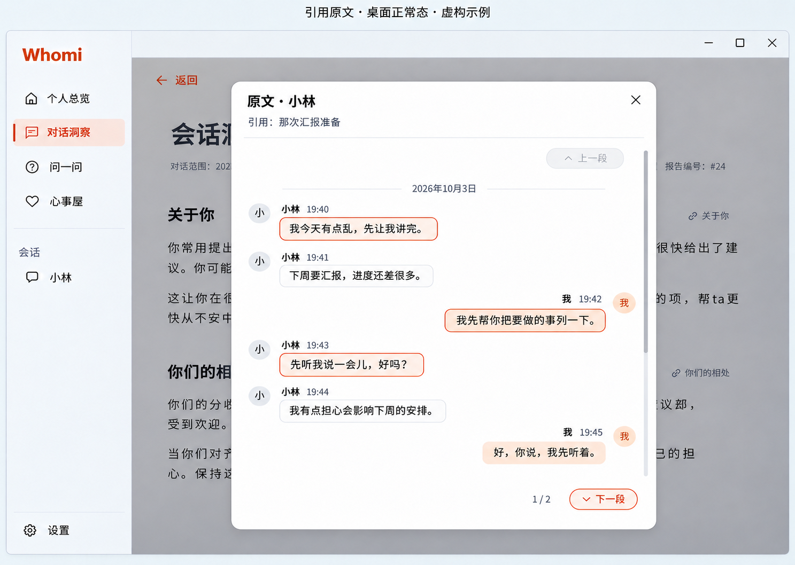
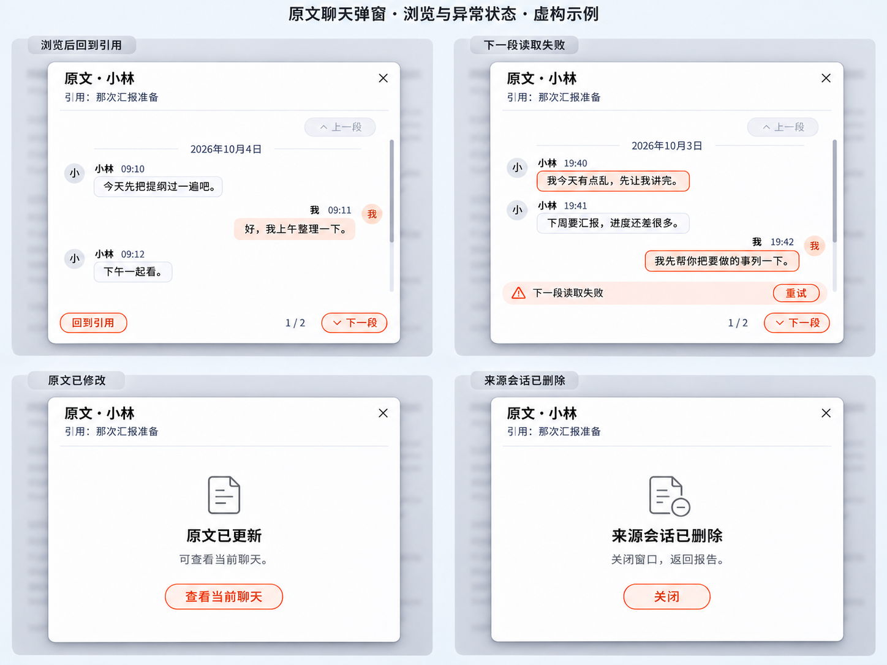

# 对话洞察：在聊天弹窗回看引用并切换片段

GitHub 工单：[#16](https://github.com/StarryJia/whomi/issues/16)；2026-11-15 已发布。

**2026-11-20 本地验收**　已用 Windows 桌面复验精确高亮、双向分页、切段与重试、原位关闭，以及删除来源后丢弃迟到响应。长会话名窄窗的修复前后截图、失败记录和复验结果见[工单验收记录](../../../research/conversation-insights-issue-16-20261120.md)。以下保留发布时的需求与历史状态。

**2026-11-15 实施回填：** 已实现独立只读原文弹窗、精确证据高亮、滚动自动前后分页、片段跳转、失败保留与重试。实际分页锚点位移为0像素，关闭后恢复报告滚动与引用焦点。快速关闭后的迟到响应尚未做真实桌面复验，见[实施验证](../../../research/conversation-insights-validation.md)；下方为发布时验收要求。

规划编号：I06。采用已确认的原文 V2、滚动加载、上下分置的片段按钮、自由浏览回到引用及下一段临时读取失败状态。

## 使用场景与目标

以下为虚构场景：用户点击报告中的那次汇报准备，弹窗定位十月三日原文。上下滚动自动加载相邻聊天，点击下一段直接定位十月十日证据。报告仍存在时，关闭回到同一阅读位置。

现有聊天阅读器绑定会话工作区，直接嵌入会带入其他流程。本工单复用只读消息呈现，建立独立的引用定位、分页及恢复状态，不添加问答或发送能力。

## 已确认设计

- 只读弹窗显示原文会话、引用短语与关闭入口，无发送框、问答或生成入口。
- 按[I02](02-scope-storage.md)的精确来源编号高亮证据；普通上下文保持普通样式。例：19:40、19:42、19:43是证据，夹在其中的19:41不得一起高亮。
- 接近已加载消息上下边缘时自动加载对应方向；插入后保持正在阅读的消息位置，无更多记录后停止请求。没有查看更早或更晚按钮。
- 上一段在聊天区右上，下一段在右下，留出空间不遮挡消息；首段禁用上一段，末段禁用下一段，不循环。下一段旁显示简洁的1／2计数，不显示相关片段文字。
- 按引用绑定的片段直接定位；上下滚动只读取当前时间附近的聊天，两种操作互不替代。允许用户浏览同会话分析范围外的上下文，不改变报告范围或调用模型。
- 离开当前引用位置后显示回到引用；初次已定位状态不显示该入口。正常关闭恢复报告阅读位置及经历链接焦点。
- 原始消息和发送者不因报告的ta称呼规则而改写；弹窗开启时隔离后台导航与焦点。

**下图仅上方两格作为当前实现依据。下方原文已修改、来源会话已删除后返回报告两格已移出首期，不得按其实现。**

| 有效状态 | 示例与结果 |
|---|---|
| 自由浏览 | 从十月三日第一段向后读到十月四日，计数仍为1／2；回到引用返回第一段，下一段仍定位十月十日 |
| 下一段临时读取失败 | 保留第一段聊天、阅读位置及1／2；重试仍指向第二段，成功定位后才改2／2 |

首次读取等待和首次读取失败复用此弹窗与已有反馈，不显示伪造内容；加载时允许关闭。下一段重试与再次点击下一段均针对同一未成功目标，防止重复请求。图片示例中未显示某条消息不改变真实证据集合，实际来源编号为准。

## 来源与删除边界

当前公开接口没有单条原文编辑、删除或全文替换入口。重新导入追加并去重，不替换旧正文；补全回复关系及修改本人确认不等于原文消失。因此不新增部分原文消失但报告保留的正常业务流程，历史图只在[设计清点表](../../../designs/conversation-insights/design-inventory.md)留档。

- 单独删除一份报告保留聊天和其他报告；删除整个会话关联删除聊天、全部报告及其个人总览贡献。
- 删除成功后，如仍处于已失效报告或弹窗，退出到有效报告列表或既有空态，不能返回已删除报告、恢复其链接焦点。
- 关闭弹窗、切换引用或删除来源后，丢弃失效请求结果；迟到响应不得跳错引用、重开弹窗或恢复已删内容。
- 来源编号和有效性须校验。异常引用无法定位时显示简洁错误，不伪造原文，也不把缓存当作当前消息。
- 现有SourceWindow只有available／unavailable结果；首尾编号不存在或顺序非法都可能不可用，一次临时失败不能证明会话删除。根据实际删除成功状态和存储结果决定退出。

示例：小林会话有#23、#24，单独删除#24保留#23和聊天；删除整个小林会话则两份均不可打开，总览撤回两份贡献。删除前发出的原文请求随后返回，也不能再次显示内容。删除明确失败不提前移除报告或贡献。

## 本地验收清单 · 2026-11-20

- [x] 抽取只读消息呈现，独立管理引用定位和前后分页，不引入输入框或其他会话操作。
- [x] 校验来源编号后只高亮精确证据，19:41等普通上下文不因处在证据之间而高亮。
- [x] 滚动边缘自动加载，追加或前插不跳动，确认无更多记录后停止对应方向请求。
- [x] 上下段直接定位、首尾禁用、不循环；右上／右下按钮和计数不遮挡聊天。
- [x] 自由浏览保持当前引用计数，回到引用定位当前片段；切段成功后才更新计数。
- [x] 临时读取失败保留当前聊天与目标，重试正确片段并避免重复请求；首次失败可重试或关闭。
- [x] 加载时可关闭，快速切段和迟到结果不跳错目标或重开弹窗。
- [x] 正常关闭恢复报告位置及链接焦点；报告失效后退出到有效列表或空态，不恢复已删入口。
- [x] 删除会话后原文、关联报告及总览贡献保持一致；一次不可用结果不会误报整个会话已删除。
- [x] 普通窄窗完成定位、连续阅读、切段、关闭与失败恢复，按既有布局验收，不增加独立选图门槛。

## 必用界面技能与证据

- **impeccable**：按V2、有效的上方两状态和既有聊天样式实现，记录精确高亮及按钮布局对照。
- **ui-ux-pro-max**：核查滚动、片段跳转、键盘焦点、正常关闭、删除后退出及桌面窄窗，记录步骤和结果。
- **design-review**：实现后审查真实页面，修复后复查，保留前后截图和未验证项；历史无效状态不作为对照。

确需新增操作图时使用design-shotgun；流程见[界面技能约定](../../../designs/conversation-insights/ui-skill-workflow.md)。例如实际打开十月三日引用后关闭，确认仍停在报告原位置；若报告已删除则验证退出到列表，不能仅凭静态图宣称通过。

## 依赖与实施定位

依赖 [I01](01-page-design.md) 设计基线、[I02](02-scope-storage.md) 来源映射、[I05](05-report-interface.md) 报告入口；删除与总览联动协作 [I07](07-validation.md)。

弹窗使用 `insight-source-dialog.tsx`，与会话阅读器共用 `chat-message-content.tsx`。来源定位复用 `readInsightCitation`，邻近原文通过 `readMessages` 分页。删除边界沿用 `electron/data/db/purge.ts`。原计划见[实施计划](../../../superpowers/plans/2026-11-13-conversation-insights.md)。
