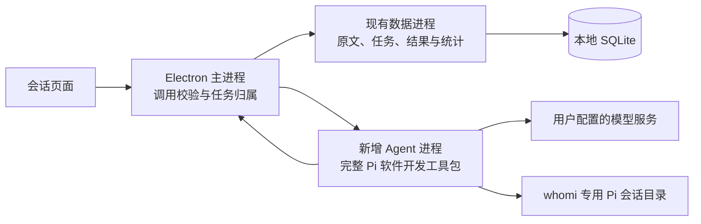

# 会话页面后端设计草案

日期：2026-10-30。状态：讨论稿，尚未批准实施。本文只记录设计，不安装依赖、不编写产品代码、不执行模型请求。现有会话界面及模拟适配器见[前端实现记录](../../designs/whomi-conversation-ai-implementation.md)。

本轮沿用用户确认的 main。文档更新前已执行 git status、git branch -vv、git fetch --all 和 git pull --ff-only；当前分支跟踪 origin/main，领先 7 个提交、落后 0 个。工作区已有本轮会话前端改动，保持原样。

## 1. 用户已确认的要求

- 采用完整 Pi 软件开发工具包，在 whomi 管理的独立后台进程中运行。
- 会话分析由用户在导入后选择启动，范围是某段已导入会话；后台结合会话内容生成人物画像结果，不产生交互，不加载用户安装的技能。
- AI 对话有两种输入方式：直接交流时加载相关用户画像；选择消息时加载画像、引用及对应技能，围绕具体情境沟通。用户技能只作用于主动 AI 对话。
- 画像、Spark 与问一问使用项目维护的固定提示词或内置技能。插件及其他 Agent 能力尚未确认。
- 会话分析和 AI 对话均需记录 token 用量及生成速度。token 是模型计量文本的单位。
- 点击会话分析先打开原位置的小浮窗；点击其中的确认按钮后才启动。模型配置页面统一说明材料如何交给模型服务，不在每次分析中重复提醒。
- 解惑统一更名为问一问，保留原问号气泡图标。分析菜单更名分析管理，更换现有曲线图标；个人总览更换为体现人格数据汇总的图标。具体建议分别采用任务清单和人物资料卡图标，尚未作为用户选定的图形。
- 分析管理用于查看各任务状态和结果，考虑每个任务单独一份总结报告；本轮不实现该页面。
- 完成态增加分析结果入口，按任务定位分析管理中的对应结果。建议解释为用户点击后直接定位该任务，而非任务结束时抢占当前页面，待确认。

上述导航和确认流程已在后续会话前端修订中实现，见[本轮审查](../../designs/whomi-conversation-review-20261030.md)；真实后台仍未实施。消息默认阅读，光标按钮开启选择，退出保留引用和草稿。结果入口预留按任务标识导航的回调；分析管理未开放时禁用并提示，不虚构跳转。旧文档中的解惑名称和禁止用户安装技能的早期范围，以本轮最新决定为准。

## 2. 页面范围与非目标

本设计覆盖消息引用校验、AI 对话运行及恢复、单会话分析任务、任务报告保存、统计、模型和已安装技能的读取接口。

不在本轮范围内：分析管理页面、Spark 和问一问生成业务、插件执行、自动发送原联系人消息、全库自动分析、完整技能商店、心理诊断或分析效果承诺。技能安装与管理保留此前方向，本页面只消费后台登记的可用技能版本，不借本次工作扩出安装界面。

例如，用户分析和小林的一段记录，后台只创建该会话任务。不会顺便读取另外十个会话，也不会为了生成独立报告再启动一遍内容相同的分析。

## 3. 复用与结构选择

已选 Pi 的决定不重新展开产品选型。本设计继续复用现有 Electron 主进程校验、独立数据进程、SQLite 本地数据库、稳定消息编号及定位接口。Pi 负责 Agent 执行、模型接入、会话上下文和事件；whomi 负责业务授权、任务状态和结果发布。

两种上下文保存方式：

| 方式 | 收益 | 代价与结论 |
|---|---|---|
| Pi 原生保存对话，数据库保存任务与展示索引 | 可复用原生历史、工具结果、压缩与恢复；减少自行重建上下文 | 需要处理 Pi 文件与数据库之间的崩溃一致性；本文推荐，仍待用户确认 |
| 数据库独占历史，每轮重建 Pi 内存会话 | 持久数据集中 | 必须自行维护工具历史、压缩和模型上下文兼容，长期维护量更大；不推荐作为默认 |

例如，对话经历两次工具调用和一次上下文压缩后，继续时由 Pi 原生会话恢复完整运行语义；界面仍从数据库读取提问、回答和任务状态，而不是解析原生会话文件绘制页面。

Pi 不直接打开第二个可写数据库连接。资料请求经主进程核对任务范围后交给数据进程；数据进程统一调度事务写入。界面不接触模型密钥。独立进程用于故障隔离，不等同于操作系统权限沙箱。

## 4. 模型配置与资料边界

不能只靠模型名称、服务商名称或接口地址确认推理发生在本机还是云端。例如，本机地址可能是转发远程模型的代理；远程地址也可能是用户自己的服务器。

采纳用户建议：模型配置页固定说明本次使用的提示词、画像及相关材料会交给所配置的模型服务，由用户确认服务地址与数据处理方式；分析浮窗只展示所选模型及服务归属，不进行本地／云端猜测，不重复弹出数据发送提醒。更换模型服务配置后，后续请求使用新配置版本；运行中的任务保持本次已确认版本。

模型的后台身份使用服务配置标识加模型标识，不能只用模型名称。同名模型分别属于本地服务和远程服务时，页面仍能区分。凭据在后台加密保存；利用 Electron 的系统加密能力时需先检查其可用性，不能把不可加密当成明文保存授权。具体支持的服务协议、默认模型、上下文容量和密钥配置界面另行确认，分析与对话不静默切换模型。

设计范围包括登记、更新和读取模型服务及凭据的最小后台接口，否则无法登记第一个真实模型。优先复用 Pi 已有服务适配，不自研模型协议；设置页面沿用已有独立设计，连接检测和已选模型归属由同一后台配置服务提供。首期验证只需一项可用配置，但必须在验收报告中写明实际验证的服务和协议，不能由单项通过推断所有服务兼容。

前端现有完整引用正文与 history 只用于开发适配，不作为正式可信协议。正式请求只提交已登记的线程、轮次、消息编号和模型／技能标识；后台重读原文、本人身份、画像和已保存历史。

例如，页面把会话甲的消息正文改成另一句话，后台仍读取甲中该编号的真实文本；如果消息编号来自会话乙，则拒绝作为甲的引用。消息编号始终用字符串传输，避免大整数精度丢失。

## 5. 分析确认与任务生命周期

### 5.1 先预览，再确认

第一次点击会话分析只进行本地准备：检查消息、本人身份和可用模型，生成短期有效的分析确认凭据，不调用模型。

小浮窗展示当前会话、本人、所选模型及本次消息数，提供确认分析按钮；关闭浮窗即放弃本次确认。空会话显示：巧妇难为无米之炊，先导入一些聊天记录吧。本人未确认时指向身份确认操作；无模型时指向模型配置，不创建任务。

确认凭据绑定会话、消息快照、本人身份版本及模型配置版本；后台消费凭据时再次校验。重复确认使用相同请求编号，不重复创建任务。凭据过期或身份／模型配置变化时重新准备，不擅自使用新配置。消息新增不改变已经显示的本次范围。

例如，确认浮窗显示 2,600 条，此后又导入 100 条；确认后本次仍处理原 2,600 条，后续任务才能包含新增部分。凭据只绑定快照，不能授予全库权限。

### 5.2 执行与恢复（建议）

任务状态为排队、准备、分析、汇总、完成、停止、失败或中断。Pi 结束一次模型响应不代表业务任务完成；最终结果校验和数据库提交成功后才发布完成事件。

建议首期每个会话最多一个活动分析任务；分析批次串行运行，用户对话优先于尚未开始的分析批次，避免同时发起大量模型请求。并发额度可由实施阶段基于运行验证确定，但不得改变单任务去重与状态一致性。

停止会取消在途请求并阻止后续批次；可靠保存的批次保留，晚返回结果不再发布。重新打开页面可查看任务；关闭浮窗不停止任务。退出应用时取消运行，重启将遗留活动任务标为中断，等待用户继续，不自动再次发送可能计费的请求。

继续从已可靠保存的批次之后执行；未提交批次重试，不承诺恢复模型生成到一半的文字。身份或模型／提示词版本变化后不能混合续算，需建立新任务或按新的范围重新确认。

例如，前 400 条已提交，第 401–600 条请求中断；继续时前 400 条不重复累计，从未提交的批次重新开始。

## 6. 分析输入、结果与报告

数据进程固定分析消息快照和已确认的本人身份。按模型上下文容量切批，并为固定指令、必要前后文和输出留出空间；单条超长消息可以拆分，但只有其必要片段全部处理并提交后才计入已分析消息。

分批结果保留观察、限定情境、支持及相反原文编号；每个批次使用应用固定指令，不加载用户技能或继承 AI 对话历史。媒体缺失保持缺失，不推测图片或语音内容。材料不足保持未知，不能用缺省分数补成画像结论。

原始消息总数与实际送入模型的材料数分开保存。确认浮窗应明确经过用户消息处理设置后实际可分析的范围；被排除的消息另计跳过数，不显示为已经分析。没有可分析材料时停止，不用空输入生成画像。合并发言必须保留原始消息映射。

计数以已提交批次覆盖的唯一原始消息为依据，重叠上下文不重复累计。全部消息处理后，界面仍可显示正在汇总；计数达到总数不能冒充报告保存成功。

每个成功任务对应不可变版本的结果与总结报告。建议报告直接采用最终画像结果的可读总结，包含范围、身份、覆盖情况、主要观察、依据、限定及不足；由同一次最终汇总产出，不额外生成一份内容重复的独立报告。失败或停止任务保留状态与已处理范围，不冒充完整总结报告。

例如，用户再次分析同一会话会产生新版本报告，旧报告仍可追溯；新任务失败不能覆盖上次有效结果。更改本人身份后，基于旧身份的报告保留历史记录，但不能继续作为当前有效画像。

任务画像如何汇总到个人总览仍待用户确认。当前设计只确定每个任务保存独立结果，不默认实现全局画像自动聚合，也不把它扩展为自动生成 Spark 或问一问。

## 7. AI 对话、技能与历史

每段原始会话关联独立的 AI 对话线程，使用后台保存的历史。无引用时提供相关有效画像和固定对话规则；画像缺失时允许普通沟通，不能假装已经了解用户。带引用时加入本轮真实原文及用户选定的技能版本。

额外同会话原文需要单独授权；固定规则、工具范围和数据归属由程序控制，技能内容不能扩大授权。第三方扩展、脚本执行、任意命令、任意文件读写和跨会话原文读取暂不开放。读取技能正文及许可参考文件使用登记资源，不开放任意路径读取；不满足环境要求的技能不能标为完整可用。

自动匹配技能尚未确认，首期按当前页面的手动选择设计。清除当前引用气泡只清空待发送选区，影响下一次提问，不删除已发送轮次的引用，也不表示撤回历史授权。已发送引用保留其可追溯关系；不借清除按钮新增历史撤回能力。

更换技能后新请求加载本轮技能，不继续将旧技能作为有效任务指令。若原文访问资格或本人身份失效，旧历史中不再获准的材料不能通过摘要绕过限制，应重建受控上下文，而非仅在提示词里要求忽略旧内容。主动撤回历史材料授权的界面与完整业务不进入本轮范围。

提交提问时先保存用户轮次和引用，再运行 Pi。一次用户提问可包含多个模型请求和工具调用，流式事件携带线程编号、轮次编号、执行尝试编号及递增事件序号；重连通过持久快照恢复，不依赖界面持续接收所有增量。

对话取消保留已显示文字并标记停止；失败重试同一用户轮次，产生新执行尝试，不重复插入提问。建议关闭侧窗只隐藏，不自动停止回答；切换页面后的继续或取消策略需与用户明确后冻结。新线程不能接收旧任务的晚到事件。

Pi 原生历史与数据库之间不能假设跨文件事务。建议数据库记录任务开始前的原生会话检查点、关联轮次及最终提交检查点；任务中断后先核对，再通过 Pi 管理接口恢复到已确认上下文。未完成或未获准的历史不能直接成为下一轮输入。具体原生检查点恢复行为列为实施前最小验证项，不能在未验证时承诺兼容。

## 8. 用量、速度与时间口径

复用 Pi 规范化的输入、输出、缓存用量及模型事件；whomi 负责计时、任务归属和去重。Pi getSessionStats 汇总 Agent 会话用量，不代表某段导入聊天的消息数，也不能作为单次提问统计直接使用。

每次模型请求保存所属业务任务、轮次／批次、执行尝试、模型配置版本、用量来源和可用字段。流式累计用量更新采用替换，不能每次累加；最终消息覆盖该请求的临时统计。推理用量若已经包含在输出中，不再额外相加。

分析任务统计包括批次处理和最终汇总；对话统计包括本次提问产生的模型请求。压缩等额外请求单独归属并记录，不重复归入多个任务。重试确实消耗且服务商返回的用量计入累计，重试不增加重复分析覆盖数。

服务商未返回的用量保持未知；部分请求有数据时注明统计不完整。Pi 的默认零值不自动证明服务商实际报告为零，不按字符数或流式文本片段数伪造 token。失败前已产生的费用或未报告用量可能无法还原，不把客户端统计表述为完整账单。

建议明确使用客户端口径：

- 首段正文等待时间：当前模型请求发出至首段非空正文返回；推理与工具事件不当作正文。
- 请求耗时：发出至终止，使用同一后台进程的单调时钟，不受系统时间调整影响。
- 当前请求平均速度：可靠输出 token 数除以该请求耗时，包含等待与网络影响；非实时逐 token 解码速度。
- 任务平均速度：本次任务已报告输出总数除以实际活动时长，计入工具与重试等待，排除用户停止后离线的时间。仅覆盖已知用量时明确标注，不伪称服务商吞吐。

例如，失败请求报告 100 输出 token，重试报告 300，累计输出为 400；同一批 200 条消息完成后，已分析消息仍只增加 200。生成速度单位为 token／秒；界面不必只写 TPS 缩写。

## 9. 拟议持久化实体与正式接口

实体是设计职责，不表示本轮已建表；字段与索引在实施计划确定，但必须满足以下关联和唯一性。

| 实体 | 主要职责 |
|---|---|
| 模型服务配置 | 服务、模型、上下文容量及配置版本；凭据单独保存 |
| 技能资源登记 | 来源、固定版本、启用状态及获准文件；不接收页面任意路径 |
| AI 对话线程与轮次 | 原会话归属、用户提问、回答状态、引用及 Pi 会话检查点 |
| 分析任务与批次 | 确认范围、身份与提示词版本、状态、覆盖范围及恢复点 |
| 画像结果与报告 | 任务、版本、原文依据、结论及有效性；每个任务至多发布一个正式结果版本 |
| 模型请求与使用量 | 业务任务归属、尝试、耗时、用量及完整性 |

正式接口应提供：读取可用模型／技能、准备分析、确认分析、查询／停止／继续任务、读取任务报告、打开线程、提交／重试／停止轮次，以及订阅与恢复任务事件。

依赖接口还包括登记／更新模型服务、保存／替换后台凭据及检测指定配置；密钥写入后不回传页面。技能目录只读取由已批准安装机制登记的资源，不以本页接口替代技能包安装管理。

主进程验证调用窗口，数据进程验证会话及消息归属；界面只获取本窗口获准的任务事件。AbortSignal 和回调不跨进程传输，使用任务编号发送取消命令。

结果跳转传递 analysisTaskId，而非用会话编号猜测最新任务。例如，同一会话有三次分析，点击第二次任务的分析结果应定位第二份报告。分析管理页面未实现前，只确定此导航契约，不制作空壳页面或伪造跳转成功。

## 10. 测试驱动开发的验收顺序

实施时逐项先写行为测试，观察预期失败，再写最小实现，通过后重构。以下是计划验收，不是已运行的测试：

| 行为 | 应验证的结果 |
|---|---|
| 打开分析浮窗后取消 | 无模型请求、无分析任务、无进度更新 |
| 双击确认或重发相同请求 | 只有一个任务或用户轮次；重复请求返回已有标识 |
| 空会话／无本人／无模型 | 阻止启动，给出对应操作提示 |
| 伪造引用正文、跨会话编号或本人标记 | 后台读真实数据；越界被拒绝，不调用模型 |
| 分析中追加导入 | 消息快照与进度分母固定，新消息留待下一次 |
| 批次失败后重试 | 已提交覆盖不重复，已报告的两次用量均保留 |
| 消息数达到总数，报告提交失败 | 不显示完成，不覆盖上次有效结果 |
| 模型停止后晚返回、进程崩溃、应用重启 | 状态不回退；保留已提交工作，不自动重新计费运行 |
| 身份或输入授权变化 | 旧结果失去当前有效资格，后续上下文不泄露已撤回原文 |
| 无引用／带引用／切换技能 | 各自获得规定材料；后台分析从不加载用户技能 |
| 服务商不返回用量、累计更新、推理用量 | 未知不补零、更新不重复累计、推理不重复加算 |
| 一个会话的多份任务报告 | 使用明确任务编号打开对应结果，不误跳最新报告 |
| 数据库升级或结果写入失败 | 事务回滚，既有导入消息仍能正常读取 |

优先使用真实临时 SQLite 和真实任务调度代码，只在模型网络传输边界使用可控响应，覆盖断流、延迟、错误与取消。不以模拟函数被调用次数作为全部验收。

## 11. 证据、验证门槛与待确认事项

本轮进行了本地源码静态核查与 Pi 官方资料阅读，没有运行真实 Pi、安装包、付费模型调用或性能测试。现有前端测试通过不代表后端已验证。

官方依据：

- [Pi 嵌入接口](https://github.com/earendil-works/pi/blob/main/packages/coding-agent/docs/sdk.md)：会话、工具、资源和模型配置能力。
- [受控资源与独立配置示例](https://github.com/earendil-works/pi/blob/main/packages/coding-agent/examples/sdk/12-full-control.ts)：嵌入方可替换自动发现与工具。
- [原生会话格式](https://github.com/earendil-works/pi/blob/main/packages/coding-agent/docs/session-format.md)：持久历史、工具结果和压缩语义。
- [事件说明](https://github.com/earendil-works/pi/blob/main/packages/coding-agent/docs/json.md)：消息用量、终止和工具事件。
- [用量定义](https://github.com/earendil-works/pi/blob/main/packages/ai/src/types.ts)：输入、输出、缓存与推理口径。

实施前最小验证提案：核验一个锁定发行版本在 Electron 后台进程中的加载、受控工具／技能、停止、原生会话恢复以及用量完整性。先使用合成消息与本地可控模型传输，不接触私人资料或产生付费请求。只有用户同意后执行；任一关键行为需要改 Pi 核心、无法阻止默认资源加载或无法安全恢复时停止验证，重新讨论方案。main 分支文档不能证明已发布包的接口相同。

仍待用户决定：

1. 每段会话画像是否自动汇总到个人总览并供下一轮 AI 对话使用，以及不同账号本人身份的对应关系。
2. 结果入口是否采用本文建议的点击后定位任务，而非任务完成时主动切走页面。
3. 离开页面后对话是否继续；本文建议后台运行、关闭侧窗仅隐藏，显式停止才取消。

仍属待验证算法：画像输出最终结构、证据充分性与计分门槛、长会话分批与汇总效果、消息预处理规则。不能把保存了一份总结报告当成画像准确性已经得到验证。

设计审阅：独立审阅者仅检查了影响后续实施计划的缺口，提出首个模型登记入口与清除选区／撤回授权的区别。本文已补齐两处设计；未执行产品代码或测试。此审阅不构成用户批准，也不证明 Pi 集成已经可运行。
